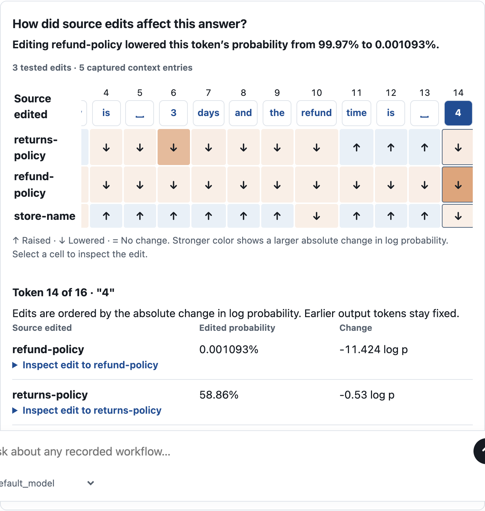

# NexusWeave

**Find which context edits change an LLM’s answer or tool call.**

NexusWeave runs beside your LLM workflow. It flags conflicting instructions and missing sources, groups recurring problems across conversations, and shows what happened when someone tested an edit.

**Start here** · [Try the demo](#try-the-demo) · [Check a request before inference](docs/getting-started.md#check-one-request-before-inference) · [Connect your application](docs/getting-started.md#instrument-your-application)

## Try the demo

A customer puts an exchange on hold, but the agent’s confirmation cache still says “approved.” To run this research preview, you need Git, stable Rust and your platform’s C build tools. The demo needs no API key or model download. [Install Rust](https://rustup.rs/)

```sh
git clone https://github.com/thakur-ro/NexusWeave.git
cd NexusWeave
cargo run --locked -- demo
```

Open the address printed in the terminal. Start with **Check current approval before dispatch**. Choose **Which instructions disagreed?** to see the cached approval beside the customer’s hold. Open **Other questions** and choose **What changed at dispatch?** to compare the two sandbox runs. Choose **Where else did that repeat?** to open the affected conversations. Press Ctrl+C to stop.

[](docs/media/exchange-approval.mp4)

**Try the receiver.** Send the included exchange batch with curl and watch the two recommendations appear on an empty dashboard. Then connect your application’s exporter to the same endpoint. [Send the sample](docs/getting-started.md#send-the-sample-to-a-running-sidecar) · [Connect your application](docs/getting-started.md#instrument-your-application)

## What can I learn?

| Your question | Evidence NexusWeave uses |
| --- | --- |
| Did my chat template drop the previous tool call? | Remove one structured field and compare the exact input token IDs before calling the model. [Try the inventory rendering check](examples/local-mlx-tool/rendering/README.md) |
| Can a quote request expose booking tools? | Compare named functions in the assembled catalog with the permissions your workflow supplies. The card shows each mismatch and its location in the request. [Try a tool-scope check](docs/guide.md#check-the-advertised-tools-before-inference) |
| Which conversations share a context problem? | Open a recommendation to find the turns with the same declared conflict, repeated input or missing source anchor. [Try a recurring capture gap](docs/demo.md#diagnose-missing-context-capture) |
| Did the request contain the sources my workflow requires? | Before dispatch, check the named fragments and optionally match their text against an upstream digest. [Staging example](docs/guide.md#check-alternative-sources-before-dispatch) |
| Can I edit this passage and isolate one source? | Check which named fragments share the same bytes in the assembled request. [See overlapping edits](docs/guide.md#check-whether-editing-a-passage-touches-two-sources) |
| Which source should I test before answering? | Check the assembled request. If your scorer supplies probabilities, compare candidate continuations before and after a named source edit at the same answer prefix. |
| Would this edit fix the answer elsewhere? | Compare original and edited generations against a supplied reference. The dashboard surfaces matched questions where the same edit had opposite effects on correctness. |

The workflow exports spans asynchronously over OTLP/HTTP. A bounded worker normalizes them and stores findings in SQLite. The Rust binary serves the dashboard. Default analysis makes zero model calls. You can attach replay results or measurements from an instrumented model when you need stronger evidence. A trace records the observable request and response. Internal activation claims require a model intervention. [Algorithms and limits](docs/methods.md) · [Research and related systems](docs/research-review.md) · [What the experiments support](docs/research-preview.md)

## Which source mattered at this word?



On this recorded answer, editing the returns policy had the largest measured effect on the return-window number. Editing the refund policy had the largest effect on the refund time. Each cell compares the probability of the same next token with the preceding output held fixed. Select a cell in the dashboard to see the edit and the two freely generated replies. [Explore the measurements](docs/research-preview.md#follow-a-source-through-a-workflow)

## Ship it beside your service

Build the container and verify that traces survive a restart with `make verify-image`. The deployment guide includes a Kubernetes example and a Collector setup for keeping your existing observability backend. [Deployment](DEPLOYMENT.md) · [Staging checks and resource measurements](docs/validation.md)

[Contributor setup and release checks](CONTRIBUTING.md) · [Rust API](docs/rust-api.md) · [Connect a model to the dashboard](docs/chat-canvas.md) · [Research and dataset credits](CREDITS.md) · [Apache 2.0 license](LICENSE)
