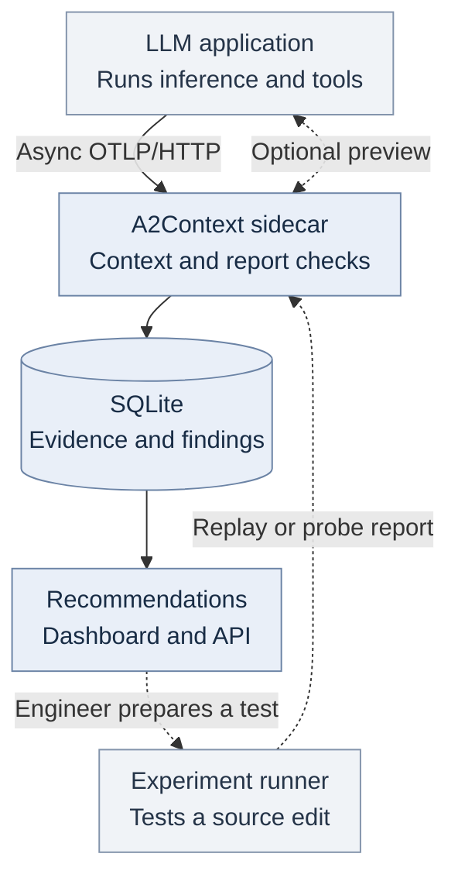

# A2Context

**Find context problems in the requests your LLM workflow already makes.**

A2Context runs beside your application in development or production. Connect its telemetry to see supported findings directly from usage, without writing test cases or configuring a judge. Follow a finding to the instructions, messages or tool activity behind it. When a controlled experiment is available, you can also see what changed.

**Start here** · [Try the demo](#try-the-demo) · [Check a request before inference](docs/getting-started.md#check-one-request-before-inference) · [Connect your application](docs/getting-started.md#instrument-your-application)

## Try the demo

A customer puts an exchange on hold, but the agent’s confirmation cache still says “approved.” To run this research preview, you need Git, stable Rust and your platform’s C build tools. The demo needs no API key or model download. [Install Rust](https://rustup.rs/)

```sh
git clone https://github.com/thakur-ro/A2Context.git
cd A2Context
cargo run --locked -- demo
```

Open the printed address, select **Exchange agent**, and ask **What should we test before the next exchange?** In this synthetic walkthrough, the sandbox guard protects a held order. The interview recommends replaying a valid approval to check whether the guard also lets that exchange through. Ask **What did the customer ask for, and did the approval check change the outcome?** to see the original message and both order states. Press Ctrl+C to stop.

[](docs/media/exchange-approval.mp4)

**Try the receiver.** Send the included exchange batch with curl and watch the two recommendations appear on an empty dashboard. Then connect your application’s exporter to the same endpoint. [Send the sample](docs/getting-started.md#send-the-sample-to-a-running-sidecar) · [Connect your application](docs/getting-started.md#instrument-your-application)

## What can I investigate?

| Question | Where to look |
| --- | --- |
| Which instructions disagree? | Open a conflict to compare declared rule values and their locations in the request. |
| Why did a tool call stall? | Compare the proposed arguments with the advertised schema and check whether the result reached a later request. |
| Which conversations share a problem? | Filter by workflow or user, then open an occurrence to inspect its supporting call. |
| Would editing a source change an answer? | Attach a controlled replay from your runner to compare baseline and edited outcomes. |

[Methods and evidence limits](docs/foundational-algorithms.md) · [Related research](docs/research-review.md)

## How it works



Your application controls inference, authorization, and tool execution. Background analysis makes zero model calls. A preview can flag a missing or conflicting source before dispatch. To measure which source changed a proposed answer or tool call, run a controlled edit separately and attach the report. [Request paths and evidence limits](docs/architecture.md#sidecar-architecture)

Build the container and verify that traces survive a restart with `make verify-image`. A local OpenTelemetry Collector can send the same spans to A2Context and your existing observability backend. [Deployment](DEPLOYMENT.md) · [Collector setup](docs/sidecar.md#fan-out-without-changing-observability-platforms) · [Staging checks](docs/validation.md)

[Contributor setup](CONTRIBUTING.md) · [Rust API](docs/rust-api.md) · [Credits](CREDITS.md) · [Apache 2.0 license](LICENSE)
