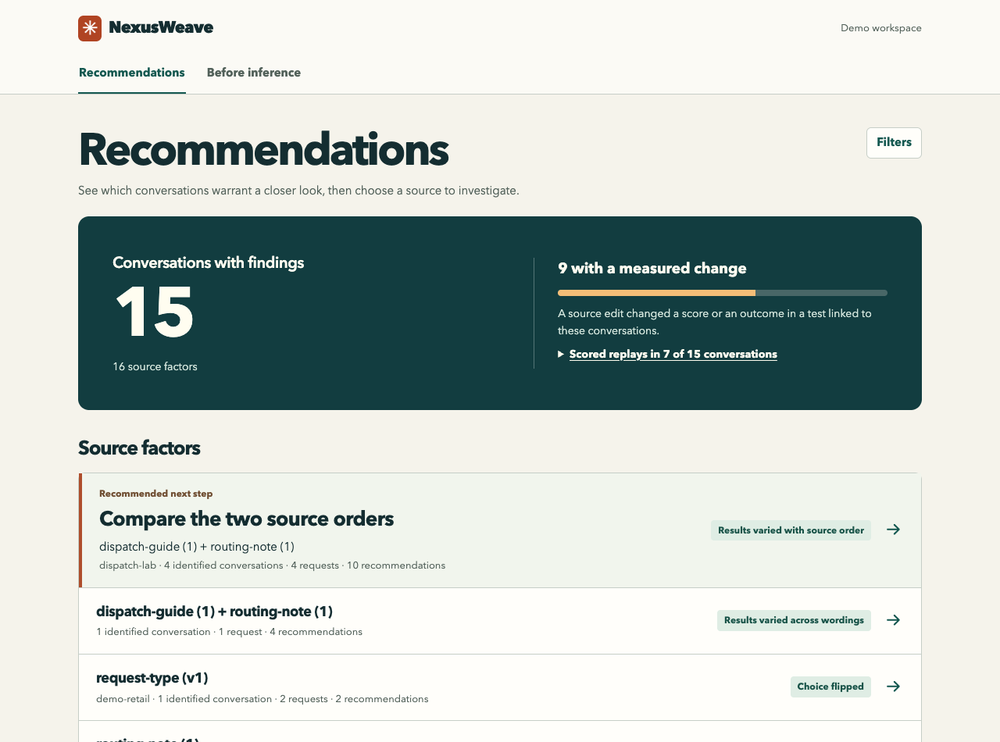

# NexusWeave

**Find the conversations where a context edit changed a model’s answer.**

NexusWeave recommends what to change or test when instructions conflict, an input repeats, or a controlled source edit changes a model’s behavior. Review an assembled request before inference, or let the Rust sidecar surface new evidence as it arrives over OpenTelemetry.



[Quickstart](#try-the-demo) · [Deploy a sidecar](docs/sidecar.md) · [Methods](docs/methods.md) · [Research review](docs/research-review.md) · [Rust API](docs/rust-api.md)

## Try the demo

From the checkout, run with a stable Rust toolchain and open [Recommendations](http://127.0.0.1:8040).

```sh
cargo run --locked -- sidecar --demo
```

1. **Choose a source to test before answering.** Open **Before inference**, check a new request against earlier edits, then compare with scores on that request. The strongest measured edit changes the model’s preference from `UNKNOWN` to `KITE`. [Open the scored example](http://127.0.0.1:8040/?view=preview&scenario=scored-history)
2. **Check which copy of an instruction mattered.** Choose **Compare the two source orders**. With one replacement, moving a dispatch record from the earlier slot to the later one changed the answer after that record was edited. Try the neutral wording in the same view to see where the match counts held. [Experiment](docs/methods.md#check-the-result-against-new-parcel-codes-and-source-order)
3. **Locate the effect along an answer.** Open the refund-policy token recommendation to see which output token changed most under the source edit and what the decoder-block swap measured.
4. **Test what to change.** Try a policy conflict before inference. Filter Recommendations by organization `demo-retail` and user `user-042` to compare recurrence with `user-077`.

In the [tool-routing experiment](http://127.0.0.1:8040/?view=preview&scenario=routing-test), giving the model a price tool changed its proposal even with the instruction “Always call stock.” Open the four setups to compare the exact conditions.

The demo uses saved local and hosted model measurements on synthetic inputs and makes zero model calls. To explore public data, compare where the same passage edit changed an answer across two input orders. [Public QA walkthrough](examples/public-qa/README.md#compare-an-edit-across-inputs)

## Connect a workflow

Send OTLP/HTTP from a batch exporter in your application or OpenTelemetry Collector. The sidecar processes spans in the background and stores findings in SQLite. Declare stable source IDs, versions, and rule scopes to connect a finding to the original input. [Deploy and configure capture](docs/sidecar.md)

Check an assembled request before serving it with [preflight](docs/guide.md#check-context-before-inference). Use a [controlled replay](docs/guide.md#try-a-decision-replay) to measure how an edit changes a selected outcome. [Read what each finding supports](docs/methods.md).

## Project

NexusWeave uses the [Apache License 2.0](LICENSE). The retail trace excerpt uses [CDLA Permissive 2.0](LICENSES/CDLA-Permissive-2.0.txt). [Contributing](CONTRIBUTING.md) · [Research and dataset credits](CREDITS.md)
