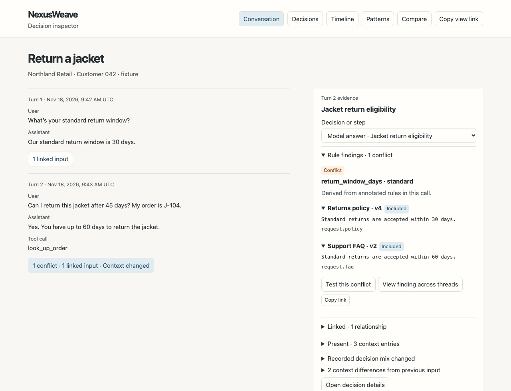

# NexusWeave

NexusWeave is a local context and decision inspector for LLM workflows. Check a pending request for conflicting rules, inspect the context behind a recorded answer or action, and test which source edits change a measured outcome. Follow the evidence across turns, threads, users, and organizations.

[Quickstart](#try-the-conversation-inspector) · [How it works](docs/architecture.md) · [Workflow guide](docs/guide.md) · [Rust API](docs/rust-api.md)

## Try the conversation inspector

With a stable Rust toolchain, run this from the repository root.

```sh
cargo run --locked -- serve fixtures/conversation.json
```

Open the inspector and look at the evidence for the second turn. The synthetic conversation shows a 60-day answer, the conflicting 30-day policy and 60-day FAQ, and the order lookup that preceded the answer. This demo runs without model weights or an API key. [Open the local inspector](http://127.0.0.1:8040)



## Check a request before inference

Start the inspector with `cargo run --locked -- serve` and open **Before inference** to inspect an assembled request. Load the returns example to see its conflicting rule values and where each source sits in the request. [Inspect an assembled request](docs/guide.md#inspect-an-assembled-request)

```sh
cargo run --locked -- preflight examples/preflight-returns.json
```

The report finds one conflict because the policy and FAQ declare different values for the same rule and scope. It identifies both source versions and their exact locations in the request. Preflight makes no model call. [Integrate preflight](docs/guide.md#check-context-before-inference)

For captured text without rule declarations, context screening finds exact reuse and can use a local model to flag possible overlap or conflict. [Try context screening](docs/guide.md#screen-captured-text-for-overlap)

## Choose an investigation

| Question | Where to start |
| --- | --- |
| What context was available for this answer or action? | Open **Conversation**, then the turn evidence. [Inspect a turn](docs/guide.md#run-the-local-demo) |
| Where did the context or decision change? | Open **Timeline** for the thread or **Compare** for two calls. [Follow a thread](docs/guide.md#follow-context-changes-through-a-thread) · [Compare calls](docs/guide.md#compare-two-recorded-decisions) |
| Which findings or effects repeat across a user's sessions or an organization? | Filter **Patterns** and open a contributing turn. [Group conflicts](docs/guide.md#group-recurring-conflicts) · [Compare screened pairs](docs/guide.md#find-recurring-screened-pairs) · [Compare candidate shifts](docs/guide.md#find-recurring-candidate-preference-shifts) · [Compare proposal shifts](docs/guide.md#find-recurring-shadow-proposal-shifts) |
| Where did one source appear, conflict, or produce a measured effect? | Open **Patterns → Context sources** and filter by evidence type. [Follow a source across sessions](docs/guide.md#follow-a-context-source-across-sessions) |
| Would a source edit change a pending decision? | Use **candidate probes** for fixed alternatives with token scores, or **shadow probes** with an API that returns proposals. [Choose a probe](docs/architecture.md#test-which-source-changes-an-outcome) |
| Would a source edit change a recorded decision? | Run a **controlled replay**. With an instrumented model, measure the effect across output positions. [Try replay](docs/guide.md#try-a-decision-replay) · [Follow an answer in time](docs/guide.md#follow-context-influence-across-an-answer) |

Captured inputs establish what was available. Trace links help you find a source to test. Probes and replay measure the effect of a specific edit under the tested conditions. [Evidence model and algorithms](docs/architecture.md#what-the-algorithms-measure)

Follow a flagged policy pair from its text scores to a controlled model run. The example includes the captured request, the two edits, and the measured outcomes. [Replay a screened pair](docs/guide.md#test-a-screened-pair)

## Connect your workflow

Import OTLP or OpenInference spans, import LangSmith runs, or emit versioned evidence JSON from any language. Declare stable source IDs, versions, rule scopes, and request locations to connect trace evidence to a probe. Add thread, user, and organization IDs to enable cross-conversation queries. [OpenTelemetry](docs/guide.md#import-opentelemetry-traces) · [LangSmith](docs/guide.md#import-langsmith-traces) · [Evidence JSON](schema/evidence-1.json) · [Source declarations](docs/guide.md#declare-context-sources-and-decision-scope)

Build against the Rust crate or query the local inspector through its HTTP and MCP interfaces. [Rust package guide](docs/rust-api.md) · [Connect an MCP client](docs/guide.md#connect-an-mcp-client)

## Project

NexusWeave source uses Apache License 2.0. The retail trace excerpt uses CDLA Permissive 2.0. [Contributing](CONTRIBUTING.md) · [Research and dataset credits](CREDITS.md) · [Source license](LICENSE) · [Data license](LICENSES/CDLA-Permissive-2.0.txt)
