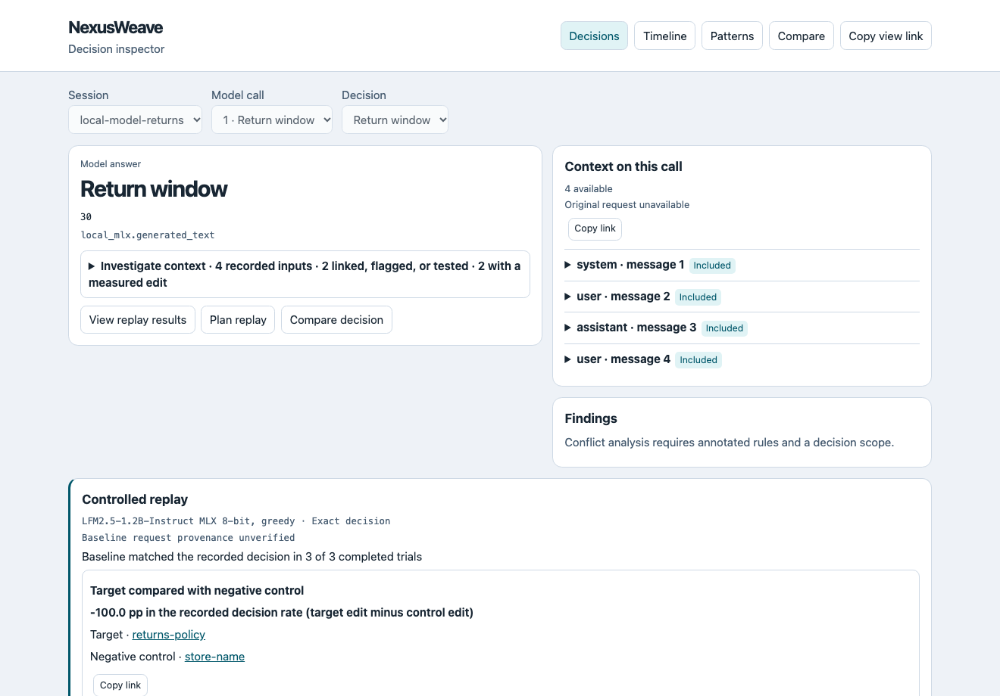

# NexusWeave

NexusWeave is a local decision inspector for LLM workflows. Read a recorded conversation, then open a turn to see which inputs were present, which rules conflicted, and which edits changed the outcome in a replay. Follow the same sources across turns, threads, users, and organizations.

## Try the conversation inspector

With a stable Rust toolchain, run this from the repository root.

```sh
cargo run --locked -- serve fixtures/conversation.json
```

In the synthetic conversation, the second answer offers a 60-day return window. Open its evidence to see the 30-day policy, the 60-day FAQ, and the order lookup that preceded the answer. [Open the local inspector](http://127.0.0.1:8040)


## Try a decision replay and activation probe

```sh
cargo run --locked -- serve \
  --replay examples/local-mlx/report.json \
  --activation-report examples/local-mlx/activation-report.json \
  examples/local-mlx/evidence.json
```

Open the turn evidence and expand **Replay results**. In these saved local-model trials, the baseline answered 30 days. Withholding the returns policy changed all three answers to 60 days. Withholding the store name preserved the 30-day answer. The supplied replay request and trials are included. You can inspect them without an API key or model download. [Open the local inspector](http://127.0.0.1:8040)

Open **Activation probe** on the same turn to see how swapping decoder-block outputs at the tested policy, store-name, and prediction positions changed the next-token preference. The saved probe covers one decision on one local model. [Experiment and measurements](docs/inference-attribution-plan.md#first-instrumented-result)

The two-policy example lets you compare the same source swaps at two different tokens in a longer answer. [Try the answer timeline](docs/guide.md#follow-context-influence-across-an-answer)

The six-conversation example shows how to find repeated activation effects by thread, user, and organization. [Try the pattern view](docs/guide.md#find-repeated-activation-effects-across-conversations)

The tool-routing example measures which inputs affected a proposed tool name and argument. [Try the tool proposal](docs/guide.md#inspect-a-tool-choice-and-its-argument), [Write an adapter](docs/guide.md#emit-activation-measurements-from-another-runtime)

Runtimes can send an OpenTelemetry trace and attach the activation report when its measurements are ready. [Send a measured trace](docs/guide.md#attach-activation-measurements-after-a-trace-arrives)

For a captured Qwen2 text answer, test each aligned prompt source without writing replacement text. Mask two sources together to check whether they back each other up. [Inspect source visibility](docs/guide.md#test-source-visibility-on-a-recorded-answer), [Try the paired test](docs/guide.md#test-a-pair-of-sources)

Query recurring masked-source effects across conversations, users, and organizations, then open the exact contributing token and source. [Compare the measured cohort](docs/guide.md#find-recurring-masked-source-effects)

The same report format carries measured results from MLX and Transformers on the same prompt. [Inspect results across runtimes](docs/guide.md#inspect-the-same-task-across-runtimes)

Inspect how a source swap changed the probability of any recorded output token, including repeated words and tool arguments. [Try the full-output view](docs/guide.md#inspect-every-recorded-output-token)

Compare what the model generates after a source swap at a selected point in an answer. [Try the continuation view](docs/guide.md#continue-decoding-after-a-source-swap)



## Inspect your workflow

| View | What you can inspect |
| --- | --- |
| **Conversation** | Captured user messages, recorded answers and actions, and evidence for each turn. Calls without recorded turn IDs stay visible. |
| **Decisions** | Captured inputs, source links, rule conflicts and duplicates, and replay results for a selected call. |
| **Timeline** | Calls in a thread, their recorded execution tree when spans are linked, and changes in context and decisions over time. |
| **Patterns** | Repeated source-to-decision links, findings, and replay results across imports or within a thread, user, or organization. |
| **Compare** | Two decisions side by side, with their captured context, findings, and replay evidence. |

Try **Patterns → Conflict breakdown** with `cargo run --locked -- serve fixtures/support.json`. Group by rule, source version, model, user, or day and open the contributing turns. The fixture includes synthetic conversations from two organizations. [Query a conflict breakdown from the CLI](docs/guide.md#group-recurring-conflicts)

NexusWeave accepts OTLP traces, including OpenInference spans, and LangSmith run exports. Workflows can also emit the [versioned evidence JSON](schema/evidence-1.json) directly. Add [context declarations](schema/context-semantics-1.json) to supply stable source names, versions, rules, and decision scope.

Captured inputs tell you what was available to the model. Annotations and exact matches help you choose what to test. Conflict checks require declared rules and a decision scope. Replay measures the effect of a specific edit under the tested conditions. Cross-conversation views depend on the identifiers in your traces. The inspector is a local workspace, and organization labels group evidence within that workspace.

## Project guide

- [Import OTLP or OpenInference traces](docs/guide.md#import-opentelemetry-traces)
- [Import LangSmith runs](docs/guide.md#import-langsmith-traces)
- [Instrument a workflow](docs/guide.md#declare-context-sources-and-decision-scope)
- [Run a controlled replay](docs/guide.md#test-a-context-item-with-a-controlled-replay)
- [Connect an MCP client](docs/guide.md#connect-an-mcp-client)
- [Contribute and run checks](CONTRIBUTING.md)
- [Research, project, and dataset credits](CREDITS.md)

NexusWeave source is licensed under [Apache License 2.0](LICENSE). The retail trace excerpt is covered by [CDLA Permissive 2.0](LICENSES/CDLA-Permissive-2.0.txt).
