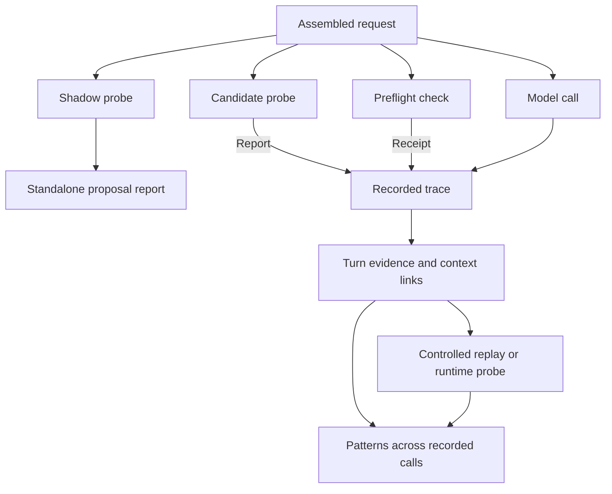
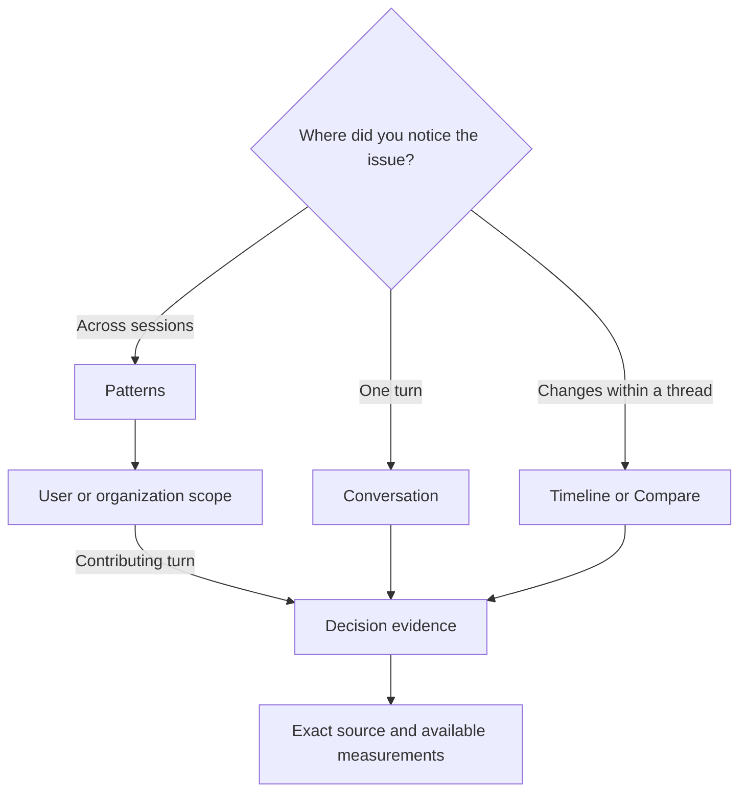

# How NexusWeave works

NexusWeave connects an assembled inference request to a turn, a measured effect, and recurring findings across sessions. A source can be an instruction, a retrieved document, a tool definition, or a fragment of a prompt. A decision can be an answer, a tool choice, or an argument within a tool call.

## What the algorithms measure

| Question | How it works | What you can conclude |
| --- | --- | --- |
| **Preflight** | Resolve source declarations against the assembled input. Group their rule values by exact key and scope. Compare the known JSON values for equality. | Declared values for the same rule disagree, agree, or are incomplete. |
| **Candidate probe** | Use the pending request and exact source edits to score two known token sequences at the same fixed assistant prefix. Compare the edited and original log odds. | You can measure how an edit shifted the model's preference between those two candidates before committing a decision. |
| **Shadow probe** | Run the original pending request and exact source edits through a proposal-only runner. Compare how often each result matches a declared outcome. | You can measure a change in proposal rate using the model's returned answer, tool name, or arguments. |
| **Trace inspection** | Normalize spans and messages into calls, context items, decisions, and tool results. Join tool calls to later results by invocation ID. Follow declared relationships and exact matches such as tool names or IDs. | Captured inputs establish what was available. A link gives you a source to investigate. |
| **Controlled replay** | Sample the original request and variants with selected sources removed or replaced. Score each result against the same answer, tool, or argument criterion. Subtract the baseline match rate from the variant's match rate. | The difference measures how the selected edit affected the scored outcome under those replay conditions. |
| **Runtime probe** | Use an instrumented local runtime to mask selected prompt sources or swap activations, then compare output token scores or continuations with a baseline. | The measurements describe effects at the tested positions for that model and intervention. |
| **Patterns** | Group findings and measurements by scope and their comparison keys. For example, candidate probes group verified measurements with matching model revision, tokenizer, scorer, prefix, ordered alternatives, source content and version, and edit. | You can see where comparable evidence repeats and inspect the contributing calls. |

### From a rule conflict to a recorded turn

In the returns example, both sources declare `return_window_days` for the `standard` scope. Preflight reads `30` from the policy and `60` from the FAQ, finds unequal values, and returns one conflict with the source versions and request locations. If those values were both `30`, the group would be a duplicate. If only one value were known, the comparison would have insufficient evidence.

In the linked demo, the recorded answer says 60 days. NexusWeave checks that the preflight receipt matches the captured request and scoped source declarations, so the finding can open beside that answer. The workflow supplies when the check ran. Seeing the FAQ and answer agree makes the FAQ a source to test. [Follow the preflight finding into the conversation](guide.md#show-preflight-alongside-the-recorded-answer)

### Test which source changes an outcome

1. **Choose what to measure.** Name an answer, tool, argument, or pair of candidate continuations. For replay, use a recorded decision and check that the baseline reproduces it.
2. **Build comparable requests.** Use the original request as the baseline. Verify each selected source at its JSON Pointer and, where supplied, its text range. Change one selected source at a time. Include a control edit or test a pair together when useful.
3. **Run the comparison.** A candidate probe subtracts the second candidate's summed token log probability from the first's at a fixed prefix. Subtract the baseline margin from the edited margin to get the shift. Replay and shadow probes apply the same match rule to each trial and subtract the baseline match rate from the variant rate.
4. **Read the effect in context.** Compare with a control and check how many trials were scored. A small measured effect applies to the tested edit, outcome, and runtime. Sources can reinforce each other, which is why a joint edit can change an outcome that either edit by itself leaves unchanged.

In the saved Qwen shadow probe, the tracked proposal is `price(42)`. The original and store-name edit each match in 0 of 1 trials. Editing the request type matches in 1 of 1, a shift of +100 percentage points from baseline. Both edits together also match in 1 of 1. Each condition used one greedy trial, so these numbers describe the four returned proposals. Before production dispatch, this test works with a runner that returns proposals. A candidate probe needs token scores for the exact continuations. [Shadow example](guide.md#test-context-with-shadow-proposals) · [Candidate example](guide.md#measure-candidate-preference-before-a-decision) · [Replay example](guide.md#try-a-decision-replay)

For a view inside an instrumented runtime, align the captured source spans to prompt tokens and select an output position. Run a baseline and repeat with a source masked or an activation replaced. The change in token score or generated continuation tells you how that intervention affected that point. Repeating at several positions shows how the measured effect changes through an answer. Coverage depends on the runtime and tested positions. [Output timeline](guide.md#follow-context-influence-across-an-answer) · [Runtime experiments and limits](inference-attribution-plan.md)

## Find an answer in the inspector

Use **Timeline** to follow calls and source versions in a thread. Use **Patterns** to group findings by a dimension such as rule, source version, or model, then open a contributing turn. Counts depend on the identifiers captured on those calls. For example, a user scope pairs the user ID with the organization ID. A missing thread ID limits conversation counts. Organization grouping describes the evidence loaded into the local inspector. [Try the inspector](guide.md#run-the-local-demo) · [Group related conflicts](guide.md#group-recurring-conflicts)

## Integrate with a workflow

| Your integration | Entry point |
| --- | --- |
| Call preflight while assembling a request | [`preflight::check`](../src/preflight.rs) in Rust, `nexusweave preflight` from the CLI, or `POST /api/preflight` from another language. [Preflight guide](guide.md#check-context-before-inference) |
| Inspect traces from an existing workflow | Import OTLP, OpenInference, or LangSmith. Supply stable source IDs and versions, and the organization, user, conversation, and turn identifiers your workflow records. [OpenTelemetry guide](guide.md#import-opentelemetry-traces) · [LangSmith guide](guide.md#import-langsmith-traces) |
| Emit evidence directly or query an inspector | Use the versioned evidence format, or connect an MCP client to browse turn evidence and query patterns. [Evidence format](../schema/evidence-1.json) · [MCP guide](guide.md#connect-an-mcp-client) |

The Rust package guide maps each entry point to its inputs, outputs, and runnable examples. [Rust package guide](rust-api.md) · [Contributing and running checks](../CONTRIBUTING.md)
