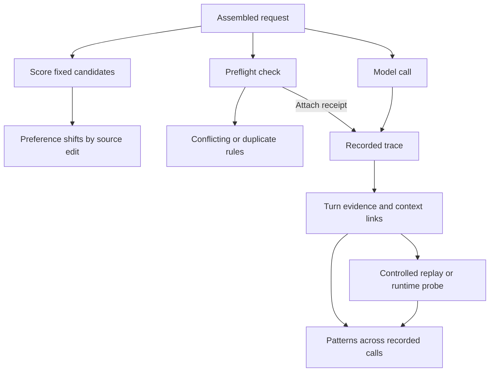
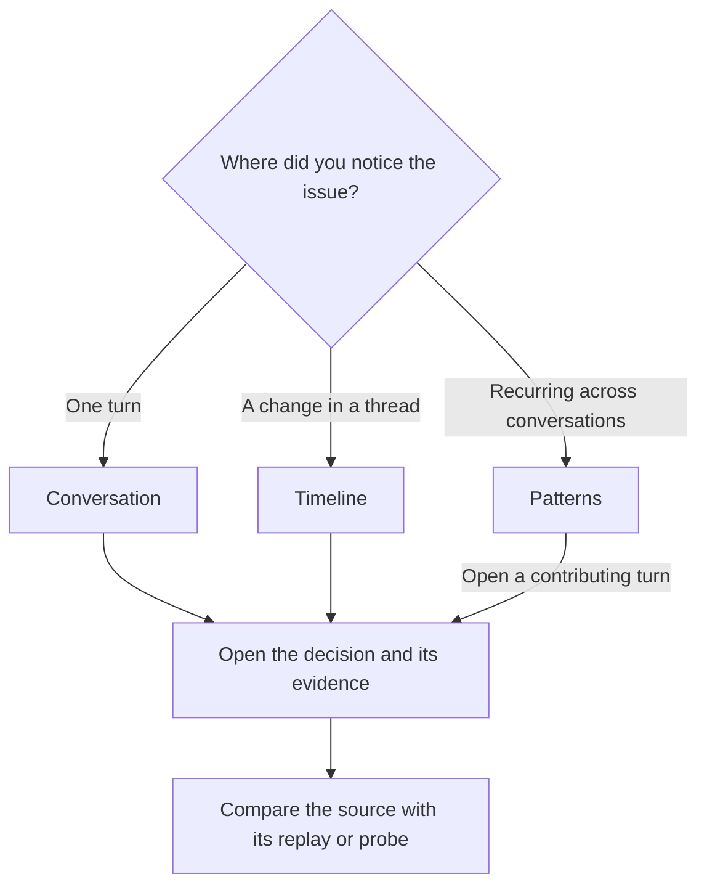

# How NexusWeave works

NexusWeave connects the sources assembled for an inference request to the evidence an engineer can inspect before and after the call. A source can be a system instruction, a retrieved document, a tool definition, or a fragment of a larger prompt. A decision can be a model answer, a tool choice, or an argument within a tool call. Each kind of evidence answers a different question.

## What the algorithms measure

| Step | How it works | What you can conclude |
| --- | --- | --- |
| **Preflight** | Resolve source declarations against the assembled input. Group their rule values by exact key and scope. Compare the known JSON values for equality. | Two declared rules disagree, agree, or have missing values. The findings describe the supplied request. |
| **Candidate probe** | Use the pending request and exact source edits to score two known token sequences at the same fixed assistant prefix. Compare the edited and original log odds. | You can measure how an edit shifted the model's preference between those two candidates before committing a decision. |
| **Trace inspection** | Normalize spans and messages into calls, context items, decisions, and tool results. Match a preflight receipt by hashing the captured request and scoped rule sources. Join tool calls to later results by invocation ID. Surface declared relationships and exact matches such as tool names or IDs. | You can inspect what was present and follow exact evidence. A source match gives you an input to investigate. |
| **Controlled replay** | Sample the original request and variants with selected sources removed or replaced. Score each result against the same answer, tool, or argument criterion. Subtract the baseline match rate from the variant's match rate. | The difference measures how the selected edit affected the scored outcome under those replay conditions. |
| **Runtime probe** | Use an instrumented local runtime to mask selected prompt sources or swap activations, then compare output token scores or continuations with a baseline. | The measurements describe effects at the tested positions for that model and intervention. |
| **Patterns** | Group supported findings and measurements using their rule, source, or outcome identifiers and the selected scope. For preflight, count each verified request and checked rule scope once in the totals. Keep links to the contributing calls and evidence. | You can see where a pattern repeats and inspect the turns behind it. User, thread, and organization views depend on captured identifiers. |

In the returns example, preflight finds the 30-day policy and 60-day FAQ because both declare `return_window_days` for `standard`. A subsequent trace can show that the model answered 60 days. To see whether the FAQ mattered, you can replay the request with the FAQ removed and compare how often the answer still says 60 days. In an instrumented runtime, you can test the same source at the output token where the answer states the number. [Preflight example](guide.md#check-context-before-inference) · [Replay guide](guide.md#test-a-context-item-with-a-controlled-replay) · [Runtime measurement guide](guide.md#follow-context-influence-across-an-answer)

## Find an answer in the inspector

Start in **Conversation** when you have a user message, answer, or proposed action. Use **Timeline** when you want to see when a source appeared or changed. Use **Patterns** to find the same issue in a user's conversations or across an organization, then open the contributing turn. [Try the inspector](guide.md#run-the-local-demo) · [Group related conflicts](guide.md#group-recurring-conflicts)

## Integrate with a workflow

| Your integration | Entry point |
| --- | --- |
| Call preflight while assembling a request | [`preflight::check`](../src/preflight.rs) in Rust, `nexusweave preflight` from the CLI, or `POST /api/preflight` from another language. [Preflight guide](guide.md#check-context-before-inference) |
| Inspect traces from an existing workflow | Import OTLP, OpenInference, or LangSmith. Supply stable source IDs and versions, and the organization, user, conversation, and turn identifiers your workflow records. [OpenTelemetry guide](guide.md#import-opentelemetry-traces) · [LangSmith guide](guide.md#import-langsmith-traces) |
| Emit evidence directly or query an inspector | Use the versioned evidence format, or connect an MCP client to browse turn evidence and query patterns. [Evidence format](../schema/evidence-1.json) · [MCP guide](guide.md#connect-an-mcp-client) |

To browse the Rust package API locally, run `cargo doc --locked --no-deps --open`. The crate index links to preflight, trace import, inspection, and replay. [Contributing and running checks](../CONTRIBUTING.md)
