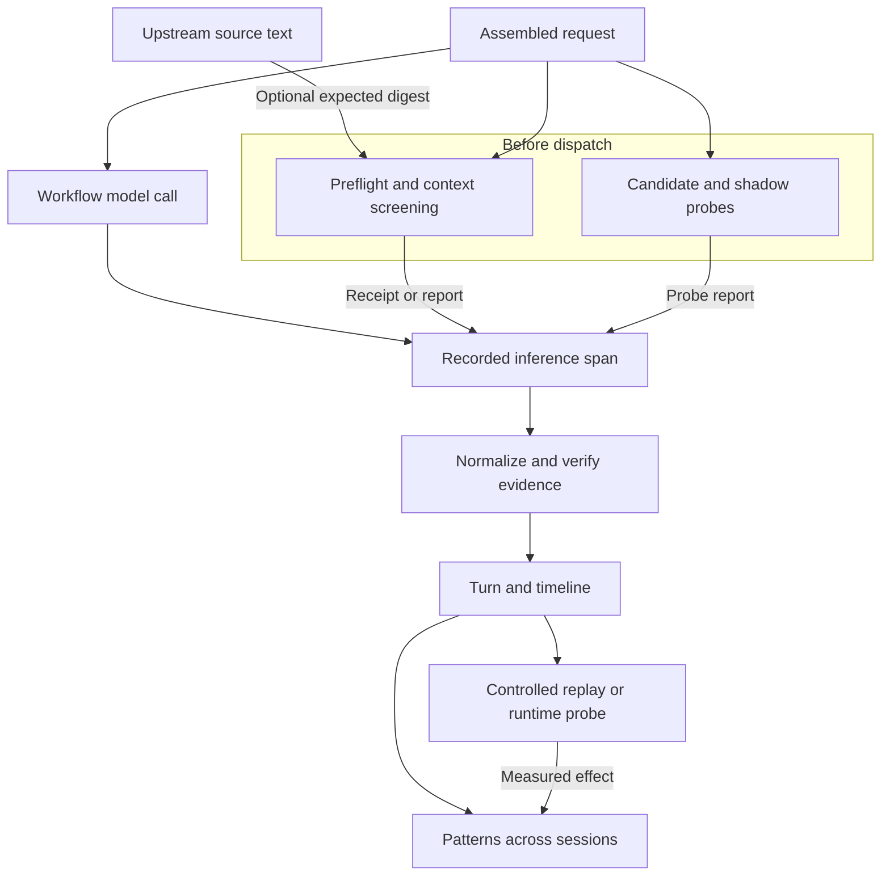
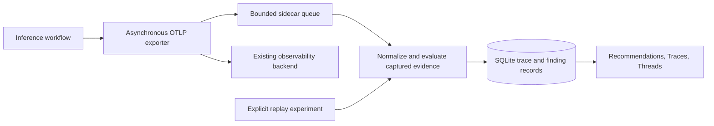
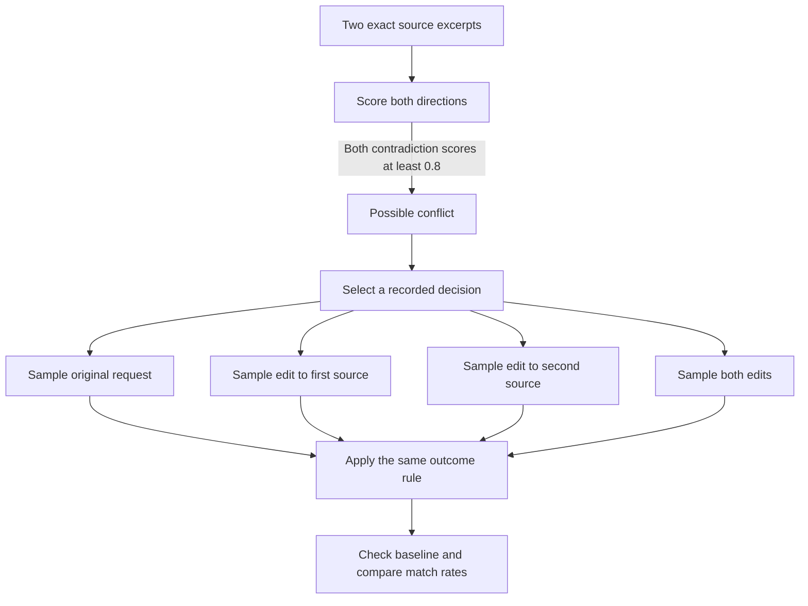
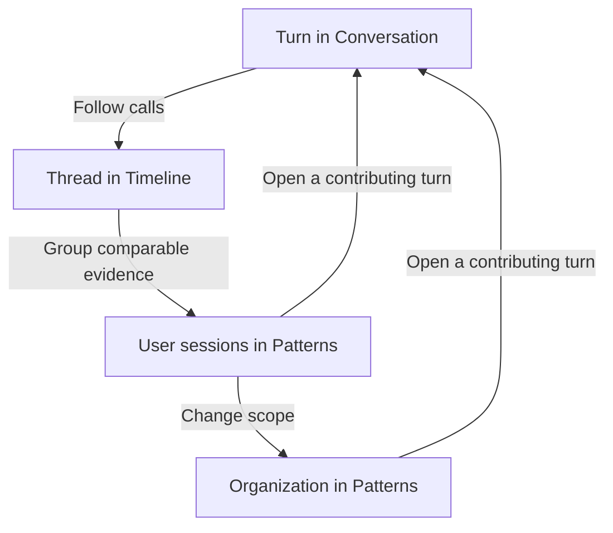

# How NexusWeave works

NexusWeave connects an assembled inference request to a turn, a measured effect, and recurring findings across sessions. A source can be an instruction, a retrieved document, a tool definition, or a fragment of a prompt. A decision can be an answer, a tool choice, or an argument within a tool call.

## Findings alongside inference

The sidecar updates recommendations as evidence arrives. Use the request preview to compare inputs and verified probes before the original inference request is sent. [Deployment](sidecar.md) · [Sidecar methods](methods.md)

### What supplies a measurement on the context map?

The browser builds the map from findings in the selected scope. It reads the representative call and named sources for each finding. A shared source node connects calls that name the same producer, organization, workflow, source, version and role. Selecting a first-token, candidate or token finding shows the values from that call. No model runs when an engineer opens the map.

| Available evidence | What an engineer can inspect |
| --- | --- |
| Workflow requirement and expected text digest | Whether at least one named alternative reached the pending request with the expected text. A later verified receipt lets the sidecar group a recurring discrepancy across conversations. |
| Captured source and declared rule | A source’s location and which values were declared together. A recurring source can connect several findings. |
| Full next-token distributions for each tested source edit | The Jensen–Shannon divergence from the original request before generation, alongside measured changes to completed proposals where a runner supplied them. |
| Candidate scores for an original request and a source edit | Which of two continuations the runner favored at a fixed prefix and how far its log odds moved. An untested continuation could still win. |
| Instrumented token and decoder-block comparisons | The original token’s probability under the edited request at the same output prefix, plus the measured effect of a swap at a named block. |

A question about missing *knowledge* needs a separate test. A second retrieved passage may support the same answer, or several passages may support it together. In the paired retrieval study, an explicit sufficiency check falsely flagged six of twenty supported requests. It runs only in the research harness. [Context map and tested limits](research-preview.md) · [Source-level evidence annotations](../examples/public-qa/support-review/README.md)

## What the algorithms measure

| Question | How it works | What you can conclude |
| --- | --- | --- |
| **Preflight** | Resolve source declarations against the assembled input. Group their rule values by exact key and scope. Compare the known JSON values for equality. | Declared values for the same rule disagree, agree, or are incomplete. |
| **Context screening** | Compare pairs of captured text for exact equality. An optional language model scores entailment and contradiction in both directions on nonidentical pairs. | You can locate reused text and shortlist source pairs for review. The scores describe the selected text and classifier. |
| **Candidate probe** | Use the pending request and exact source edits to score two known token sequences at the same fixed assistant prefix. Compare the edited and original log odds. | You can measure how an edit shifted the model's preference between those two candidates before committing a decision. |
| **Shadow probe** | Run the original pending request and exact source edits through a proposal-only runner. Compare how often each result matches a declared outcome. | You can measure a change in proposal rate using the model's returned answer, tool name, or arguments. |
| **Trace inspection** | Normalize spans and messages into calls, context items, decisions, and tool results. Join tool calls to later results by invocation ID. Follow declared relationships and exact matches such as tool names or IDs. | Captured inputs establish what was available. A link gives you a source to investigate. |
| **Controlled replay** | Sample the original request and variants with selected sources removed or replaced. Score each result against the same answer, tool, or argument criterion. Subtract the baseline match rate from the variant's match rate. | The difference measures how the selected edit affected the scored outcome under those replay conditions. |
| **Runtime probe** | Use an instrumented local runtime to mask selected prompt sources or swap activations, then compare output token scores or continuations with a baseline. | The measurements describe effects at the tested positions for that model and intervention. |
| **Patterns** | Group findings and measurements by scope and their comparison keys. Screening groups match both captured sources and the classifier, then check which flagged calls have verified replays for those sources. Candidate groups match token scoring setups. Shadow groups match the runner, sampling design, proposal criterion, and source edit. | You can see where comparable evidence repeats and inspect the contributing calls. |

### What active context means in the inspector

**Captured** means the workflow recorded a source in the call's inputs. The source anchor identifies the recorded field or exact request fragment. **Linked** means a recorded relationship or a match such as a tool name connects a source to a specific decision. **Measured** means a probe compares a named score, proposal, or outcome against a baseline after a source intervention. A turn can contain any combination of these. With a trace alone, model influence remains unknown even when an answer agrees with a source.

Two timelines use different clocks. The thread timeline follows model calls, source versions, and tool activity. The output timeline uses token positions from an instrumented model and shows how the effect of an intervention changes as the answer is generated. [Follow calls in a thread](guide.md#follow-context-changes-through-a-thread) · [Follow output positions](guide.md#follow-context-influence-across-an-answer)

### From a possible conflict to a measured effect

Each comparison uses the exact captured source text and a chosen request location. A comparison needs a scored result for every trial in both conditions and at least one match in the original condition. NexusWeave subtracts the original match rate from the edited match rate. The classifier describes the relationship between the excerpts in both directions. The replay measures the workflow model's response to a particular edit. [Try the saved run](guide.md#test-a-screened-pair)

### From a rule conflict to a recorded turn

In the returns example, both sources declare `return_window_days` for the `standard` scope. Preflight reads `30` from the policy and `60` from the FAQ, finds unequal values, and returns one conflict with the source versions and request locations. If those values were both `30`, the group would be a duplicate. If only one value were known, the comparison would have insufficient evidence.

In the linked demo, the recorded answer says 60 days. NexusWeave checks that the preflight receipt matches the captured request and scoped source declarations, so the finding can open beside that answer. The workflow supplies when the check ran. Seeing the FAQ and answer agree makes the FAQ a source to test. [Follow the preflight finding into the conversation](guide.md#show-preflight-alongside-the-recorded-answer)

### Test which source changes an outcome

1. **Choose what to measure.** Name an answer, tool, argument, or pair of candidate continuations. For replay, use a recorded decision and check that the baseline reproduces it.
2. **Build comparable requests.** Use the original request as the baseline. Verify each selected source at its JSON Pointer and, where supplied, its text range. Change one selected source at a time. Include a control edit or test a pair together when useful.
3. **Run the comparison.** A candidate probe subtracts the second candidate's summed token log probability from the first's at a fixed prefix. Subtract the baseline margin from the edited margin to get the shift. Replay and shadow probes apply the same match rule to each trial and subtract the baseline match rate from the variant rate.
4. **Read the effect in context.** Compare with a control and check how many trials were scored. A small measured effect applies to the tested edit, outcome, and runtime. Sources can reinforce each other, which is why a joint edit can change an outcome that either edit by itself leaves unchanged.

In the saved Qwen shadow probe, the tracked proposal is `price(42)`. The original and store-name edit each match in 0 of 1 trials. Editing the request type matches in 1 of 1, a shift of +100 percentage points from baseline. Both edits together also match in 1 of 1. Each condition used one greedy trial, so these numbers describe the four returned proposals. Before production dispatch, this test works with a runner that returns proposals. A candidate probe needs token scores for the exact continuations. [Shadow example](guide.md#test-context-with-shadow-proposals) · [Candidate example](guide.md#measure-candidate-preference-before-a-decision) · [Replay example](guide.md#try-a-decision-replay)

For a view inside an instrumented runtime, align the captured source spans to prompt tokens and select an output position. Run a baseline and repeat with a source masked or an activation replaced. The change in token score or generated continuation tells you how that intervention affected that point. Repeating at several positions shows how the measured effect changes through an answer. Coverage depends on the runtime and tested positions. [Output timeline](guide.md#follow-context-influence-across-an-answer) · [Runtime experiments and limits](inference-attribution-plan.md)

## Find an answer in the inspector

Use **Timeline** to follow calls and source versions in a thread. Use **Patterns** to group findings by a dimension such as rule, source version, or model. User scope pairs the user ID with the organization ID. When a thread ID is missing, the conflict breakdown counts the finding separately from identified conversations. Organization totals cover the evidence loaded into the local inspector. [Follow one finding through the four views](guide.md#follow-a-conflict-from-one-turn-to-an-organization)

## Integrate with a workflow

| Your integration | Entry point |
| --- | --- |
| Inspect an assembled request and optional probe reports | Open **Before inference**, call `pending::inspect` in Rust, use `POST /api/pending`, or use MCP `inspect_pending`. [Pending request guide](guide.md#inspect-an-assembled-request) · [Pending MCP tools](guide.md#inspect-pending-requests-through-mcp) |
| Call preflight while assembling a request | [`preflight::check`](../src/preflight.rs) in Rust, `nexusweave preflight` from the CLI, or `POST /api/preflight` from another language. [Preflight guide](guide.md#check-context-before-inference) |
| Inspect traces from an existing workflow | Import OTLP, OpenInference, or LangSmith. Supply stable source IDs and versions, and the organization, user, conversation, and turn identifiers your workflow records. [OpenTelemetry guide](guide.md#import-opentelemetry-traces) · [LangSmith guide](guide.md#import-langsmith-traces) |
| Emit evidence directly or query an inspector | Use the versioned evidence format, or connect an MCP client to browse turn evidence and query patterns. [Evidence format](../schema/evidence-1.json) · [MCP guide](guide.md#connect-an-mcp-client) |

The Rust package guide maps each entry point to its inputs, outputs, and runnable examples. [Rust package guide](rust-api.md) · [Contributing and running checks](../CONTRIBUTING.md)
