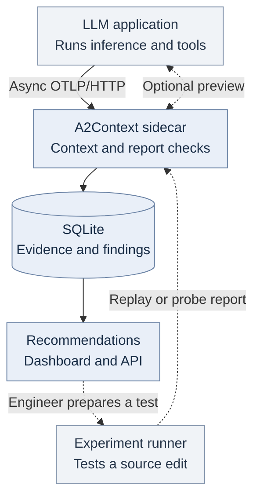

# Architecture

## Sidecar architecture

The exporter sends OTLP/HTTP asynchronously. The receiver validates the batch and processes accepted work on a bounded worker. SQLite stores normalized calls, evidence references and grouped observations. The dashboard and API read from the same store. The application retains control of inference and tool execution.

A request builder can call preflight before dispatch. A separate runner can submit baseline and edited trials for comparison. Only the provider or application can supply evidence about inputs that were actually assembled.

[Capture and deployment](../DEPLOYMENT.md) · [Evidence contracts](../schema)
