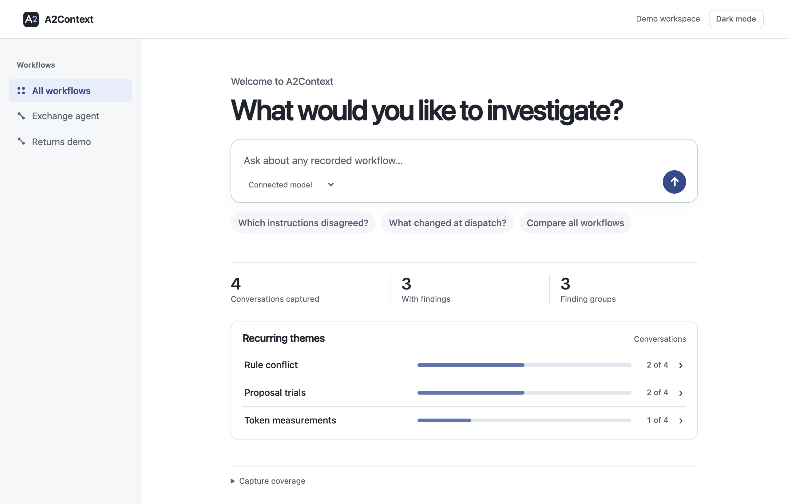
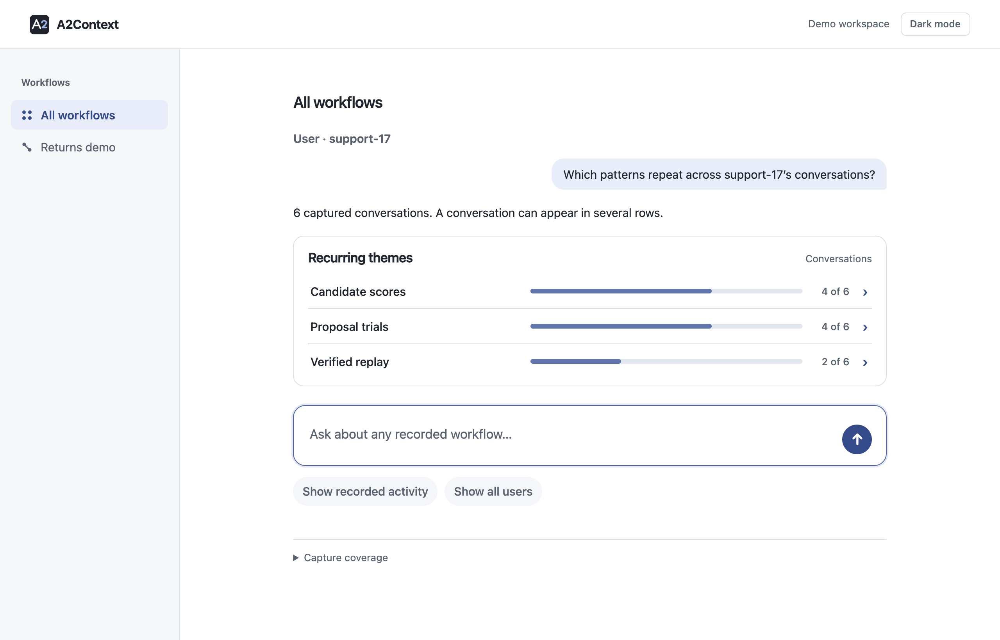

# Ask about a workflow

Open the dashboard and ask a question. Below the composer, **Recurring themes** shows how many captured conversations contain each kind of evidence. Choose a row to see its highest-ranked example in the interview. You can also type **Show an example of Rule conflict**. One conversation can appear in several rows. Choose a workflow in the sidebar for its own recommendation, or type **Focus on** followed by its name. Type **Show all workflows** to return to the workspace.



Ask “Which instructions disagreed?” to compare the values declared by two sources. Ask “Show the exact inputs” for the captured excerpts behind that answer, or “Where else did that repeat?” for counts and representative conversations. A sandbox comparison shows both branches of the same proposal. Ask “Show the order states” for the saved receipt. The appearance control switches between light and dark and remembers the setting on that origin. [Interview design](interview-design.md)

From **All workflows**, try **What did the customer ask for, and did the approval check change the outcome?** The message and the measured order states appear together. Ask **Show the dispatch states** to inspect every recorded state field in the receipt.

From the workspace briefing, type **Compare** followed by two workflow names. The answer shows captured conversations with findings, the denominator, and the most common finding type. Add **by repeated inputs**, **rule conflicts**, or **source capture gaps** to compare one class. The percentages describe captured evidence. Different workflows can record different amounts of evidence.

Ask **Show recent conversations in** followed by a workflow name to find activity from the workspace homepage. Type **Find conversation** followed by part of its recorded name. A unique match opens up to three captured calls in the interview, including recorded tool results when available. Type **What happened next?** to read the next calls or ask **What did the tool return?** for the visible results. This works for conversations without a finding. When a model is connected, it can interpret the calls in view and cite them. Ask for a call by number to see the stored record.

When you don’t know the conversation name, ask about a recorded phrase, entity, or tool. In the exchange demo, try **What did verify_customer return?** from the workspace homepage. Ask **Show call 1** to see the supporting record inline. **Search for** followed by a few words searches captured activity. Add a workflow name after **in** to narrow the search.

## Find patterns for one user

Start the gallery with `cargo run --locked -- sidecar --demo --listen 127.0.0.1:0` and open the printed address. Ask **Which issues keep coming up for this user?** When the interview asks for the recorded user ID, enter **support-17**. The gallery has 26 captured conversations. Six belong to this user, and four of those six have candidate scores. Select that row to inspect a measured example, then ask **Show the exact inputs**. The sidebar and follow-up answers keep the same user.



You can also name the user in your first question. Try **Which patterns repeat across support-17’s conversations?** IDs come from recorded metadata and can include spaces. An ID with no captured conversations gets a different answer from a user with recorded conversations and zero findings. **Show all users** clears the user while keeping the workflow and other active filters.

Ask **Which four conversations?** Both candidate scores and proposal trials appear in four conversations, so the interview asks which theme you mean. Answer **Candidate scores**. **Show more conversations** retrieves the next three or fewer. **Open the first one** opens the first conversation on the page you just saw, at the call where the evidence was recorded. You can also ask **Which conversations had candidate scores?** directly.

## Connect a model

**Workspace evidence** uses the local sidecar to retrieve findings and recorded excerpts. To interpret the retrieved evidence in plain language, run the optional Python gateway on the same host as the sidecar. It accepts a model server’s Chat Completions endpoint. This example assumes a model already served on loopback. Substitute the sidecar origin printed by the demo and a model ID your server accepts.

```sh
python3 examples/chat-partner/serve.py \
  --sidecar http://127.0.0.1:8040 \
  --endpoint http://127.0.0.1:11434/v1/chat/completions \
  --model YOUR_MODEL_ID
```

Open the gateway address and ask **Was the shopper’s identity confirmed?** in the exchange demo. The partner can select the verification tool by name and show its recorded result. Ask **Which words were most sensitive to changing the refund instructions?** to see the saved experiment. The first configured model is selected automatically. Repeat `--model` to offer several models at one endpoint. For a hosted endpoint, use HTTPS and supply its bearer credential through `A2CONTEXT_CHAT_KEY` in the gateway process environment. The browser never receives the key. Send telemetry and experiment uploads directly to the Rust sidecar.

For an open-ended question, the sidecar searches recorded activity in scope. The partner can choose to read those matches, search different terms or inspect a finding. It sees up to four matching workflow and conversation names during this choice. If it reads activity, a second model request selects lines from the captured calls. The interview shows them verbatim and can open the call that supplied each line. Explicit searches and the token diagram also work with workspace evidence alone. Background analysis makes zero model calls.

The planner receives at most 15 distinct finding descriptions and 16 tool names sampled from the latest 64 scoped calls. For a multi-part question it can also choose from up to 12 combinations of evidence from individual experiments. The browser resolves the selected ID and renders the stored values. Finding interpretation can include recent turns, source names, declared values, state fields, and proposal previews. Activity questions can send excerpts of captured messages and tool results. Choose a provider approved for those data. The gateway allows two concurrent requests and caps each response at 450 tokens. The read selector requests up to 80.

When the retrieved calls leave a question open, the interview says so. Type **Show the retrieved excerpts** to see what it checked. For example, a verification tool can establish that a customer passed the check. Those calls alone cannot establish how the check affected the model’s answer.

## How an answer becomes a diagram

1. The Rust sidecar groups observations in SQLite and returns the ranked findings and their exact evidence references.
2. For an open question, each available read has an ID. A read can retrieve executions or proposals for a named tool, display a measured comparison, or return to the evidence in the last answer. The host maps the ID to the stored evidence and view. The partner can also suggest two short searches. Each alternative must match all its words in one recorded excerpt. If neither matches, the sidecar can show partial matches to the original wording. A question about tool activity can only quote lines from the retrieved sample. A uniquely identified finding can also be interpreted in plain language.
3. The browser sends an A2UI 1.0 component update when the evidence is ready. A comparison renders both arms together. The recurring-theme chart uses a registered Lit component with the counts from the scoped sidecar summary. One conversation can contribute to several themes. [A2UI catalogs](https://a2ui.org/concepts/catalogs/)

**Choose different evidence** corrects a match for the same question on the open page. Refreshing or switching scope clears that correction and the conversation. This lets an engineer recover a bad match without changing ranking for other users.

The browser regression checks that supporting calls and the saved comparison appear in the interview and match the stored evidence. It also checks a query with no matches, a workflow without token measurements, and the measured returns diagram. Routing accuracy on other questions still needs a separately labeled question set. [Exchange walkthrough](demo.md)

## Check a partner before using it

Run the browser test against the exchange demo with the gateway enabled. Supply the names from your gateway and Playwright installation.

```sh
CHAT_MODEL=YOUR_MODEL_ID node tests/exchange-a2ui-browser.mjs http://127.0.0.1:8041
```

The optional live check asks whether the shopper was verified, what changed at dispatch, and where the result repeated. The browser also exercises a fixed read selection to check that a follow-up uses the same captured result and that an unrelated question can switch to a measured comparison.

In the walkthrough, Gemma 3 4B identified the customer message as the source of the hold. In development, Qwen2.5 0.5B returned a valid finding ID with an unfamiliar view name on one question and carried an earlier conflict into a later dispatch question. Gemma also described two sandbox arms as a chronological transition. The dispatch answer now names each arm from the receipt. Those cases led us to keep chart values in the renderer and narrow single-match questions to the matching evidence before generation. These observations come from the saved exchange case.
