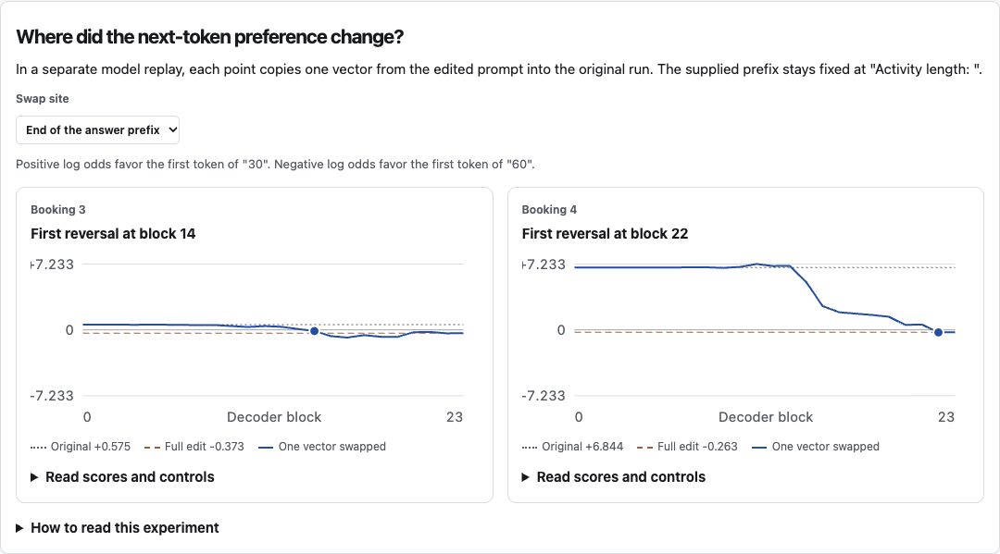

# See what a source edit changed

https://github.com/user-attachments/assets/c3038ec0-4445-47e8-babd-64daa2b0d139

Two users ask about different activities. The same calendar edit changes both answers from 30 to 60 minutes. The greenhouse booking called for 60. The orchestra rehearsal called for 30. The recording follows the recommendation to the captured calendar entry, its replacement, and the original and edited answers.

[MP4 file for offline viewing](media/booking.mp4)

## Reproduce the recording

From the checkout with stable Rust and Python 3.11 or later, start a sidecar with a fresh database for this synthetic example. In the first terminal run:

```sh
mkdir -p data
cargo run --locked -- sidecar --db data/booking-demo.sqlite --capture-content
```

In a second terminal, send the 16 saved conversations:

```sh
python3 examples/view_calendar_prefixes.py --indirect --reference
```

Open the address printed by the sender. Choose **Compare two questions**, then **Inspect this edit** under the rehearsal question. Expand **Compare the other source edits** to see what happened when the other calendar was edited. All measurements are saved. Running the walkthrough spends no model credits. [Study and limitations](methods.md#does-the-suggested-edit-follow-the-question-when-source-order-changes)

Below the matched answers, **Where did the next-token preference change?** compares the two questions on the same scale. For the Atlas edit, the first reversal appeared at block 14 for the greenhouse question and block 22 for the rehearsal. Change **Swap site** to the end of the user message to see both sweeps stay on the original side of zero. **Inspect this edit** also lets you switch the source whose activations were used. [Block experiment and controls](../examples/context-screening/replay/prefix-blocks/README.md)



For the general demo, stop this sidecar and run `make demo`. For an actual workflow, use the [shipping image and deployment guide](../DEPLOYMENT.md).

## Refresh the recording

With the labeled booking study running, use `node scripts/record_demo.mjs http://127.0.0.1:8040 /tmp/booking.mp4`. The recorder uses Playwright's Chromium driver and FFmpeg. Set `PLAYWRIGHT_MODULE` to your playwright-core module, `CHROME_BINARY` to the browser executable, and `FFMPEG` if the encoder is outside your PATH. The clip uses only the synthetic study.
