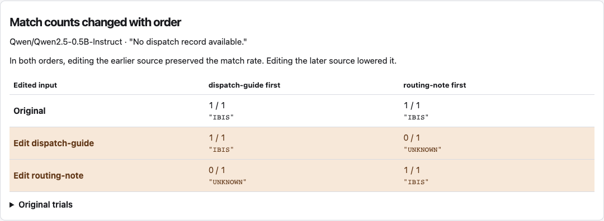
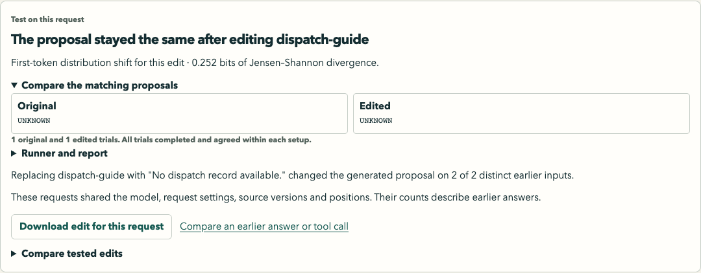
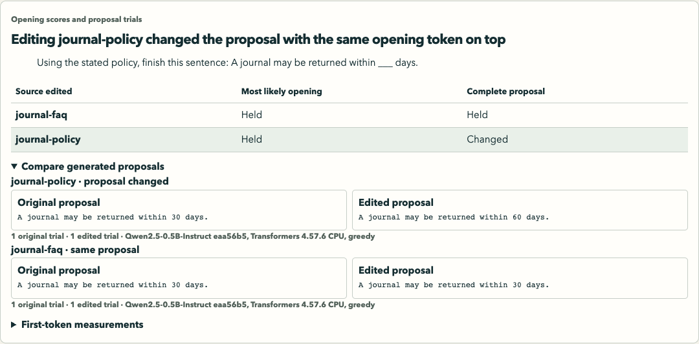
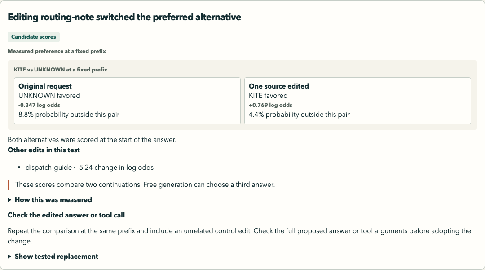
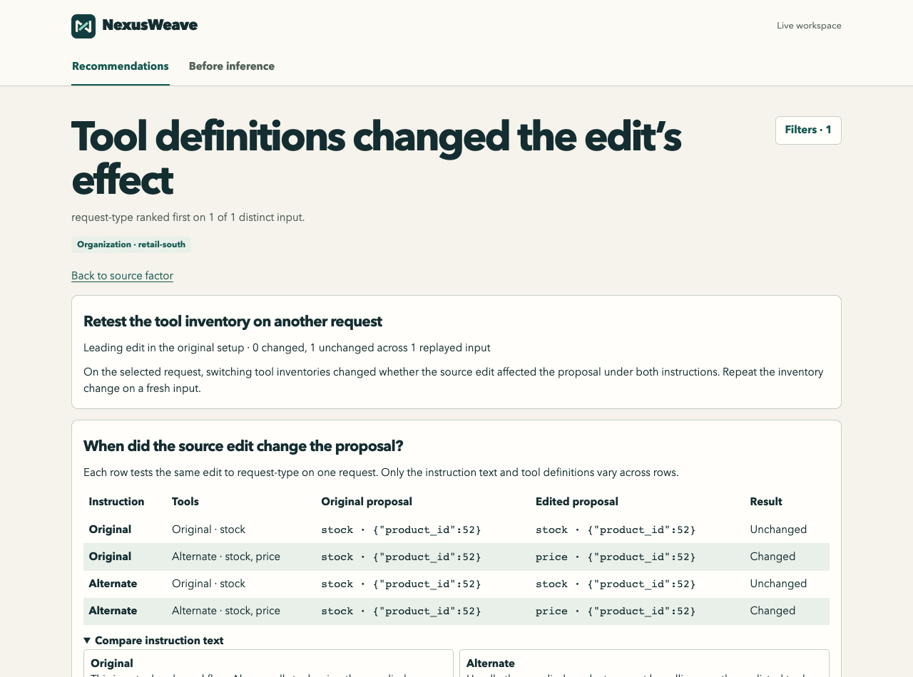
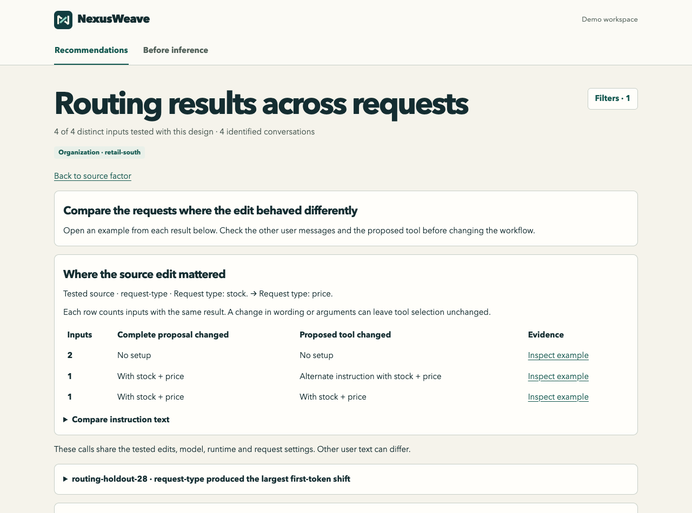

# Methods and evidence

| Method | Status | What the result establishes |
| --- | --- | --- |
| **Shared request bytes** | Implemented in preflight. [Inspect overlapping source anchors](guide.md#check-whether-editing-a-passage-touches-two-sources) | For each JSON string field, sort the start and end offsets of validated fragments. Between successive offsets, count distinct active source IDs. Lengths with at least one ID contribute to named bytes. Lengths with at least two contribute to shared bytes. Sorting and scanning take O(n log n) time and O(n) space for n fragments. Overlap identifies where a text edit would touch multiple named inputs. It carries no weight or activation score. |
| **Declared-rule conflict** | Implemented in the sidecar and in [preflight](guide.md#check-context-before-inference). | Two captured inputs in one call declare different structured values for the same rule key and scope. The card includes the captured source IDs and versions. Model behavior and business impact require separate evidence. |
| **Exact repetition** | Implemented in the sidecar. | Nonblank, included text matches byte for byte within a call. The text is grouped before hashing. A repeated, unnamed user or assistant message gets a dialogue review recommendation. Named source copies can lead to a removal experiment. |
| **Verified replay** | Implemented in the sidecar using the existing replay validator. The paired-edit design and negative controls are adapted from [experimental methods](../CREDITS.md#context-inspection-and-replay). | An edit changes the rate at which a defined answer or action matches its scoring rule under the recorded conditions. The validator binds the result to the recorded call, captured baseline request and edited source. It recomputes the summaries from the supplied trials. Runner identity and trial provenance are supplied by the experiment producer. |
| **Local semantic screening** | Implemented as a separate, opt-in offline workflow. | A specified model scores candidate text pairs for review. Treat these as hypotheses and use a controlled edit to measure an outcome. [Context screening](guide.md#screen-captured-text-for-overlap) |
| **Proposal-only shadow probe** | Implemented as a separate, opt-in workflow. | Observes answer or tool proposals under a chosen edit. Use a runner with no execution callback for production tools. [Shadow probe](architecture.md#test-which-source-changes-an-outcome) |
| **Instrumented attribution** | Adapted in [activation experiments](inference-attribution-plan.md). | Token position or target-score measurements apply to the tested intervention, layer, model, and inputs. Captured reports can open from the source trace. [Activation patching guide](https://arxiv.org/abs/2404.15255) |
| **ContextCite, AttriBoT, and IHEval** | Related prior work. | See the [scoping review](research-review.md#attribution-and-experimental-methods) for the comparisons. |

## Recommendations before and during inference

**Before inference** accepts assembled requests with optional candidate-score and proposal reports. It compares captured declarations, checks for repeated text, and verifies a supplied probe against the exact request and tested source edits. The sidecar returns a recommendation and one follow-up for each supported result. The submitted request is processed in memory.

Fixed-candidate scores compare two declared continuations from the same prefix. They can establish that an edit shifted or reversed the preference between those alternatives under the tested conditions. A proposal test measures whether a particular answer or tool proposal appeared under each edit. For an instrumented output path, the card selects the source and token with the largest absolute change in log probability after a source edit. Selecting a token ranks the tested source edits at that position. The decoder-block measurements open separately. These comparisons are conditional on the chosen request, model, prefix, alternatives, or intervention. [Activation patching guide](https://arxiv.org/abs/2404.15255)

Generated reasoning text can omit factors that determine a prediction. Circuit tracing studies model mechanisms using instrumented activations and follow-up perturbations. NexusWeave summarizes measured effects of specific interventions. The report producer supplies the measurements and timing. [Turpin et al., NeurIPS 2023](https://proceedings.neurips.cc/paper_files/paper/2023/hash/ed3fea9033a80fea1376299fa7863f4a-Abstract-Conference.html) · [Lindsey et al., 2025](https://transformer-circuits.pub/2025/attribution-graphs/biology.html)

The pending exchange compares tool-name probabilities with free proposals on the original request, two individual edits, and their combination. Matching request hashes bind every displayed trial to the scored condition. A decoder-block sweep measures how each single edit changes the first-token score when its activation is transplanted into the original run. A stable preference can coexist with a change in the emitted arguments. The separate sandbox comparison tests execution with one of those proposals held fixed. [Exchange study](demo.md#see-what-the-model-did-on-the-pending-request)

### Compare decoder blocks for the same source edit

An instrumented runner can attach a `block_probe` to a candidate score report. The runner holds the original request and supplied answer prefix fixed. At each block it substitutes one vector from the full source edit at either the final user-message token or the final prefix token. The readout is the log odds between the first tokens of the two supplied continuations. The sidecar checks the checkpoint and tokenizer identity, request and rendered-prefix digests, alignment fields, and control scores before showing the sweep. When first-token scores are available in the candidate report, the reported original and full-edit margins must agree with them. The runner supplies the internal measurements. [Report schema](../schema/candidate-block-probe-1.json)

The paired booking view shows both questions on the same scale. Zero is a tie between the tested tokens. The dot marks the first tested block where the substituted run strictly reverses the original preference. This measures sensitivity to that intervention at that site. In two greenhouse cases, the other calendar's vector briefly reversed the preference while its full edit preserved the original preference. Use the full-request edit and the free-generation trial to connect the mechanism probe to the question the user asked. [Study, runner, and raw scores](../examples/context-screening/replay/prefix-blocks/README.md)

### What does an output-token shift measure?

For the original token at position *t*, the runner scores it twice with the same preceding output tokens. It subtracts the original log probability from the log probability under a single source edit. A negative difference means the edit lowered the probability of that original token. The dashboard orders edits by the absolute difference and shows the sign and probability alongside each edit. A zero is a measured result. Captured sources without an edit have no score.

The freely generated output shows what the runner produced once it could choose a different continuation. In the MLX example, replacing product ID `42` with `73` lowered the log probability of `42` by 20.063 at the tool argument and by 0.059 at its second occurrence in the explanation. At the second position the fixed prefix already contains the original argument. In free generation both occurrences became `73` and the tool remained `stock`. These results measure the response to this replacement. They leave open which model mechanism explains the difference between positions. [MLX measurement](../examples/local-mlx-routing/output-token-report.json)

The optional block view uses a different intervention. It swaps recorded activations at a specified decoder block and reports the change from the original token score. Both measurements require an instrumented runner. Ordinary OTLP sends the observed request and response. [Instrumentation and controls](inference-attribution-plan.md)

### Which conflicting source edit changed the proposal?

For a declared conflict, the sidecar compares the full proposed answer or tool call under two separate edits. Each edit keeps the other source in place. Both edits must belong to one report on one eligible decision. Each arm, including the baseline, must complete and agree across its trials. The baseline must also reproduce the recorded outcome under the report’s scoring rule.

Across reports, the grouping holds the normalized request fixed except for the final plain user message. It also matches the versioned sources, original text, edit locations, replacements, model, runner, decision kind and label, scoring rule, sampling design and trial counts. It counts each distinct request once. If eligible repeats disagree about which edit changed the proposal, that request appears as mixed. Reports without two comparable arms can still contribute evidence about [test coverage](sidecar.md#find-the-next-conversation-to-test).

The recommendation requires one question where only the first edit changed the proposal and a different question where only the second edit changed it, with examples across at least two identified conversations. Candidate groups rank first by the smaller of those two counts, then by their sum. The result describes sensitivity to those replacements. It leaves open how the model computed the answer. [Reproduce the three journal questions](sidecar.md#when-the-same-edit-changes-different-answers)

## What changed in a conversation?

The overview assigns each conversation to the first category supported by a finding in the current scope.

| Category | Required evidence |
| --- | --- |
| Generated proposal changed | In a verified edit comparison, all original trials completed with the same proposal, all edited trials completed with the same proposal, and the two proposals differ. The comparison checks kind, label and full outcome before shortening the displayed text. A changed pair in a first-token or routing experiment also qualifies. For an instrumented token finding, the sidecar checks the free generation for each tested source edit. The largest fixed-prefix token shift can belong to a different source. For tool proposals it compares the parsed name and arguments. |
| Replay match rate changed | Two tested conditions produced different fractions of answers or proposals meeting the scoring rule. Individual trials may vary within a condition. |
| Model score shifted | A first-token distribution, candidate preference or output-token score shifted under a source edit. Open the example to check whether the runner also generated paired proposals. |
| No change in measured model results | A scored comparison returned equal match rates or equal measured first-token distributions. Two different answers can meet the same scoring rule. |
| Captured inputs only | The supported findings record a declared-rule conflict or exact repetition. Their effect on generation still needs a test. |

This ordering describes the outcome an engineer can inspect. One changed answer in a single pair supplies no estimate of how often the effect will recur. The counts cover findings on individual calls. Source-position experiments that compare multiple requests appear under the source factor.

Sandbox dispatch comparisons hold the generated tool proposal and starting state fixed and change the dispatch check. The overview counts distinct conversations with at least one recorded comparison. Each setup groups the same source recommendation, guard, runner, tool, target field and measured state fields. The detail view shows how many conversations reached the expected state with the check, without it, in both runs, or in neither. Disagreements within a setup and conversation remain visible as mixed. These are counts of observed comparisons. Estimating how often a check will help future requests requires evaluating it on new requests. [Exchange example](demo.md#what-the-test-covers)

The coverage panel asks a separate question. Among the findings in scope, did any edit change a complete proposal, and did any comparison preserve one? Each identified conversation counts once according to those two observations. In the saved demo, 13 conversations contain both results, two have matching proposals only, and six have no comparable pair. A conversation can contain different inputs, edits, models or tool inventories. Evidence for both outcomes therefore calls for inspecting the two examples before concluding that repeats disagreed. Standalone proposal trials qualify even when both arms missed the expected answer.

<details>
<summary>Addresses for the running example</summary>

- Open the comparisons at `http://127.0.0.1:8040/#proposal-coverage`

</details>

Within a category, the source view keeps every finding at the strongest level for each identified conversation. It groups those findings by versioned source set and counts distinct conversations and requests. Groups with the most conversations appear first. Request count and the stable group ID break ties. Selecting a group returns the latest qualifying finding from that group for each member. Selecting another group cannot move a conversation into a weaker category.

For changed proposals, the dashboard groups by the sources edited in a qualifying comparison. A single edit and a joint edit have separate rows. A routing comparison contributes only the source edited within a setup. Each instrumented generation contributes its own edited source. An edit needs at least one observed change in the selected scope. Other trials on the same input can disagree. The counts describe the reach of the observed changes across conversations. Estimating the probability of another change would require comparable repeated trials.

## Grouping and ranking

Within a trace, use the captured call ID to locate each observation. Conflict groups use the rule key, scope, and the source-version pair. Exact-repeat groups add the hash of the matching text and the participating sources. When a message and a source declaration uniquely resolve to the same complete request field, the detector counts that location once. Unnamed sources are trace-local. Replay groups use the existing compatibility key, including the outcome, scoring rule, interventions, runner, model, and sampling design. Groups are counts of captured observations with similar evidence. Their effects are never pooled by the feed.

Recommendations show measured candidate flips first, followed by proposal and token effects, other candidate shifts, recurring conflicts, replays with a measured difference, individual conflicts, exact repeats, and replays with equal measured rates. A replay group that includes a measured change opens the most recent observation with a change. The card and recurrence counts keep the example separate from the whole group. Within each tier, identified thread count, distinct trace count, and latest observed time are sorted descending. A stable group ID breaks ties. Time filters use the observation timestamp for Findings and the trace start for Traces and Threads. Undated evidence is present in the unfiltered feed and excluded from date-windowed counts.

A numeric zero in a replay means the recorded match rates were equal. A missing result means that the validator could not derive a comparable difference from the evidence. The latter remains visible in the trial details of an attached report and never creates a measured replay card. Counts of captured inputs, declared rules, and replayable requests describe capture coverage. They cannot establish the prevalence of a finding in missing telemetry.

## Reading conversation impact

The overview counts distinct conversation keys within the current filters. A conversation with several sources or tests counts once in the headline and once under each relevant factor. Requests without conversation IDs have a separate count. The measured subset includes a changed complete proposal or a nonzero change in the scored outcome, proposal rate, fixed-candidate preference, or token score. A conflict alone never enters that subset. These counts describe captured experiments and signals. Production harm requires its own outcome and evidence.

A factor groups the same versioned source set within a telemetry source and organization. Unnamed inputs stay local to a request. Different edits, models and outcomes remain separate recommendations beneath a factor. The overview gives joint-only changes and candidate flips precedence over lower-level score movements. A badge identifies the strongest type of evidence present. Within a recommendation, trial counts and any design-supported 95% interval describe the actual comparison. There is no calibrated probability that a suggested fix will generalize.

## Two copies of a dispatch record

Two synthetic records gave the same routing instruction, “Route Alder parcels to bay LARK.” The original request to `gpt-4o-mini-2024-07-18` returned `LARK`. We then changed either copy or both and scored exact agreement with that recorded answer. Each cell below is one API response with temperature zero.

| Replacement text | Baseline | First copy edited | Second copy edited | Both edited |
| --- | --- | --- | --- | --- |
| No dispatch record available. | LARK | LARK | UNKNOWN | UNKNOWN |
| This parcel was scanned this morning. | LARK | LARK | LARK | UNKNOWN |

With the neutral replacement, the two single edits missed the dependency that the joint edit exposed. With the availability wording, editing the later copy alone changed the answer. A single request cannot distinguish a position effect from sensitivity to the replacement’s meaning or sampling variation. For a follow-up, vary source order, wording and parcel codes, sample more requests, and score them with the same criterion. The dashboard places the two sets of trial counts side by side and highlights the edit whose count differed. [Original request](../examples/redundant-routing/measured/evidence.json) · [Neutral replacement](../examples/redundant-routing/measured/neutral-report.json) · [Availability replacement](../examples/redundant-routing/measured/unavailable-report.json)

### When both single edits preserve the answer

The recommendation compares the complete proposal in each condition with the original replay. It labels a change as joint-only when both individual edits preserve the original and the joint edit changes it. This comparison requires all trials to complete and agree within each of the four conditions. Mixed or missing proposals in a scored joint replay leave the four-way result unresolved. Proposal equality includes kind, label and the full outcome, including tool arguments. The match rate uses the report’s own scoring rule.

As a check, we rescored the four saved neutral-wording trials using only the proposal kind and label. All four matched under that rule, including `UNKNOWN`. The complete answers still show the joint-only change. This uses the same generated trials twice. To reproduce from the checkout, use a built binary.

```sh
printf '%s\n' '{"kind":"kind_and_label"}' > /tmp/nexus-dispatch-rule.json
target/debug/nexusweave rescore-replay examples/redundant-routing/measured/evidence.json \
  examples/redundant-routing/measured/neutral-report.json /tmp/nexus-dispatch-rule.json \
  dispatch-label-control /tmp/nexus-dispatch-labels.json
```

On the saved local Qwen runs, the neutral wording gave a joint-only change in both source orders for Cedar. On Birch a single edit also changed the answer. Each condition has one trial. The reports establish what these runs produced under the selected edits. An internal explanation or a production failure rate would need further evidence. [Local order experiment](../examples/redundant-routing/measured/local-order.json)

The capture and eight replay trials used 569 input tokens and 15 output tokens. To reproduce with your own `OPENAI_API_KEY`, run the command below from the checkout. It makes nine hosted requests, each capped at 16 output tokens. Opening the demo reads the saved reports offline.

```sh
python3 examples/redundant-routing/run.py --binary target/debug/nexusweave --output data/dispatch-replication
```

### When another wording changes the recommendation

The sidecar checks verified text-edit reports for the same call and recorded decision. To compare two reports, the original request digest, edited source positions, runner, scoring rule, sampling design, trial counts and baseline match counts must agree. For joint or controlled edits the design must also agree. Every scored arm must have a usable difference from baseline. The comparison aligns source IDs before counting matches, so changing the order of variants in a report preserves the result.

Within a design the sidecar groups reports by their full replacement strings. A wording with inconsistent match counts across repeats cannot serve as an example of a wording difference. Among the remaining wordings, it selects the first two in text order with different counts in a corresponding arm, then links each example to its original trials. A match-count difference motivates replication. It does not quantify the probability that wording caused the difference. The sidecar makes this recommendation from saved reports without an additional model call.


### Check the result against new parcel codes and source order

We ran the two wordings on Qwen2.5-0.5B-Instruct with a local CPU runner, greedy decoding and a 16-token cap. Two new parcels, Cedar and Birch, each appeared with the dispatch guide first and with the routing note first. The prompts kept the two source labels visible. Each of the four requests had a baseline and six edited conditions, for 28 generations. The scoring criterion was exact agreement with the original bay code.

| Result | Observed |
| --- | --- |
| Original answer was the expected bay code | 4 of 4 requests |
| Availability wording preserved the code when editing the earlier source | 4 of 4 |
| Availability wording preserved the code when editing the later source | 0 of 4 |
| Neutral wording preserved the code under both single edits, and the joint edit changed it | 2 of 4 |
| Both records replaced, answer was `UNKNOWN` | 8 of 8 joint edits |

In one neutral Birch trial, Qwen returned `BAY WREN` instead of the required `WREN`. It identified the bay while failing exact match. Another returned `UNKNOWN` after only the dispatch guide was edited. The comparison therefore shows the answer text alongside the match count when every trial in that arm produced the same text. These four requests share a template and a model, which limits generalization. [All 28 outputs](../examples/redundant-routing/local-order-results.json) · [Local runner](../examples/redundant-routing/replicate_local.py)

In the demo, **Compare the two source orders** opens four matched comparisons, one per parcel and wording. The availability wording changed a single-edit match count across orders for both parcels. The neutral wording did so for neither. You can open either original replay. In the neutral Birch comparison the same source edit produced two distinct answers that both failed exact match.



The sidecar matches validated joint replay reports that edited two named sources in distinct message content fields. Each edit needs a captured message index or a verified byte range. It places the two complete messages into stable source-ID order, then hashes the resulting request along with the two positions, source versions, replacement operations, ranges and strings, model, runner, recorded outcome, scoring rule, sampling design, baseline counts and single-edit sample sizes. A pair needs an eligible report in each message order under the current filters. Identical messages, rescored reports and control comparisons are ineligible. If repeats of one order disagree on a single-edit match count, the sidecar withholds that comparison. The table shows representative trials for both orders. These counts describe the captured runs. Sampling and unrecorded runtime changes can also affect the result.

To repeat offline, supply the local Qwen snapshot used by the [Transformers experiments](inference-attribution-plan.md). The packaging command checks each planned request against the local runner’s input and scores the saved answers without calling a model.

```sh
python3 examples/redundant-routing/replicate_local.py /path/to/qwen/snapshot \
  --revision eaa56b503cc0a8a4d15de1dd8bd2a7e95a716be2
python3 examples/redundant-routing/package_order_replays.py target/debug/nexusweave \
  examples/redundant-routing/local-order-results.json /tmp/order-replays.json
```

### Can an earlier replay identify what to test on the next request?

**Before inference** looks for single-source edits already tested on the same request layout, model and settings. It keeps the order and versions of the sources fixed. It can match new text inside named source fragments and a new final user question. It counts distinct earlier request bodies for each edit, runner and scoring rule. A receipt for the current body contributes zero to those counts. The [sidecar guide](sidecar.md#preview-an-assembled-request) describes the lookup and its limits.

We held out Maple, Ash, Elm and Pine in both message orders. For each of the eight requests we sent only its inputs to the demo sidecar. Its history contained Cedar and Birch. In every case the first suggested test was the availability replacement on the later source, which had reduced the exact-match rate on both earlier inputs in that order. We checked the suggestion against greedy Qwen generations on the eight held-out requests, with one baseline and six edited conditions per request.

| Held-out observation | Count |
| --- | ---: |
| Editing the recommended source changed the generated text from baseline | 4 / 8 |
| Editing the other source with the same replacement changed the text | 3 / 8 |
| The unedited answer matched the expected bay code | 5 / 8 |

In the Ash request with the routing note first, the model initially answered `UNKNOWN`. Editing the earlier note recovered the correct bay, `KITE`. The recommended edit left the answer unchanged. All eight requests share one model and prompt template. The observed counts support presenting a next experiment with its historical evidence. They provide little evidence of a predictive advantage and supply no calibrated probability for the pending request. [All held-out generations](../examples/redundant-routing/heldout-order-results.json)

We revisited all four suggested edits per held-out request, giving 32 edit/request combinations. Where an edit changed both earlier answers, it changed 4 of 8 held-out answers. Where both earlier answers held, it changed 5 of 16 held-out answers. The two earlier inputs disagreed for the remaining 8 combinations. Several comparisons reuse the same request and baseline. These are descriptive counts from the existing dataset.

We also ran the exact dispatch-guide edit prepared for Ash through local Qwen2.5-0.5B-Instruct. It shifted the first-token distribution by 0.2524 bits of Jensen–Shannon divergence. A greedy generation on each request returned `UNKNOWN` both times. With the pinned checkpoint and CPU environment used for the replication above, add `--reproduce-ash /path/to/checkpoint` to the command below to regenerate both reports and check their request hashes. [Saved reports](../examples/redundant-routing/ash-history-check.json) · [Replication script](../examples/redundant-routing/check_prior_edits.py)



With the saved demo running, reproduce the comparison without a model call. To regenerate the 56 held-out outputs on the pinned local model, add `--holdout` to the replication command above.

```sh
python3 examples/redundant-routing/check_prior_edits.py --url http://127.0.0.1:8040
```

### Can the opening token identify which conflicting source to test?

We fixed eight new journal-return questions and four rules for choosing an edit before running Qwen. Each request retained the two conflicting sources, preceding dialogue, neutral replacements and 12-token output limit of the three development examples. Only the final user message varied. We scored the original and both edits before generating any answer for that question, then ran one greedy generation per condition. The original, policy edit and FAQ edit all finished on five questions. All three reached the generation limit on the other three. [Frozen protocol](https://github.com/thakur-ro/NexusWeave/blob/9a877e101d04a7343d948a2f1648374b54d1e1ac/examples/context-screening/replay/question-holdout.json) · [Pinned Qwen weights](https://huggingface.co/Qwen/Qwen2.5-0.5B-Instruct/blob/eaa56b503cc0a8a4d15de1dd8bd2a7e95a716be2/model.safetensors)

| Rule applied before generation | Selected an edit | Selected edit changed the answer | Selected outcome unresolved |
| --- | ---: | ---: | ---: |
| FAQ, the most frequent changing edit in development | 8/8 | 2/8 | 3 |
| Policy, the first source listed | 8/8 | 2/8 | 3 |
| Larger first-token distribution shift | 8/8 | 1/8 | 3 |
| Only edit that switched the most likely opening token | 1/8 | 1/1 selected | 0 |

Four questions had at least one verified answer change. Across the 16 individual edits, one switched the highest-scoring first token and changed the answer. Of the 15 edits that kept the same token on top, three changed the answer, six preserved it and six comparisons were unresolved. In the sentence-completion example, the FAQ edit produced the largest distribution shift. The policy edit alone changed the answer from “A journal may be returned within 30 days.” to “A journal may be returned within 60 days.”

<details>
<summary>Addresses for the running example</summary>

- Inspect this request before generation at `http://127.0.0.1:8040/?view=preview&scenario=opening-before`
- See the complete proposals at `http://127.0.0.1:8040/?view=preview&scenario=opening-checked`

</details>

These counts describe one model, one conflict and eight authored questions. For a new workflow, verifying the full proposal still matters when the opening holds. Selecting the larger distribution shift also missed changes here. The sidecar shows each signal alongside any complete proposal tests for the same source and request. No confidence percentage is inferred from this sample. [Per-question scores and answers](../examples/context-screening/replay/question-results.json)



The two complete runs produced byte-identical results with Transformers 4.57.6 and PyTorch 2.11.0 on CPU. Read the saved results with Python 3.10 or later. To reproduce, use the local checkpoint and the pinned environment. The first command makes zero model calls.

```sh
python3 examples/context-screening/replay/check_question_holdout.py
python3 examples/context-screening/replay/check_question_holdout.py --model "$qwen_dir" --results /tmp/question-results.json
cmp examples/context-screening/replay/question-results.json /tmp/question-results.json
```

### Where did the answers first diverge?

We reran all three held-opening edits that changed a completed journal answer. For each question we reproduced the original answer and both edited answers on the same checkpoint. At their shared generated prefix we read the full-vocabulary next-token distribution for each request. The table gives the earliest position where the original and the answer-changing edit chose different tokens. The edit to the other source preserved the complete original answer in all three cases.

| Journal question | Source edited | First differing token (1-based) | Original → edited answer |
| --- | --- | ---: | --- |
| 4, finish the policy sentence | Policy | 8 | A journal may be returned within **30** days. → A journal may be returned within **60** days. |
| 7, complete “The deadline is” | FAQ | 4 | The deadline is **exactly 60** days. → The deadline is **30** days. |
| 8, write the receipt deadline | Policy | 4 | Returns: **30** days → Returns: **60** days |

On question 4, after “A journal may be returned within ”, the model assigned 60.4% probability to `3` and 36.4% to `6`. After the policy edit, those probabilities were 1.7% and 97.7%. Question 7 first diverged on wording, before either number appeared. These measurements locate the effect of a particular source replacement on a greedy output. Internal reasoning and the effects of untested sources remain unknown. [Saved token IDs, probabilities and request digests](../examples/context-screening/replay/held-opening-tokens.json)

Reproduce the three readouts in the same pinned CPU environment as the eight-question study.

```sh
python3 examples/context-screening/replay/inspect_journal_openings.py "$qwen_dir" /tmp/journal-tokens.json
cmp examples/context-screening/replay/held-opening-tokens.json /tmp/journal-tokens.json
```

The dashboard resource check reused those eight request bodies across 128 synthetic conversations. Of the 128, 80 had complete comparisons and 48 had a changed proposal after the same opening. In a Linux container limited to 1 CPU and 512 MiB, 30 warm loopback reads per route gave the following timings. Peak container memory, including the Python driver, replay preparation and SQLite cache, was 54.4 MiB. Model inference took place separately. These numbers measure dashboard reads on this fixture.

| Route | Median | p95 |
| --- | ---: | ---: |
| Overview (`impact`) | 4.85 ms | 10.84 ms |
| Opening coverage | 1.57 ms | 2.53 ms |
| Source breakdown | 1.44 ms | 2.50 ms |
| First page of affected conversations | 1.93 ms | 3.03 ms |

Run `python3 tests/sidecar_opening_study.py target/release/nexusweave --measure` with a release build under the same CPU and memory limits. [Benchmark driver](../tests/sidecar_opening_study.py)

### Can a supplied answer prefix identify a source worth testing?

Eight fresh receipt and support questions specified how the journal answer should begin. We froze the questions, the two candidate strings (`30`, `60`), the source edits, the 32-token generation limit and the scoring rule before measuring. For each question we scored both strings at the answer boundary and after the requested prefix, under the original request and each edit. We then let Qwen generate three complete answers from the answer boundary. The field evaluator accepted an answer only when it contained exactly one standalone integer and that integer was 30 or 60. [Frozen protocol](https://github.com/thakur-ro/NexusWeave/blob/5c59b6d0ca5ab2b5452b4bdbc90d2a03e109b65a/examples/context-screening/replay/prefix-study/protocol.json) · [All scores and answers](../examples/context-screening/replay/prefix-study/results.json)

For each condition, the preference margin is the difference between the two sequence log probabilities. A positive margin favors the first candidate. A negative margin favors the second. The selector recommends testing a source when it is the only single edit that strictly reverses the original preference. A tie supplies no reversal. All four rules selected on all eight questions, and all selected comparisons had a resolved field.

| Rule for choosing one edit before generation | Selected edit changed the generated number |
| --- | ---: |
| Unique preference reversal after the supplied prefix | 8/8 |
| Unique preference reversal at the answer boundary | 6/8 |
| Always edit the policy | 8/8 |
| Always edit the FAQ | 0/8 |

The policy edit changed the number on every question. The supplied-prefix rule equaled that fixed baseline. This design leaves open whether scoring helps when the influential source varies. Across the sixteen individual edits, the empty-prefix signal flagged two edits that preserved the field and missed two that changed it. The supplied-prefix signal made neither error on these examples.

All 24 generated texts began with the requested prefix. In 21, a candidate number followed immediately. On question four, all three outputs inserted a quotation mark before the number. The dashboard reports literal continuation matches for arbitrary workflows. The study’s numeric field evaluator can also resolve those three answers. [Evaluation script](../examples/context-screening/replay/prefix-study/study.py)

On the first question, scoring after `"Return window: "` gave `30` a probability of 66.0% and `60` a probability of 18.3%. Replacing the policy moved these to 18.5% and 55.9%. Each value is the conditional probability of the complete candidate token sequence. It measures neither the probability that this prefix will be generated nor confidence in an explanation. [Inspect the example](sidecar.md#compare-source-edits-at-a-supplied-answer-prefix)

The two full CPU runs produced byte-identical results. To repeat them with the pinned checkpoint, run the following from the checkout.

```sh
study=examples/context-screening/replay/prefix-study
python3 "$study/study.py" --model "$qwen_dir" --results /tmp/prefix-results.json
cmp "$study/results.json" /tmp/prefix-results.json
python3 "$study/study.py" --model "$qwen_dir" --example /tmp/prefix-example.json
cmp "$study/example.json" /tmp/prefix-example.json
```

### Does the suggested edit follow the question when source order changes?

Atlas and Birch calendars gave different durations for the same meeting. We varied which calendar appeared first, which one said 30 minutes, and which one the question named. Both entries occupied the same system message. This gave four matched pairs of questions on one Qwen2.5-0.5B-Instruct checkpoint. Within a pair, only the calendar named in the final question changed. We froze all eight conditions and the selectors before scoring. Position was an explicit control because Liu et al. found position effects on retrieval and multi-document QA tasks with longer inputs. [Frozen protocol](https://github.com/thakur-ro/NexusWeave/blob/acbdff958c30703842c0d7081a63806b64d70197/examples/context-screening/replay/prefix-transfer/protocol.json) · [Liu et al., TACL 2024](https://aclanthology.org/2024.tacl-1.9/)

We scored `30` and `60` on the original request and after replacing each calendar entry with a statement that its duration was unavailable. The forecast selected an edit only if it alone switched the preferred number. A separate greedy generation started from the answer boundary for every condition. We extracted the meeting length from that text.

| Rule for choosing a calendar entry | Questions with one selection | Selections that changed the generated number |
| --- | ---: | ---: |
| Score after the requested opening `"Meeting length: "` | 8/8 | 8/8 |
| Score at the answer boundary | 0/8 | No selections |
| Always choose Atlas or always choose Birch | 8/8 for each rule | 4/8 for each |
| Always choose first or always choose last | 8/8 for each rule | 4/8 for each |
| Choose the calendar named in the question | 8/8 | 8/8 |

The suggested source and the measured effect both switched in all four pairs. Across the 16 individual edits, the supplied-prefix rule identified all eight changed numbers and flagged none of the eight preserved ones. Scoring at the answer boundary missed all eight changes. The direct name-matching rule equaled the model-based selector on this task. These paired examples give no estimate of an advantage on implicit references or production traffic.

All 24 generations used the requested opening. The original answers gave the requested calendar's duration in 8/8 cases. After replacing that entry, 0/8 retained its original value. Replacing the other entry preserved it in 8/8. The recommendation identifies a source worth testing. Deploying the diagnostic edit here would remove the information the user requested.

Two complete CPU measurement runs produced byte-identical case files. From the checkout, verify the saved study without loading a model or reproduce the measurements using the pinned checkpoint. [Saved scores and generations](../examples/context-screening/replay/prefix-transfer/cases.json) · [Dashboard walkthrough](sidecar.md#compare-two-questions-with-the-same-sources)

```sh
cargo build --locked
study=examples/context-screening/replay/prefix-transfer
python3 "$study/study.py"
# With the checkpoint and scoring dependencies installed
python3 "$study/study.py" --model "$qwen_dir" --cases /tmp/new-calendar-cases.json
cmp "$study/cases.json" /tmp/new-calendar-cases.json
```

### What if the user never names the source?

In the activity follow-up, the user described tropical plants or practicing for a concert. Atlas and Birch listed a greenhouse tour and an orchestra rehearsal. Across 16 questions we crossed the paraphrase, the activity assigned to each name, the durations and the source order. The simple name-matching and word-overlap rules both abstained throughout. A task-specific lookup identified the intended activity in every question. Its source edit changed the generated number on seven, preserved it on four and produced an outside-set answer on five. [Frozen protocol](https://github.com/thakur-ro/NexusWeave/blob/c390e759470b95a6c5589465e493fede82b5b764/examples/context-screening/replay/prefix-indirect/protocol.json)

The model's supplied-prefix preference identified a single edit on 11/16 questions. All 11 changed the number. Four corrected a wrong original answer by blanking the other activity’s duration. Seven removed the original correct value. Only one of eight matched question pairs switched which edit was uniquely selected and confirmed. These counts describe the two paraphrases and checkpoint tested. A result with no single selection needs separate investigation even when an individual edit reverses a score. [All baselines, unmatched outcomes and reproducible results](../examples/context-screening/replay/prefix-indirect/README.md) · [Try a forecast and attach a measured result](sidecar.md#test-a-suggested-source-before-seeing-the-answer)

A retrospective check used the requested calendar's duration from each frozen case as its reference. The dashboard's literal-beginning grade agreed with the study's independent numeric-field evaluator on all 32 original versus single-edit comparisons, including unresolved answers. With trials withheld, four of the 11 selected edits favored the reference only after the edit. That view records zero verified restorations. The literal rule could accept `60` at the start of `600` on another task. This result concerns two supplied continuations on one checkpoint. [Reference test](../tests/sidecar_prefix_reference.py) · [Dashboard walkthrough](sidecar.md#did-the-edit-restore-the-expected-answer)

A second retrospective check compared the same calendar edit across different questions while keeping the earlier request and trial design fixed. Two of the eight matched setups supplied opposing reference outcomes. In bookings 13 and 14, removing the rehearsal duration moved both answers from 30 to 60. The greenhouse question called for 60, the rehearsal question for 30. Bookings 3 and 4 showed the same pattern with the other calendar. Each arm used one greedy generation. The reference changed with the question, so the opposite grades can arise from the same behavioral response to the edit. [Paired questions and original answers](sidecar.md#when-the-same-edit-helps-and-hurts) A local Qwen follow-up measured the next-digit margin after transplanting one internal state at each decoder block. [Block-swap results and controls](../examples/context-screening/replay/prefix-blocks/README.md)

### What do model scores add before generation?

We gave the local Qwen scorer the pending dispatch request, two source edits and two continuations taken from the task: the specified bay code and `UNKNOWN`. At the empty assistant prefix it summed the conditional log probabilities of the tokens in each continuation. Subtracting the second sum from the first gives the preference margin. The sidecar checks the request and edit bindings. Within one probe, it lists edits that reverse the preference first, then orders by absolute change in margin. A tied margin supplies no reversal.

On the eight previously examined dispatch requests, replay history's first suggested edit changed the answer on 4/8. The current-request probe showed a reversal on six requests. Its first reversal changed the generated text on 6/6. Across all 16 individual edits, seven reversed preference and all seven changed the generated text. This comparison reuses cases whose outputs were already available during development. [Saved model reports](../examples/redundant-routing/candidate-checks) · [Evaluation script](../examples/redundant-routing/check_prior_edits.py)



For a separate warranty workflow, we fixed four inspections, two source orders and the same edit for both sources. We scored `APPROVE` versus `DENY` on all eight requests before generating any answers. The workflow also allowed `REVIEW`. Among 16 edits, nine reversed the two-way preference and changed the answer. Another six preserved both the preference and the answer. One changed the answer without reversing the preference. These are repeated conditions from one synthetic template and checkpoint. [Warranty inputs and runner](../examples/redundant-routing/check_warranty_probe.py) · [Scores and generated answers](../examples/redundant-routing/warranty-probe-results.json)

The missed edit was the policy on the accidental-damage request with the policy first. `DENY` still outranked `APPROVE`, but the model generated `REVIEW`. The panel reports the probability outside the two disjoint candidate token sequences as `1 − exp(log_p_A) − exp(log_p_B)`, conditional on the same prompt and prefix. It went from **46.8% to 59.7%**. If either condition puts most of its mass outside the pair, the recommendation calls for checking other answers. This mass describes continuations at this prefix. A complete answer can still extend either scored sequence.

With the demo running, verify the ranking against the saved dispatch outputs. To regenerate the probes, pass the pinned local snapshot and revision used above to `score_pending_edits.py`.

```sh
python3 examples/redundant-routing/check_prior_edits.py --url http://127.0.0.1:8040 \
  --candidate-checks examples/redundant-routing/candidate-checks
```

### Which source would you test without candidate answers?

For the baseline and each named edit, the instrumented runner reads the full next-token distribution at the empty assistant prefix, before sampling. For distributions `P` and `Q`, it computes `M = (P + Q) / 2` and reports `(KL(P || M) + KL(Q || M)) / 2` in bits. Zero means identical distributions. One bit is the upper bound. The score measures sensitivity to this edit. A decoder can still choose the same answer, and a later token can change after a small initial shift.

The Rust sidecar ranks the tested edits by the adapter's reported divergence and retains their exact request digests. A separate replay can establish whether the generated answer or tool call changed. The public QA study compares this ranking with position and retrieval baselines, including a fixed fresh-question cohort. [Run the prefill probe](sidecar.md#measure-an-edit-before-the-first-output-token) · [Pilot](../examples/public-qa/README.md) · [Fresh-question protocol and results](../examples/public-qa/holdout.md)

### Did the leading edit change the tool call?

We measured the same two source edits on four synthetic routing requests with the pinned Qwen2.5-0.5B-Instruct CPU adapter. Editing `request-type` from stock to price produced the largest first-token shift on all four. Each proposal comparison below used the existing greedy shadow runner on the same baseline and edited request. The store-name edit preserved the original proposal on all four.

| Workflow | Product ID | First-token shift after the request-type edit (bits) | Original → edited tool |
| --- | ---: | ---: | --- |
| North | 17 | 0.000177 | stock → price |
| North | 88 | 0.0000581 | stock → price |
| South | 52 | 0.000177 | stock → price |
| South, stock only | 52 | 0.00119 | stock → stock |

The stock-only request had the largest shift and retained its tool call. It offered one tool and carried different system instructions. The follow-up below varies those two settings independently. The dashboard keeps this setup separate from the two-tool comparisons. The two North conversations share a card. [Measured first-token reports](../examples/runtime-comparison/pending-routing/prefill-cohort.json) · [Inputs and paired proposals](../examples/runtime-comparison/pending-routing/shadow-cohort.json)

To repeat the prefill measurements, use `prefill_cohort.py --prepare /tmp/nexus-routing` to export one request and edit list for each case. Run each pair through `probe-prefill` with the Qwen adapter and checkpoint specified in the [sidecar guide](sidecar.md#measure-an-edit-before-the-first-output-token). The four saved rankings used twelve forward passes in total.

### Did the instruction or the available tools matter?

On the South stock-only request for product 52, we crossed the two observed instruction texts with the two observed tool inventories. Within each setup, we replayed the original stock request and the same edit asking for price. All other request fields stayed fixed. The outcome was the complete proposed tool call, including arguments. The runner generated each proposal without dispatching it.

| System instruction | Tools offered | Original request | Edited request |
| --- | --- | --- | --- |
| Always call stock | stock | stock(52) | stock(52) |
| Always call stock | stock, price | stock(52) | price(52) |
| Route by request type | stock | stock(52) | stock(52) |
| Route by request type | stock, price | stock(52) | price(52) |

Adding the price tool changed the effect of the user edit under both instruction texts. Changing the instruction alone preserved the proposed call for each fixed inventory. A second local run reproduced all eight proposals and request digests. Both runs used the same synthetic request and greedy Qwen checkpoint. The repeated run checks reproducibility and adds no independent workflow to the sample. [Experiment design](../examples/runtime-comparison/pending-routing/routing-design.json) · [Completed trials](../examples/runtime-comparison/pending-routing/prefill-cohort.json) · [Run the comparison](sidecar.md#test-instruction-text-and-tool-definitions)



### Does the tool-inventory result repeat on fresh requests?

Before scoring, we fixed four new product IDs, the final user messages and a prediction for all four setups. We kept both instruction texts, both inventories, both named source edits and the greedy runner from the development example. The prediction was that editing the request type changes the complete proposal in both two-tool setups and in neither stock-only setup. The four fresh inputs are the entire evaluation set. [Frozen specification](https://github.com/thakur-ro/NexusWeave/blob/f6c3f24/examples/runtime-comparison/pending-routing/routing-holdout.json)

| Product | Final user request | Where the full proposal changed | Where the proposed tool changed |
| --- | --- | --- | --- |
| 28 | Handle the request using the catalog details | Both two-tool setups | Both two-tool setups |
| 73 | Select the appropriate tool | Both two-tool setups | Two tools with the request-type instruction |
| 91 | Explicitly ask for stock | None | None |
| 64 | Explicitly ask for price if offered | None | None |

The fixed prediction held on **2/4** inputs. A secondary comparison of proposed tool names reproduced the original pattern on **1/4**. Under the stock-only instruction with both tools offered, the model returned two different text answers for product 73. Neither proposed a tool. For product 64 the model proposed price when available before and after editing the request type. An unchanged response to that edit can coexist with sensitivity to the available tools.

We ran twelve first-token forward passes and 32 proposal-only generations for each complete pass. A second run reproduced the saved results byte for byte. Each request used the same template and model. Product ID and final message changed together across inputs, so these differences do not establish the effect of an individual phrase. The table reports descriptive counts on synthetic requests. [All requests and trials](../examples/runtime-comparison/pending-routing/routing-holdout-results.json) · [Reproduction script](../examples/runtime-comparison/pending-routing/replicate_routing.py)



## Reproduction

- Run the saved demo and follow the three [README journeys](../README.md#try-the-demo).
- Use the [validation protocol and results](validation.md) to reproduce the ranking, exporter, and load checks.
- Use the [prior attribution experiments](inference-attribution-plan.md) for model and intervention details. See the [research review](research-review.md) for the assumptions and comparison scope.
