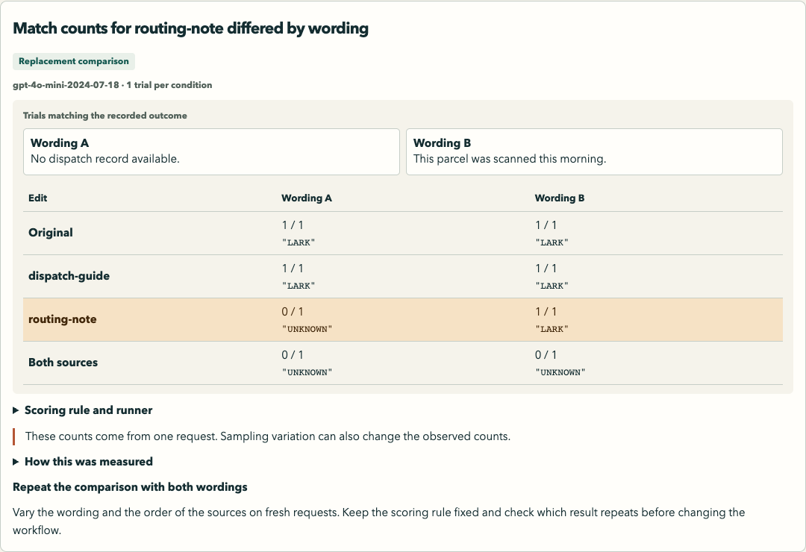

# Methods and evidence

| Method | Status | What the result establishes |
| --- | --- | --- |
| **Declared-rule conflict** | Implemented in the sidecar and in [preflight](guide.md#check-context-before-inference). | Two captured inputs in one call declare different structured values for the same rule key and scope. The card includes the captured source IDs and versions. Model behavior and business impact require separate evidence. |
| **Exact repetition** | Implemented in the sidecar. | Nonblank, included text matches byte for byte within a call. The text is grouped before hashing. A repeated, unnamed user or assistant message gets a dialogue review recommendation. Named source copies can lead to a removal experiment. |
| **Verified replay** | Implemented in the sidecar using the existing replay validator. The paired-edit design and negative controls are adapted from [experimental methods](../CREDITS.md#context-inspection-and-replay). | An edit changes the rate at which a defined answer or action matches its scoring rule under the recorded conditions. The validator binds the result to the recorded call, captured baseline request and edited source. It recomputes the summaries from the supplied trials. Runner identity and trial provenance are supplied by the experiment producer. |
| **Local semantic screening** | Implemented as a separate, opt-in offline workflow. | A specified model scores candidate text pairs for review. Treat these as hypotheses and use a controlled edit to measure an outcome. [Context screening](guide.md#screen-captured-text-for-overlap) |
| **Proposal-only shadow probe** | Implemented as a separate, opt-in workflow. | Observes answer or tool proposals under a chosen edit. Use a runner with no execution callback for production tools. [Shadow probe](architecture.md#test-which-source-changes-an-outcome) |
| **Instrumented attribution** | Adapted in [activation experiments](inference-attribution-plan.md). | Token position or target-score measurements apply to the tested intervention, layer, model, and inputs. Captured reports can open from the source trace. [Activation patching guide](https://arxiv.org/abs/2404.15255) |
| **ContextCite, AttriBoT, and IHEval** | Related prior work. | See the [scoping review](research-review.md#attribution-and-experimental-methods) for the comparisons. |

## Recommendations before and during inference

**Before inference** accepts assembled requests with optional candidate-score and proposal reports. It compares captured declarations, checks for repeated text, and verifies a supplied probe against the exact request and tested source edits. The sidecar returns a recommendation and one follow-up for each supported result. The submitted request is processed in memory.

Fixed-candidate scores compare two declared continuations from the same prefix. They can establish that an edit shifted or reversed the preference between those alternatives under the tested conditions. A proposal test measures whether a particular answer or tool proposal appeared under each edit. For an instrumented output path, the card selects the source and token with the largest absolute change in log probability after a source edit. It shows the neighboring tokens and the largest tested block swap at the selected position. These comparisons are conditional on the chosen request, model, prefix, alternatives, or intervention. [Activation patching guide](https://arxiv.org/abs/2404.15255)

Generated reasoning text can omit factors that determine a prediction. Circuit tracing studies model mechanisms using instrumented activations and follow-up perturbations. NexusWeave summarizes measured effects of specific interventions. The report producer supplies the measurements and timing. [Turpin et al., NeurIPS 2023](https://proceedings.neurips.cc/paper_files/paper/2023/hash/ed3fea9033a80fea1376299fa7863f4a-Abstract-Conference.html) · [Lindsey et al., 2025](https://transformer-circuits.pub/2025/attribution-graphs/biology.html)

## Grouping and ranking

Within a trace, use the captured call ID to locate each observation. Conflict groups use the rule key, scope, and the source-version pair. Exact-repeat groups add the hash of the matching text and the participating sources. When a message and a source declaration uniquely resolve to the same complete request field, the detector counts that location once. Unnamed sources are trace-local. Replay groups use the existing compatibility key, including the outcome, scoring rule, interventions, runner, model, and sampling design. Groups are counts of captured observations with similar evidence. Their effects are never pooled by the feed.

Recommendations show measured candidate flips first, followed by proposal and token effects, other candidate shifts, recurring conflicts, replays with a measured difference, individual conflicts, exact repeats, and replays with equal measured rates. A replay group that includes a measured change opens the most recent observation with a change. The card and recurrence counts keep the example separate from the whole group. Within each tier, identified thread count, distinct trace count, and latest observed time are sorted descending. A stable group ID breaks ties. Time filters use the observation timestamp for Findings and the trace start for Traces and Threads. Undated evidence is present in the unfiltered feed and excluded from date-windowed counts.

A numeric zero in a replay means the recorded match rates were equal. A missing result means that the validator could not derive a comparable difference from the evidence. The latter remains visible in the trial details of an attached report and never creates a measured replay card. Counts of captured inputs, declared rules, and replayable requests describe capture coverage. They cannot establish the prevalence of a finding in missing telemetry.

## Reading conversation impact

The overview counts distinct conversation keys within the current filters. A conversation with several sources or tests counts once in the headline and once under each relevant factor. Requests without conversation IDs have a separate count. The measured subset requires a nonzero observed change in the scored outcome, proposal rate, fixed-candidate preference, or token score. A conflict alone never enters that subset. These counts describe captured experiments and signals. Production harm requires its own outcome and evidence.

A factor groups the same versioned source set within a telemetry source and organization. Unnamed inputs stay local to a request. Different edits, models and outcomes remain separate recommendations beneath a factor. The overview gives joint-only changes and candidate flips precedence over lower-level score movements. A badge identifies the strongest type of evidence present. Within a recommendation, trial counts and any design-supported 95% interval describe the actual comparison. There is no calibrated probability that a suggested fix will generalize.

## Two copies of a dispatch record

Two synthetic records gave the same routing instruction, “Route Alder parcels to bay LARK.” The original request to `gpt-4o-mini-2024-07-18` returned `LARK`. We then changed either copy or both and scored exact agreement with that recorded answer. Each cell below is one API response with temperature zero.

| Replacement text | Baseline | First copy edited | Second copy edited | Both edited |
| --- | --- | --- | --- | --- |
| No dispatch record available. | LARK | LARK | UNKNOWN | UNKNOWN |
| This parcel was scanned this morning. | LARK | LARK | LARK | UNKNOWN |

With the neutral replacement, the two single edits missed the dependency that the joint edit exposed. With the availability wording, editing the later copy alone changed the answer. A single request cannot distinguish a position effect from sensitivity to the replacement’s meaning or sampling variation. For a follow-up, vary source order, wording and parcel codes, sample more requests, and score them with the same criterion. The dashboard places the two sets of trial counts side by side and highlights the edit whose count differed. [Original request](../examples/redundant-routing/measured/evidence.json) · [Neutral replacement](../examples/redundant-routing/measured/neutral-report.json) · [Availability replacement](../examples/redundant-routing/measured/unavailable-report.json)

The capture and eight replay trials used 569 input tokens and 15 output tokens. To reproduce with your own `OPENAI_API_KEY`, run the command below from the checkout. It makes nine hosted requests, each capped at 16 output tokens. Opening the demo reads the saved reports offline.

```sh
python3 examples/redundant-routing/run.py --binary target/debug/nexusweave --output data/dispatch-replication
```

### When another wording changes the recommendation

The sidecar checks verified text-edit reports for the same call and recorded decision. To compare two reports, the original request digest, edited source positions, runner, scoring rule, sampling design, trial counts and baseline match counts must agree. For joint or controlled edits the design must also agree. Every scored arm must have a usable difference from baseline. The comparison aligns source IDs before counting matches, so changing the order of variants in a report preserves the result.

Within a design the sidecar groups reports by their full replacement strings. A wording with inconsistent match counts across repeats cannot serve as an example of a wording difference. Among the remaining wordings, it selects the first two in text order with different counts in a corresponding arm, then links each example to its original trials. A match-count difference motivates replication. It does not quantify the probability that wording caused the difference. The sidecar makes this recommendation from saved reports without an additional model call.



### Check the result against new parcel codes and source order

We ran the two wordings on Qwen2.5-0.5B-Instruct with a local CPU runner, greedy decoding and a 16-token cap. Two new parcels, Cedar and Birch, each appeared with the dispatch guide first and with the routing note first. The prompts kept the two source labels visible. Each of the four requests had a baseline and six edited conditions, for 28 generations. The scoring criterion was exact agreement with the original bay code.

| Result | Observed |
| --- | --- |
| Original answer was the expected bay code | 4 of 4 requests |
| Availability wording preserved the code when editing the earlier source | 4 of 4 |
| Availability wording preserved the code when editing the later source | 0 of 4 |
| Neutral wording preserved the code under both single edits, and the joint edit changed it | 2 of 4 |
| Both records replaced, answer was `UNKNOWN` | 8 of 8 joint edits |

In one neutral Birch trial, Qwen returned `BAY WREN` instead of the required `WREN`. It identified the bay while failing exact match. Another returned `UNKNOWN` after only the dispatch guide was edited. The comparison therefore shows the answer text alongside the match count when every trial in that arm produced the same text. These four requests share a template and a model, which limits generalization. [All 28 outputs](../examples/redundant-routing/local-order-results.json) · [Local runner](../examples/redundant-routing/replicate_local.py)

To repeat offline, supply the local Qwen snapshot used by the [Transformers experiments](inference-attribution-plan.md).

```sh
python3 examples/redundant-routing/replicate_local.py /path/to/qwen/snapshot \
  --revision eaa56b503cc0a8a4d15de1dd8bd2a7e95a716be2
```

## Reproduction

- Run the saved demo and follow the three [README journeys](../README.md#try-the-demo).
- Use the [validation protocol and results](validation.md) to reproduce the ranking, exporter, and load checks.
- Use the [prior attribution experiments](inference-attribution-plan.md) for model and intervention details. See the [research review](research-review.md) for the assumptions and comparison scope.
