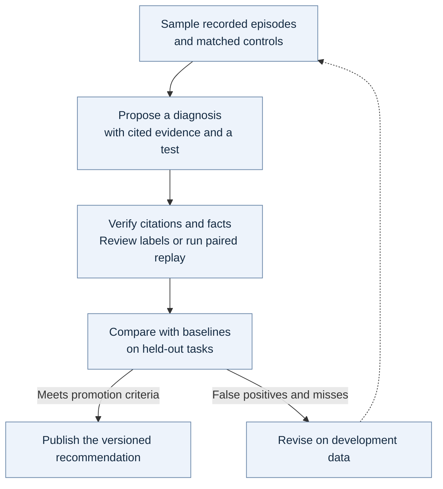

# Improve recommendations from workflow evidence

A recommendation should name a decision, the context that may explain it, and a test that could change our mind. A useful card can say that the evidence is too thin to recommend an edit. The dashboard can still show exact repeats on request.

## What similar systems already do

| Work | What it demonstrates | What NexusWeave should test |
| --- | --- | --- |
| [AgentRx paper](https://arxiv.org/abs/2602.02475v1) and [open implementation](https://github.com/microsoft/AgentRx/tree/7a18c79708e7671be15124460f4f7296107c2a55) | Synthesize step-level constraints, produce an auditable violation log, and localize failures with a model judge. | Compare evidence-guided diagnosis with direct prompting and programmatic checks. Use independently annotated steps where access permits. |
| [TRACE](https://arxiv.org/abs/2608.09153v1) | Mine historical trajectories and verify which context component to create or update. | Require the actual request source or a named capture gap for a proposed change. |
| [REFLECT](https://arxiv.org/abs/2606.09071v1) | Replay a targeted patch, then use the intervention result to refine the diagnosis. | Require an unchanged-request control and test the same outcome after one source edit. |
| [AgentDebugX](https://github.com/AgentDebugX/AgentDebugX) | Diagnose, attribute, prepare a recovery, and rerun it from an integrated CLI and web console. | Reuse its attribution and rerun outputs when a NexusWeave evidence adapter can retain exact provenance. |
| [AdaMAST runtime in ATLAS](https://github.com/multi-agent-systems-failure-taxonomy/ATLAS/tree/546687ad2289d3fe4865b7e02aa2413c8b99821b) | Learn a failure taxonomy from traces with exact evidence spans and a review step. Use it at checkpoints to decide whether to repair or continue. | Evaluate its categories and evidence references as inputs to an investigation. Keep source verification and outcome comparisons in NexusWeave. |
| [LangSmith Engine](https://www.langchain.com/blog/how-we-built-langsmith-engine-our-agent-for-improving-agents) | Review recurring patterns from production traces and turn them into evaluators. | Import model-generated and independently scored hypotheses with the same IDs used by the sidecar. |

These systems already do trajectory-level diagnosis and feedback. The NexusWeave research question is whether a small runtime service can connect exact context snapshots before inference to verified interventions and cross-session recommendations without adding model calls to ordinary telemetry intake.

## The proposed loop



1. Retain exact source snapshots and collect enough episodes of each pattern. Sample successes as controls. Match on task, workflow revision, and runner where IDs support it. Freeze a holdout before using outcome labels to tune a detector or prompt.
2. Run a bounded model job on the cited events. Ask it to name a concrete hypothesis, quote the relevant evidence, give a plausible alternative, and propose one safe test. An event without enough evidence should yield an abstention.
3. Use the repository’s normalized evidence and report validation to resolve IDs and verify observed claims. Keep judgments of actionability distinct from validation of a quote, a tool name or a time ordering. Replays run in isolation with a frozen checkpoint and independent outcome score.
4. Compare precision among the top five, abstention and coverage, citation validity, exact localization, and replay fidelity. Log cost, latency, and false positives by workflow and label. Use direct model prompting, frequency and deterministic checks as baselines. Hold out entire tasks and at least one workflow for transfer. A diagnosis supported by a run-level outcome alone remains a hypothesis.
5. Version the prompt, detector, dataset, and corrections. Use the previous development set to test a proposed change before promotion. Open the held-out results only after choosing a candidate. Keep approved workflow edits in the normal deployment process.

The proposed worker can run as a separately budgeted batch job. It reads a bounded sample and publishes a signed-off evidence record that the sidecar can serve. An engineer sees why the card appeared, where it recurred, and whether its test has run. Replaying a source edit requires a separately configured runner. Deployed workflows retain control of their prompts, tools and authorization.

## First reproducible trial

The Exgentic census found 437 calls across six workflows where a proposed tool name was absent from the captured named catalog. Some differences are consistent with namespace aliases. Some calls include a large catalog and very similar names. Both are useful controls against turning a string mismatch into a claim of workflow failure. [Exgentic import and measurements](scale-study.md)

The trial freezes a small stratified sample of recorded proposals. It starts with three labels that can be derived from the full captured catalog. An exact match warrants no action. A unique match after removing a known provider namespace warrants an alias check. An unlisted name warrants a catalog and dispatch check. These labels evaluate a narrow evidence task. They do not establish that a tool failed, that the catalog is complete, or that changing it improves a benchmark score.

The study asks a local model for a classification, evidence IDs, and one proposed test. It compares direct prompting with an evidence guide on AppWorld, BrowseCompPlus and retail. The better development prompt runs once on SWE-bench, airline, and telecom with no holdout tuning. An exact-name matcher supplies a baseline. Both the full catalog labels and the model's answers stay in the local study artifacts.

```sh
python scripts/census_tool_catalogs.py \
  --report data/scale/catalog-census.json data/scale/exgentic-v2/*.parquet

python scripts/study_catalog_diagnosis.py \
  --endpoint http://127.0.0.1:18059/v1/chat/completions --model default_model \
  --cases data/scale/catalog-diagnosis-cases.json \
  --report data/scale/catalog-diagnosis-report.json \
  data/scale/exgentic-v2/*.parquet
```

The trial makes zero paid model calls. The AgentRx and TRAIL dataset cards and papers are public; the raw evaluation files require Hugging Face access. Their labeled traces would support a separate localization benchmark after access is available. [AgentRx data](https://huggingface.co/datasets/microsoft/AgentRx) · [TRAIL data](https://huggingface.co/datasets/PatronusAI/TRAIL)

### Result and promotion decision

Gemma 3 4B in MLX scored 1 of 14 development cases with the direct prompt and 6 of 14 with the evidence guide. The guide was selected on development data. On 16 cases from the three held-out workflows it scored 4 of 16, with 7 responses that failed the structured contract. The exact-name baseline scored 10 of 16. This pilot uses a deliberately balanced sample, so these figures do not estimate production accuracy.

The model did not meet the promotion gate. Retain the simple catalog check as the baseline for exact facts. The next research pass should test recommendations about a decision that spans calls, where a model can add value by relating a tool result to a later proposal. Compare successful and failed controls with matched task context, require the actual tool-call and result IDs, and record whether the proposed test changes a verified outcome. Keep that new task’s holdout separate from these catalog cases.

## Second pass: follow a tool result into a later decision

The catalog pilot showed that a model adds little to an exact comparison. The second pass checked a temporal hypothesis across all 241,473 Exgentic calls. If an agent proposes the same tool with the same arguments after its earlier result has disappeared, keeping that result in context might prevent another lookup.

The detector requires an earlier recorded proposal, its result in a subsequent captured request, and a later proposal in the same trace and conversation lane. It checks the new request for the result by invocation ID and then by exact payload. It records the later result independently when another captured request contains it. Calls without the required evidence fall outside the comparison.

| Workflow | Same tool and arguments proposed again | Earlier result ID present | Same payload under another ID | Neither found among captured tool results |
| --- | ---: | ---: | ---: | ---: |
| AppWorld | 2,629 | 2,610 | 3 | 16 |
| BrowseCompPlus | 416 | 412 | 0 | 4 |
| SWE-bench | 3,675 | 3,662 | 2 | 11 |
| Airline | 323 | 323 | 0 | 0 |
| Retail | 191 | 191 | 0 | 0 |
| Telecom | 165 | 162 | 0 | 3 |
| **Total** | **7,399** | **7,360** | **5** | **34** |

These counts are proposals with evidence, so one session can contribute several. The result may also be represented in other context fields or in runtime state outside capture. “Same payload” compares the normalized JSON value, preserving the contents of strings. Tool names beginning with words such as `get`, `show`, or `read` provide a convenient sample of lookup-like calls. The prefix carries no guarantee about tool behavior.

### Test whether the earlier result helps

The replay verified exact trace, call, invocation, and payload identifiers against the sidecar. It used excerpts from the recorded inputs to reconstruct a local lookup decision for Gemma 3 4B. The model chose between requesting the lookup and reusing a result. Each case had three arms: baseline, restoration of the earlier matching result, and an unrelated recorded-result control. The runner emitted only those choices. The original benchmark models, full request templates, and tools were outside this experiment.

Of seven non-coding candidate episodes with no earlier payload in the later captured tool history, six had both a user request and a control result. The two cases with equal captured results still chose the lookup after restoration. Three telecom cases switched from lookup to reuse, even though the repeated lookup returned changed data. Two observed changes were to bill status and one was to the `data_refueling_gb` plan field. Across three runs with identical input digests, the restoration arm made the same choice in all six cases. The baseline varied in one AppWorld case, and the unrelated-result control varied in one telecom case. The control prompted reuse in two or three cases per run. The model's output alone would make a poor guard for a cached result.

A fixed retrieval corpus also has failure modes. BrowseCompPlus recorded 23 repeat calls whose matching results both contained an explicit error field. Five other repeat calls returned a result without that field after a prior error, and seven did the reverse. A fixed corpus makes a good setting to test a cached document, provided that both the document and the retriever revision are verified. [BrowseCompPlus benchmark](https://github.com/texttron/BrowseComp-Plus)

The replay rejects automatic reuse based on this signal. In a real workflow, a cached result needs freshness evidence appropriate to the tool and request. The next positive test needs two comparable cohorts: a versioned read with evidence that the underlying state is still current, and a mutable read with a verified state change. The first can test saved lookups while the second tests whether the workflow still refreshes state when it should.

```sh
python scripts/study_tool_result_retention.py \
  --report data/scale/tool-result-retention.json data/scale/exgentic-v2/*.parquet

python scripts/replay_tool_result_retention.py \
  --sidecar http://127.0.0.1:18058 --endpoint http://127.0.0.1:18059/v1/chat/completions \
  --cases data/scale/tool-result-retention.json --report data/scale/tool-result-replay.json
```

## Third pass: verify a result at the point of reuse

We tested whether the elapsed time between first seeing a tool result and proposing the same lookup predicts whether that result is still usable. The sample covers 2,175 pairs of captured responses across all six workflows. It requires lookups by name, identical arguments, both results present, and no recognized explicit error field in either result. These timestamps come from captured model requests, so they are a proxy for result age. The measured outcome is equality of the captured payloads.

The development set contains 1,746 pairs from AppWorld, BrowseCompPlus, and retail. One second was the most permissive candidate threshold with at least one matching reuse and no observed mismatches. It would have skipped 97 lookups in development. We kept that threshold fixed for the 429 pairs from airline, telecom, and SWE-bench. All eight airline reuses matched. In telecom, 22 of 31 reuses differed from the later result. No SWE-bench pair met the time threshold. We dropped the age rule because a short interval can still contain a state change.

### Compare revisions and verify bytes

The controlled replay takes each held-out pair and supplies an origin record with a scope, a revision, and a payload digest. The simulator schedules writes independently of the payload equality check. A write advances the revision even when it leaves the payload unchanged. It also tries a missing revision, a coincident revision under another scope, a write between the check and the conditional read, and a corrupted local payload.

| Policy | Observed behavior in the controlled transfer |
| --- | --- |
| Always fetch the full result | Performs a full lookup in every arm. |
| Reuse after a separate successful revision check | Reuses the old payload in all 429 concurrent-update trials. The new payload differs in 132. |
| Conditional read with a scoped revision and payload digest | Reuses the stored payload in all 429 unchanged trials. It fetches the current payload in the other six arms, including 297 writes whose later captured payload equals the earlier one. It also fetches when the stored bytes fail the digest check. |

The simulation tests decision rules against explicit state transitions using captured payload digests. A conditional read checks the scoped representation at the origin when it serves the result. A strong ETag is one established mechanism. Scope needs to include the resource and representation chosen by the tool and arguments, along with the application's authorization boundary. Any guarantee applies at the conditional read. [HTTP validators, RFC 9110](https://www.rfc-editor.org/rfc/rfc9110.html#name-validators) · [HTTP cache validation, RFC 9111](https://www.rfc-editor.org/rfc/rfc9111.html#name-validation)

A loopback HTTP fixture exercised this exchange on two recorded pairs from each of the six workflows. In all 12 unchanged controls, the origin returned `304` and the client served the verified cached bytes. It fetched the expected full payload in all 48 controls with a different scope, cache corruption, a revision change with unchanged bytes, or a write after an earlier successful check. Every case contacts the fixture origin. These checks establish transport behavior under the fixture's update rules. They measure neither production latency nor the outcome of an agent task.

### See the evidence in Before inference

The preview script resolves earlier and later results by trace, call, and invocation ID on the content sidecar. It checks the payload digests before constructing the pending request. For this historical comparison, the later captured payload supplies the expected digest. A live workflow would get the expected digest independently from its origin. The sidecar checks the assembled request and makes no model calls.

```sh
python scripts/study_tool_result_freshness.py \
  --report data/scale/tool-result-freshness.json data/scale/exgentic-v2/*.parquet

python scripts/preview_tool_result_freshness.py \
  --sidecar http://127.0.0.1:18058 --study data/scale/tool-result-freshness.json \
  --output-dir data/scale/freshness-preview

python scripts/check_conditional_tool_origin.py \
  --sidecar http://127.0.0.1:18058 --study data/scale/tool-result-freshness.json \
  --report data/scale/conditional-tool-origin.json
```

The preview verified 36 packets across the six workflows. On **Before inference**, open the telecom `different-cached` packet to inspect which fragment differs. Open the matching `different-refreshed` packet to verify the refreshed bytes. The `different-missing-anchor` packet shows missing evidence even though it carries those bytes.

## Fourth pass: does refreshing a tool result prevent a second charge?

The archive showed a changed `data_refueling_gb` value on a repeat telecom lookup. We tested the consequence in the pinned τ²-Bench telecom simulator. We screened all 2,285 tasks and found 1,120 with one reference top-up and a matching exact-amount assertion. This includes 38 train tasks, 12 test tasks, and 1,070 tasks outside those two splits. The scenarios reuse the same account, line and 2 GB top-up. [Pinned tasks](https://github.com/sierra-research/tau2-bench/blob/c06b07dd7c4d4ec61ba6ff9bcdf0b15dd7ef36d4/data/tau2/domains/telecom/tasks.json) · [How benchmark assertions are scored](https://github.com/sierra-research/tau2-bench/blob/c06b07dd7c4d4ec61ba6ff9bcdf0b15dd7ef36d4/docs/evaluation.md)

Each test replays the task's reference actions to the top-up step and holds the earlier `get_data_usage` response. In the update arm, another channel applies the authorized top-up through the simulator's tool before the agent acts. The unchanged arm leaves it due. The workflow either uses the cached result, always refreshes, or uses NexusWeave to verify the assembled fragment against the current result from the simulator. It then runs the same remaining reference actions and evaluates every original environment assertion. This is a controlled checkpoint experiment with scripted decisions and surroundings.

| Scripted decision input | Unchanged controls passing | Updated controls passing | Additional top-ups after another channel fulfilled the request |
| --- | ---: | ---: | ---: |
| Cached result | 1,120 / 1,120 | 0 / 1,120 | 1,120 |
| Always refresh | 1,120 / 1,120 | 1,120 / 1,120 | 0 |
| NexusWeave preview and refresh on mismatch | 1,120 / 1,120 | 1,120 / 1,120 | 0 |

The stale arm ended with 4 GB refueled and an additional simulated $4 charge in each updated case. All 6,720 scripted results reproduced. The preview arm reads the current value from the tool backend to establish the expected digest. This test measures request validation and task state. It offers no estimate of saved tool calls or the incidence of stale results in production.

### Refresh the request, then test dispatch separately

We gave a local Gemma 3 4B runner a constructed support turn and asked it to propose a 2 GB charge or finish without one. It proposed the charge for both the stale and refreshed tool results in all three repetitions. The 12 test checkpoints produce two unique model inputs per repetition. We ran each input once per repetition and applied its proposal to each corresponding checkpoint. With the refreshed result alone, all 12 updated checkpoints received a second charge. Checking the then-current refueling amount at dispatch blocked the same proposal in all 12, and all 12 unchanged controls still passed. This test uses the sequential simulator and a cacheable one-turn proposal. A production test should exercise a transaction-scoped idempotency key, concurrent requests, and the application's authorization policy.

In **Before inference**, upload `telecom-refuel-measured.json`. The recommendation names the fragment that differs from the origin. The source edit preserved the proposal. The attached sandbox comparison shows the same proposal taking the line from 2 GB to 4 GB without the dispatch check and leaving it at 2 GB with the check. The suggested next step is to test dispatch on authorized requests. The sidecar verifies that the report refers to the exact request and proposal. The local harness supplies the simulator outcomes.

The measured packet exposed a browser upload bug. Parsing and reserializing the file changed `2.0` to `2`, so the checkpoint digest no longer matched. The dashboard now forwards the uploaded JSON without reserializing it and shows text mismatches separately from unconfirmed source anchors.

### Reproduce the checkpoint study

Reuse the content study sidecar or run a fresh instance on loopback:

```sh
cargo build --locked
mkdir -p data/scale
target/debug/nexusweave sidecar --listen 127.0.0.1:18058 --db data/scale/telecom-preview.sqlite
```

From another terminal in the NexusWeave checkout, install the pinned simulator dependencies and run the study with Python 3.13:

```sh
TAU2_CHECKOUT="$(mktemp -d)"
git clone --filter=blob:none --sparse https://github.com/sierra-research/tau2-bench.git "$TAU2_CHECKOUT"
git -C "$TAU2_CHECKOUT" sparse-checkout set src/tau2 data/tau2/domains/telecom
git -C "$TAU2_CHECKOUT" checkout --detach c06b07dd7c4d4ec61ba6ff9bcdf0b15dd7ef36d4
uv sync --project "$TAU2_CHECKOUT" --frozen --no-install-project --python 3.13
uv pip install --python "$TAU2_CHECKOUT/.venv/bin/python" audioop-lts==0.2.2 pyarrow==21.0.0
mkdir -p data/scale

PYTHONPATH="$TAU2_CHECKOUT/src" LITELLM_LOCAL_MODEL_COST_MAP=True PYTHON_DOTENV_DISABLED=1 \
  "$TAU2_CHECKOUT/.venv/bin/python" scripts/study_telecom_refuel_freshness.py \
  --sidecar http://127.0.0.1:18058 --split full --report data/scale/telecom-freshness.json
```

Use `--split test --model-endpoint http://127.0.0.1:18059/v1/chat/completions --model default_model --packets data/scale/freshness-preview` to run the model comparison and generate a preview packet when the proposals are scorable. Set `--binary` if the built CLI is elsewhere. The sampler accepts loopback endpoints only. These runs made zero paid model calls. Promotion to production advice requires an independently scored transfer workflow with different accounts, tools and action effects.

The local MLX runner used 4-bit quantization with a group size of 64. These hashes identify the files used for the three repeated model runs. The upstream revision of this local copy is unconfirmed.

```text
b4bb1430e6090d163d33822dbad1c3e6cb16276f0c8f55cf27a6a240640bfa61  model.safetensors
ee036bd0fae8bb5791217540f33e0b85f6fd56db37218100ddea01c442fcee24  config.json
4667f2089529e8e7657cfb6d1c19910ae71ff5f28aa7ab2ff2763330affad795  tokenizer.json
```

## Fifth pass: compare the operation with the source change

The archived AppWorld runs include repeated reads of notes and payment requests. We tested those operations on task snapshots from the public AppWorld release. The simulator supplies the accounts, tool responses and database state. The experiment supplies a second actor and a fixed user intent. Each outcome is a state assertion checked after the real simulated API call. The script runs two intervention tests inside the task snapshots. It does not score completion of their original user instructions. [AppWorld paper](https://aclanthology.org/2024.acl-long.850/) · [AppWorld package and data setup](https://github.com/StonyBrookNLP/appworld#-installation)

**Payment request.** Pick an affordable pending request and bind the action to its ID. Approve it and verify that the simulator created exactly one transaction. Use that same state as the starting point for the retry control. Verify the original pending status against an up-to-date status projection, then send the stale proposal with its original ID. Measure the response, payer balance and outgoing transaction IDs. When another affordable request fills the list, test the different outcome of approving that request by list position.

**Shared note.** An agent needs to append a handoff to a note. The separate actor leaves the note unchanged, toggles its pinned status, or adds a line. Compare replacing the note from the saved copy, refreshing on any change to the three-field snapshot, refreshing only when the named content fragment changes, and using the API's native append operation. Success requires the note to retain the desired handoff, the intervening text or pinned status, and its original ID. The digest uses the encoded content string at its exact byte range. The simulator supplies the current value for both checks.

### Outcomes

We screened all 732 released task snapshots across 106 simulated accounts. The original splits contain 90 train, 57 dev, 168 normal test and 417 challenge test tasks. Accounts can recur across splits. The payment comparison ran on 713 snapshots, 571 of them in the test splits. Of 19 excluded snapshots, nine had no affordable pending request, eight gave no login token, and two had a payment list that referenced a missing user. The note comparison ran on 724 snapshots, 577 in the test splits. Five snapshots had no notes available and three gave no login token.

The simulator accepted every initial payment. It rejected all 713 retries against the original request ID and preserved the payer's balance and transaction set. The preview detected all 713 stale status fragments. Every refreshed pending list had another ID. A policy that selected an affordable replacement by list position created a different transaction in all 709 eligible cases. The other four lists had no affordable alternative. Advice to refresh the list needs to preserve the request ID. The API already enforces that ID's completed state in these tests.

| Note policy | Unchanged passed | Pin changed passed | Text changed passed | Pin changes that triggered refresh |
| --- | ---: | ---: | ---: | ---: |
| Replace from cache | 724 / 724 | 724 / 724 | 0 / 724 | 0 |
| Refresh on snapshot mismatch | 724 / 724 | 724 / 724 | 724 / 724 | 724 |
| Refresh on content mismatch | 724 / 724 | 724 / 724 | 724 / 724 | 0 |
| Native append | 724 / 724 | 724 / 724 | 724 / 724 | 0 |

All 724 text changes triggered both digest checks. Narrowing the comparison kept those detections and avoided refresh recommendations for the pin controls. Both arms read the current simulator state to calculate a digest, so the table counts refresh decisions rather than savings in backend reads. The native append outcome covers the sequential controls in this study. These checks do not estimate failure rates in production or concurrent transaction behavior.

Repeating the first 16 snapshots per split against the updated sidecar reproduced all 64 records, including exclusions, digest results and tool outcomes.

The dashboard now exposes the exact compared byte range when a fragment matches, alongside the ranges for differing fragments. That makes the narrower note check auditable. We kept refresh and dispatch actions out of the default policy because the appropriate action depends on the tool's contract and the declared target.

### Reproduce the transfer

Use a separate AppWorld directory and a built sidecar listening on loopback. The package downloads its public `data-0.1.0.bundle`. Use `--splits train dev` for development and `--splits test_normal test_challenge` for the test tasks. Each report retains task IDs, split manifests and account digests, alongside eligibility and measured outcomes. The preview packets stay under `data/scale/`.

```sh
APPWORLD_STUDY="$(mktemp -d)"
export APPWORLD_ROOT="$APPWORLD_STUDY"
uv venv --python 3.13 "$APPWORLD_STUDY/venv"
uv pip install --python "$APPWORLD_STUDY/venv/bin/python" appworld==0.1.3.post1 pyarrow==21.0.0
"$APPWORLD_STUDY/venv/bin/appworld" install
"$APPWORLD_STUDY/venv/bin/appworld" download data
mkdir -p data/scale

"$APPWORLD_STUDY/venv/bin/python" scripts/study_appworld_workflow_transfers.py \
  --sidecar http://127.0.0.1:18062 --packets data/scale/freshness-preview \
  --report data/scale/appworld-workflow-transfers.json
```

Upload the `appworld-note-metadata-snapshot.json` and `appworld-note-metadata-content.json` packets in **Before inference**. The first compares the entire projected record and shows a mismatch. The second compares the note text and matches. Expand the fragment details to see the different byte ranges. The payment packet shows that the stale status differs from the simulator. The payment retry outcome comes from the study's app-state checks.

### Prepare the ranking evaluation

The pinned MAST archive has 1,642 model-annotated rows across seven frameworks and eight benchmarks, with 1,537 distinct trajectory texts. Its 65 repeated-text groups must stay together when creating a holdout. Even adding model name to the public framework, benchmark and trace ID leaves 90 excess rows. Including the released trace key and index resolves those identities. The human file contains 19 entries. Three match an archived trajectory byte for byte. Keep all 19 as a standalone human reference set and prevent the three exact matches from appearing in development. Model-annotated categories support a separate, larger comparison of category agreement. [Pinned archive](https://huggingface.co/datasets/mcemri/MAST-Data/tree/95118ac951421753cf1deb87ddea3b01e693c41b) · [Annotation study](https://proceedings.neurips.cc/paper_files/paper/2025/hash/b1041e52d3be19f0a9bc491657488e4a-Abstract-Datasets_and_Benchmarks_Track.html)

Download both JSON files from the pinned revision into `data/scale/mast-95118ac/`. The audit verifies their hashes and reports the duplicated bodies and join counts. Its result reproduced exactly in a second run.

```sh
python scripts/audit_mast_archive.py data/scale/mast-95118ac --report data/scale/mast-archive-audit.json
```
