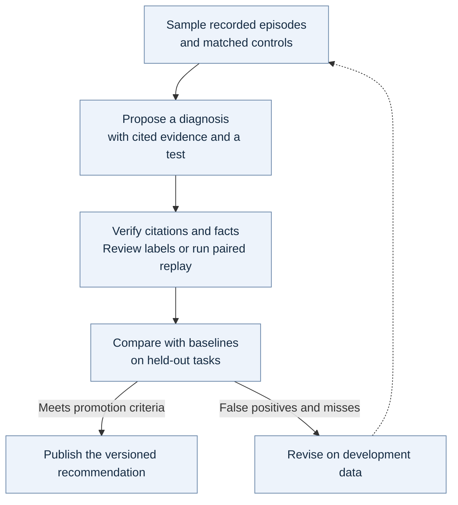

# Improve recommendations from workflow evidence

A recommendation should name a decision, the context that may explain it, and a test that could change our mind. A useful card can say that the evidence is too thin to recommend an edit. The dashboard can still show exact repeats on request.

## What similar systems already do

| Work | What it demonstrates | What NexusWeave should test |
| --- | --- | --- |
| [AgentRx paper](https://arxiv.org/abs/2602.02475v1) and [open implementation](https://github.com/microsoft/AgentRx/tree/7a18c79708e7671be15124460f4f7296107c2a55) | Synthesize step-level constraints, produce an auditable violation log, and localize failures with a model judge. | Compare evidence-guided diagnosis with direct prompting and programmatic checks. Use independently annotated steps where access permits. |
| [TRACE](https://arxiv.org/abs/2608.09153v1) | Mine historical trajectories and verify which context component to create or update. | Require the actual request source or a named capture gap for a proposed change. |
| [REFLECT](https://arxiv.org/abs/2606.09071v1) | Replay a targeted patch, then use the intervention result to refine the diagnosis. | Require an unchanged-request control and test the same outcome after one source edit. |
| [AgentDebugX](https://github.com/AgentDebugX/AgentDebugX) | Diagnose, attribute, prepare a recovery, and rerun it from an integrated CLI and web console. | Reuse its attribution and rerun outputs when a NexusWeave evidence adapter can retain exact provenance. |
| [LangSmith Engine](https://www.langchain.com/blog/how-we-built-langsmith-engine-our-agent-for-improving-agents) | Review recurring patterns from production traces and turn them into evaluators. | Import model-generated and independently scored hypotheses with the same IDs used by the sidecar. |

These systems already do trajectory-level diagnosis and feedback. The NexusWeave research question is whether a small runtime service can connect exact context snapshots before inference to verified interventions and cross-session recommendations without adding model calls to ordinary telemetry intake.

## The proposed loop



1. Retain exact source snapshots and collect enough episodes of each pattern. Sample successes as controls. Match on task, workflow revision, and runner where IDs support it. Freeze a holdout before using outcome labels to tune a detector or prompt.
2. Run a bounded model job on the cited events. Ask it to name a concrete hypothesis, quote the relevant evidence, give a plausible alternative, and propose one safe test. An event without enough evidence should yield an abstention.
3. Use the repository’s normalized evidence and report validation to resolve IDs and verify observed claims. Keep judgments of actionability distinct from validation of a quote, a tool name or a time ordering. Replays run in isolation with a frozen checkpoint and independent outcome score.
4. Compare precision among the top five, abstention and coverage, citation validity, exact localization, and replay fidelity. Log cost, latency, and false positives by workflow and label. Use direct model prompting, frequency and deterministic checks as baselines. Hold out entire tasks and at least one workflow for transfer. A diagnosis supported by a run-level outcome alone remains a hypothesis.
5. Version the prompt, detector, dataset, and corrections. Use the previous development set to test a proposed change before promotion. Open the held-out results only after choosing a candidate. Keep approved workflow edits in the normal deployment process.

The proposed worker can run as a separately budgeted batch job. It reads a bounded sample and publishes a signed-off evidence record that the sidecar can serve. An engineer sees why the card appeared, where it recurred, and whether its test has run. Replaying a source edit requires a separately configured runner. Deployed workflows retain control of their prompts, tools and authorization.

## First reproducible trial

The Exgentic census found 437 calls across six workflows where a proposed tool name was absent from the captured named catalog. Some differences are consistent with namespace aliases. Some calls include a large catalog and very similar names. Both are useful controls against turning a string mismatch into a claim of workflow failure. [Exgentic import and measurements](scale-study.md)

The trial freezes a small stratified sample of recorded proposals. It starts with three labels that can be derived from the full captured catalog. An exact match warrants no action. A unique match after removing a known provider namespace warrants an alias check. An unlisted name warrants a catalog and dispatch check. These labels evaluate a narrow evidence task. They do not establish that a tool failed, that the catalog is complete, or that changing it improves a benchmark score.

The study asks a local model for a classification, evidence IDs, and one proposed test. It compares direct prompting with an evidence guide on AppWorld, BrowseCompPlus and retail. The better development prompt runs once on SWE-bench, airline, and telecom with no holdout tuning. An exact-name matcher supplies a baseline. Both the full catalog labels and the model's answers stay in the local study artifacts.

```sh
python scripts/census_tool_catalogs.py \
  --report data/scale/catalog-census.json data/scale/exgentic-v2/*.parquet

python scripts/study_catalog_diagnosis.py \
  --endpoint http://127.0.0.1:18059/v1/chat/completions --model default_model \
  --cases data/scale/catalog-diagnosis-cases.json \
  --report data/scale/catalog-diagnosis-report.json \
  data/scale/exgentic-v2/*.parquet
```

The trial makes zero paid model calls. The AgentRx and TRAIL dataset cards and papers are public; the raw evaluation files require Hugging Face access. Their labeled traces would support a separate localization benchmark after access is available. [AgentRx data](https://huggingface.co/datasets/microsoft/AgentRx) · [TRAIL data](https://huggingface.co/datasets/PatronusAI/TRAIL)

### Result and promotion decision

Gemma 3 4B in MLX scored 1 of 14 development cases with the direct prompt and 6 of 14 with the evidence guide. The guide was selected on development data. On 16 cases from the three held-out workflows it scored 4 of 16, with 7 responses that failed the structured contract. The exact-name baseline scored 10 of 16. This pilot uses a deliberately balanced sample, so these figures do not estimate production accuracy.

The model did not meet the promotion gate. Retain the simple catalog check as the baseline for exact facts. The next research pass should test recommendations about a decision that spans calls, where a model can add value by relating a tool result to a later proposal. Compare successful and failed controls with matched task context, require the actual tool-call and result IDs, and record whether the proposed test changes a verified outcome. Keep that new task’s holdout separate from these catalog cases.
