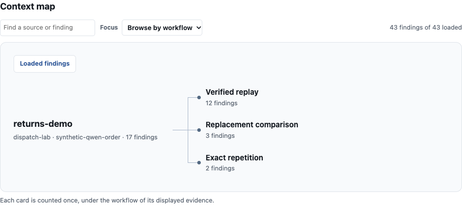
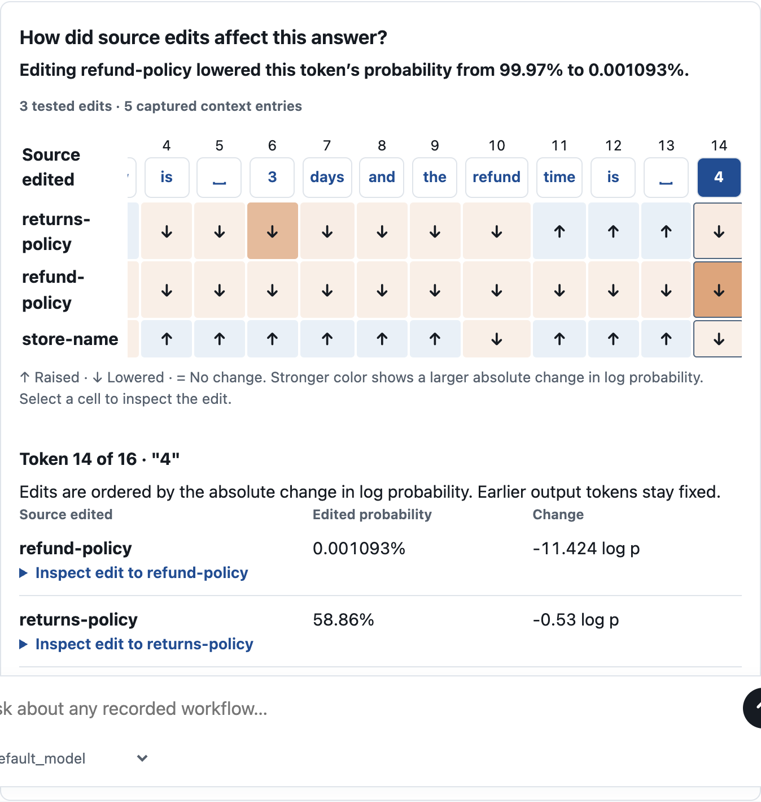
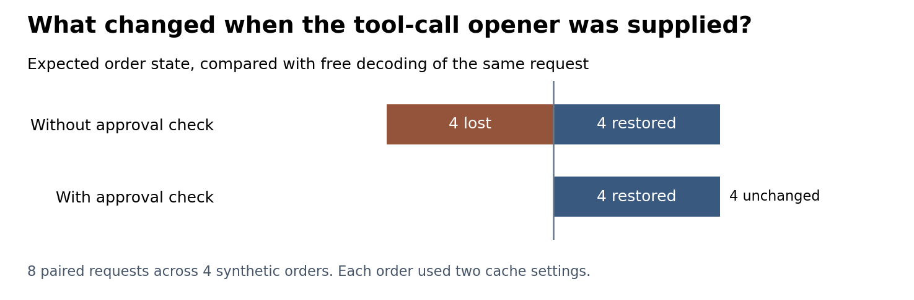

# What can we tell before an LLM answers?

A workflow engineer can check that the pending request contains a declared rule, see which sources disagree, and use an earlier replay to choose an experiment. Inferring which undeclared piece of knowledge is missing is a harder problem. Our first held-out detector missed 19 of 20 removed passages. We kept it out of the recommendation feed. [Experiment design, scores and reproduction](../examples/public-qa/annotation-gap.md)

## Follow a source through a workflow



Choose **Show the context map**. For up to 120 loaded nodes, the overview draws the relationships between sources, findings and outcomes. Larger maps open by workflow. Each branch counts every loaded finding once, using the workflow of the card’s representative evidence. Follow a workflow to a finding type, select a finding, then open the exact call. Loading another page updates counts in the current filter scope.

Select a source to see other findings that cite it. Matching a source uses its producer, organization, workflow, identifier, revision and role. Unnamed items stay tied to their call. Declared values come from captured instructions. Trial outcomes come from attached comparisons.

Select a first-token finding to compare the source edits before generation. For a candidate-score finding, the two branches show log odds at a fixed prefix. A token finding shows the original token’s probability before and after the named edit. In the example below, editing the refund policy reduced the probability assigned to the token `4` at output position 14 from 99.97% to about 0.0011%. The bar chart shows nearby token positions. The decoder-block swap is a separate measurement on the same output path.


Choose **Follow source edits across this answer** to see which edits mattered at different points in the same generation. In the recorded sentence, **returns-policy** has the largest measured effect on the return-window number at position 6. **refund-policy** has the largest effect on the refund time at position 14. Selecting a cell shows the exact edit, the score change at that prefix and both freely generated answers. Untested inputs appear below the measurements. From the recommendation detail page, the address includes the selected token and source edit so another engineer can open the same comparison.



Each cell compares two log probabilities for the same output token with all earlier output tokens fixed. The sign shows direction and the color intensity uses one scale for the entire answer. The report requires access to a model that can score edited requests. A workflow trace alone supplies no cell values. [Measurement and generation conditions](methods.md) · [Saved CPU measurements](../examples/runtime-comparison/output-token-report-transformers.json)

The example above contains 43 findings. A browser regression builds 2,400 synthetic finding cards across 60 workflows, pages through the workflow branches and opens the last finding and its source on desktop and mobile. This exercises client-side navigation. The layout groups related evidence for browsing. To investigate model internals, open the exchange demo’s **Before inference** view, select the measured request, then **Inspect both activation positions**. Each dot there represents one intervention at a known decoder block and token position. [Browser regression](../tests/context-network-browser.mjs) · [Walkthrough](demo.md#see-what-the-model-did-on-the-pending-request)

## Evidence ledger for 20 November 2026

| Question | Result | Engineering decision |
| --- | --- | --- |
| Can we detect a known rule capture gap? | With an explicit rule key and scope, preflight counts matching declarations and known values before inference. A request can have zero conflicts and zero declarations. | Show the missing capture before inference and direct the engineer to the request builder. [Preflight check](guide.md#check-context-before-inference) |
| Does the first-token distribution identify a useful passage to edit? | Editing the highest-ranked passage changed 14 of 17 scorable answers. Editing the first passage changed 11 of 17. Only five pairs differed on this outcome, with exact paired two-sided p = 0.375. Three pairs were unscorable. | Offer the ranking as an experiment selector. The holdout leaves its advantage over first position uncertain. [Paired holdout](../examples/public-qa/holdout.md) |
| Can the model warn that an undeclared passage is missing? | On 20 new questions, Qwen’s score for the instructed abstention flagged one missing request and the intact version of that question. Negative maximum BM25 also detected one missing request and flagged three intact ones. Both measures scored the missing variant higher in 8 of 20 pairs. | Keep both scores experimental. Two complete CPU runs reproduced the saved 60-prompt result, including the ten pilot pairs. [Omission study](../examples/public-qa/annotation-gap.md) |
| What did a tested internal change affect? | On the held-out exchange request, swapping one vector at the supplied tool-call prefix shifted the score by up to −0.55 log odds for the cache edit and +0.74 for the customer edit. No tested swap reversed the token preference. | Expose the block, position, baseline, patched score and self-swap together. Check generated arguments separately. [Exchange measurements](demo.md#see-what-the-model-did-on-the-pending-request) |

For the passage ranking, the statistic is Jensen–Shannon divergence between the next-token distributions of the original request and the edited request. For a block intervention, the statistic is the change in log odds between two specified tokens at a fixed prefix. Neither quantity identifies a complete computation. An ordinary provider trace supplies no intermediate activations. The research contribution we can test is whether linking these limited measurements back to sources and workflow outcomes helps engineers choose better interventions. Existing attribution and circuit-tracing methods already address parts of that question. [Methods](methods.md) · [Scoping review](research-review.md) · [Activation patching guide](https://arxiv.org/abs/2404.15255v1) · [Circuit tracing methods](https://transformer-circuits.pub/2025/attribution-graphs/methods.html)

## What the next two studies changed

Removing the annotated passage still left sufficient evidence for a plausible answer in eight of twelve pairs, according to a score-blind AI review. A pre-answer support question caught one of the three requests that lacked an identified answer and flagged six of twenty supported requests. One uncertain request was excluded. On 48 human-labeled, single-paragraph SQuAD questions, the same threshold caught 15 of 24 unsupported questions and flagged one of 24 supported questions. These samples do not establish a reliable general alert for a production retriever. [Paired support study](../examples/public-qa/support-review/README.md) · [Independent benchmark](../examples/public-qa/support-review/transfer/README.md)

## From a support guess to a measured edit

We used the reviewed evidence sets to choose the smallest group of passages whose removal would break every identified route to an answer. Each question also got a control edit touching the same number of unrelated passages, chosen for similar length and position. Qwen’s greedy answer changed after the evidence edit on ten of twelve questions and after the control edit on six. Five answers changed only after the evidence edit. One changed only after the control edit. Five changed under both edits and one stayed the same throughout. All 36 generations completed. [Frozen selection and matching procedure](../examples/public-qa/support-review/witness-edits/protocol.md) · [Outputs and reproduction](../examples/public-qa/support-review/witness-edits/README.md)

One evidence edit only changed quotation marks. Only two original answers contained a reference alias. An automatic recommendation based on a text difference would give punctuation the same weight as a change of answer. The current actionable results are the *specific observed edits*, with their original outputs and controls available for review.

## Does a pre-answer source ranking find a change in business state?

In eight new synthetic exchange requests, the pre-answer divergence ranking selected the latest customer wording every time. Before enforcing approval, the selected edit changed the pending order on four requests. The first listed edit did so on one. Two wording edits restored the requested hold and the reverse edits lost it. Choosing the latest customer message directly would have selected the same eight edits at zero scoring cost. With the example adapter and an approval check at dispatch, all 32 edits preserved the final order state. These eight requests are paired wordings of one workflow. [Registered design, local measurements and reproduction](../examples/exchange-approval/dispatch-study/README.md)

Changing only the tool parser changed which four requests the top edit affected. The example adapter accepted 30 of 40 generations as executable tool calls. Requiring the inner payload to parse as JSON accepted eight. Applying the same approval gate still left twelve final states that differed between parsers. A production replay therefore needs the actual parser and dispatch policy as well as the model and prompt. [Per-arm evidence](../examples/exchange-approval/dispatch-study/results.json) · [Offline parser replay](../examples/exchange-approval/dispatch-study/compare_parsers.py)

For a known staging requirement, preflight now checks whether at least one complete set of named source fragments is anchored in the request. An exchange can be configured to require the cache and latest customer message together, or an independent consent event. With a matching version-two receipt, the sidecar also groups repeated gaps across conversations and links back to the calls. A successful check establishes that the configured IDs are present. The live authorization decision still belongs at dispatch. [Check alternative sources](guide.md#check-alternative-sources-before-dispatch)

## What did an independent agent runtime actually execute?

Qwen-Agent’s native tool parser and registered tool callback replayed the same 40 previously generated responses. It recognized 30 tool calls, rejected 22 argument payloads and executed eight. Relative to the original adapter, the pending state differed on 12 of 40 trials even with the approval gate enabled. Source sensitivity changed with the execution stack. The ranked edit affected four approved requests under Qwen-Agent and four held requests under the original ungated adapter.

Of those four approved exchanges, the ranked edit restored two expected writes and lost two. Counting any changed outcome would have reported all four as successes. For a recommendation to say that an edit helped, the workflow needs to supply its expected outcome.

The harness exported 236 application-instrumented OpenTelemetry spans to a disposable sidecar across 80 traces and eight threads. The two dispatch policies reused the same generated text. The exporter captured stage boundaries without prompt or response bodies. These spans establish where a proposal stopped. They cannot establish which context the model used. [Framework implementation, saved receipts and sidecar check](../examples/exchange-approval/dispatch-study/framework/README.md)

## Does the ranking transfer to a second workflow?

We allowed one fresh local generation after each of the 22 argument rejections. Every retry produced plain text. Twelve approved exchange trials still lacked their expected write. The pre-answer ranking picked the latest customer message on all eight requests. A selector based only on message position would have tested the same edits on these requests. The result supports keeping model-based ranking opt-in. [Per-request figure, retry protocol and reproduction](../examples/exchange-approval/dispatch-study/framework/README.md#what-happened-when-the-model-could-try-again)

We froze five trial-zero checkpoints from Sierra’s public airline submission. Each follows a linked reservation lookup and stops immediately before an agent response. Across those checkpoints, all 19 controlled substitutions kept their source ID and passed the name-only preflight check. With independently pinned text digests, preflight flagged all 19 substitutions, distinguished all 19 missing-anchor controls, and passed all five intact requests. The source ranges were disjoint in each request. This measures whether exact upstream text survived assembly. It requires the workflow to know which text to expect. [Frozen checkpoints](../examples/airline-transfer/selection.json) · [Capture results](../examples/airline-transfer/capture-results.json)

To reproduce the capture comparison after downloading the pinned inputs, build the CLI and run:

```sh
cargo build --locked
python3 examples/airline-transfer/check_capture.py --data /tmp/airline-study --binary target/debug/nexusweave --check
```

To inspect a substitution yourself, export one reconstructed request and choose it in the dashboard’s **Before inference** view. Task 32 replaces a reservation lookup with a placeholder while preserving its source label. Open **Inspect differing fragments** to see the JSON field, its byte range and the two digests. The file contains public simulated conversation history.

```sh
python3 examples/airline-transfer/check_capture.py --data /tmp/airline-study --request 32 lookup > /tmp/airline-lookup.json
```

On those five airline requests, the most disruptive edit at the first token was always the latest customer message. Choosing by recency would have selected exactly the same five edits. Only one unchanged Qwen generation finished within 128 tokens. It gave a text reply where the recorded agent proposed transferring the customer to a human. No completed baseline reproduced a historical tool call. The outcome comparison has one scorable request and four unknowns. [Per-request results, scoring and CPU costs](../examples/airline-transfer/README.md)

Doubling the generation limit recovered three of the four truncated replies. Each completed with text on a checkpoint where the historical agent had used tools. All four longer runs reproduced their earlier 128-token prefixes exactly. We stopped before running more source edits with this runner. [Budget comparison and all four stop reasons](../examples/airline-transfer/baseline-budget.md)

This changes the order of an investigation. To explain a specific historical action, first try the unchanged request with the proposed runner, parser and match rule. The replay CLI now supports a baseline-only check. On fresh workflow evaluations, record expected outcomes separately so that a different valid proposal can receive credit. Automatic edit selection remains opt-in. [Baseline check](guide.md#test-a-context-item-with-a-controlled-replay)

## Did fixing the conflicting source fix the workflow?

Four fresh exchange conversations put the latest customer instruction in conflict with a cached consent record. The original and repaired requests went through Qwen-Agent’s own tool prompt, model transport, parser, argument validator and an isolated two-order SQLite database. Refreshing only the cache cleared the preflight conflict on all four requests. One reply changed wording. None of the eight replies proposed a tool call, and both approved exchanges remained unsubmitted. The four unchanged baselines reproduced exactly in a fresh process. Passing a known valid write through the same callback confirmed that the sandbox could execute it.

On the desk fan order, the assistant promised to submit the exchange in both conditions. The parser received text and the order stayed delivered. An engineer could correctly close the instruction-conflict finding and still need to investigate why no tool was invoked. [Frozen repair, expected outcomes, per-arm requests and execution receipts](../examples/exchange-approval/dispatch-study/prospective/README.md)

Changing the tool-call example by two braces changed two of eight replies, both on the desk fan order. One renderer made the assistant name the right tool in prose. Across both renderers the native parser received zero calls in 16 completed generations. Neither rendering changed a database outcome. The two cache states of one order are paired measurements. [Frozen renderer comparison and reproduction](../examples/exchange-approval/dispatch-study/rendering/README.md)

## What happened when we supplied the first two assistant tokens?

We gave the same model the opening tool-call tag and a newline. It generated the rest freely, including the tool name, four argument values and closing tag. All eight previously uncalled requests produced a valid exchange call. Only the four approved requests called the right tool. The two cache settings yielded identical output tokens for each order.



The overall ungated state score stayed at four of eight. Every approved request improved, and every held request got worse. The dispatch check blocked the four incorrect writes and allowed the four correct ones. A recommendation based on the count of valid tool calls alone would have missed every incorrect write. Supplying the first two tokens tests a specific intervention on previously observed failures. Recovering the arguments under that intervention leaves open why free generation originally chose prose. [Frozen design, repeat and parser receipts](../examples/exchange-approval/dispatch-study/prefill-tool/README.md) · [Figure from saved results](../examples/exchange-approval/dispatch-study/plot_prefix_states.py)

## Which experiment would justify a pre-deployment recommendation?

We isolated one field on the four exchange orders. Changing a single lookup digit changed exactly one generated token in the payment argument on every order. A same-size punctuation edit elsewhere changed none. Before inference, the sidecar flagged all four substitutions using the expected payment ID digest supplied by the workflow. After inference, all four substituted IDs passed the tool schema and failed the simulator’s order check. This is evidence that the lookup controlled that argument on this forced tool-call branch. [Inspect the pending request and reproduce the generations](../examples/exchange-approval/dispatch-study/lookup-field/README.md)

Use an independently maintained simulator with a recorded expected action and final state. BFCL V3 is one candidate. First verify that the unedited runner can complete examples that require a write and examples that require leaving state alone. Save the parser version, exact request and database or simulator checkpoint for each case.

Before viewing the held-out completions, freeze one source-selection rule, a cheap baseline such as choosing the latest message, and the allowed edits. Score whether each selected edit restores or loses the expected action and state. Keep failures to finish and mismatches on the unchanged input visible. If the selectors choose the same sources, the study cannot establish an advantage for model scoring. The result that would justify a recommendation is more correct downstream outcomes on new workflows at a measured cost. [Earlier source-ranking result](../examples/exchange-approval/dispatch-study/README.md) · [BFCL V3 evaluation](https://gorilla.cs.berkeley.edu/blogs/13_bfcl_v3_multi_turn.html)

## Release scope

A source preview can ship the deterministic checks, trace adapters, UI and reproducible experiments. The sidecar and browser journeys have scripted fixture coverage. The release still needs a completed hosted CI run. GitHub declined to start the runners for the last validation push. The public QA examples now include upstream data notices and an article index for the 62 questions used in the passage studies. The SQuAD transfer example ships identifiers, labels, hashes and measurements, with the full text downloaded separately for reproduction. [QA data credits](../examples/public-qa/data-credits.md) · [SQuAD source and license](https://rajpurkar.github.io/SQuAD-explorer/)

Inference accuracy and deployment cost require separate evidence on the target workflow. [Validation and resource measurements](validation.md) · [Dataset and software credits](../CREDITS.md)

The remaining usability check requires an engineer who has never used NexusWeave. Give them the saved exchange demo and ask, “Did refreshing consent fix the order? Show what happened to the pending order and where you found it.” Record their first action, whether they find both the conflicting sources and the SQLite receipt, and where they need help. Desktop and mobile scripts exercise those controls. We have yet to observe an unfamiliar engineer complete this task.
