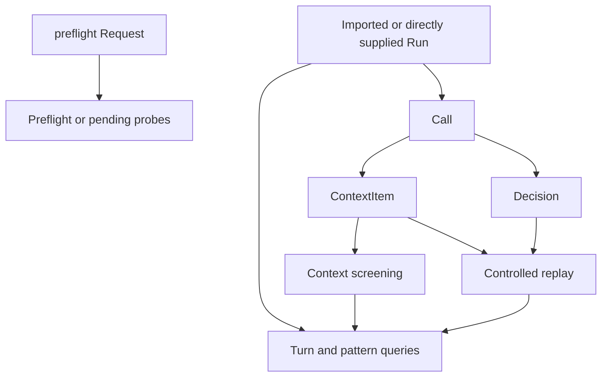

# Rust package

NexusWeave exposes the same inspection and replay functions used by its CLI. Use the crate to check a pending request in process, import a recorded trace, or supply your own model runner for an experiment.

## Use the package from a checkout

To install the CLI, run this from the repository root with a stable Rust toolchain.

```sh
cargo install --locked --path .
```

To depend on the library, run this from your Rust application's directory, with the NexusWeave checkout in a sibling directory.

```sh
cargo add nexusweave --path ../NexusWeave
```

Generate the API reference from the NexusWeave checkout. The crate homepage has a runnable trace import. The `preflight::check` and `context_screening::screen_pending` pages have runnable pending-request examples.

```sh
cargo doc --locked --no-deps --open
cargo test --locked --doc
```

## How the data fits together



A `Run` carries optional organization, user, and conversation IDs. Each `Call` carries its own ID and an optional turn ID. Source IDs and versions connect copies of a source across calls. A `replay::Location` selects one run, call, and decision. An intervention then names a context item and where to edit it in the captured request. [Evidence schema](../schema/evidence-1.json) · [Example replay case](../examples/context-screening/replay/case.json)

## Find the API for your task

| Task | Entry point | Input and result |
| --- | --- | --- |
| Inspect an assembled request | `pending::inspect` | Pass a pending request and optional existing reports. Read captured sources, matching request locations, and report verification. [Inspect an assembled request](guide.md#inspect-an-assembled-request) |
| Check a pending request | `preflight::check` | Pass a `preflight::Request` with captured attributes and source declarations. Read the findings and optional receipt. [Preflight guide](guide.md#check-context-before-inference) |
| Screen captured text pairs | `context_screening::screen_pending`, `context_screening::screen_call` | Pass a request or captured call, a selection, and a scorer callback. Read exact reuse and model-scored pairs with captured source references. [Context screening](guide.md#screen-captured-text-for-overlap) |
| Compare recurring screened pairs | `context_screening::patterns::query`, `context_screening::patterns::query_with_replays` | Pass a query and scoped runs. Include saved reports to read verified replay coverage and links to tested decisions. [Replay coverage](guide.md#compare-replay-coverage-on-recurring-pairs) |
| Inspect recorded calls | `otlp::import`, `langsmith::import`, `inspect` | Import trace JSON or deserialize versioned evidence into `Vec<Run>`. Pass the runs to `inspect` to derive findings, context links, source profiles, and verified probe evidence. [Evidence schema](../schema/evidence-1.json) |
| Get one turn or group findings | `turn_evidence::query`, `conflict_query::query` | Pass the runs and a query. Turn queries return evidence for the selected call or decision. Conflict queries return counts and contributing calls. Pass only the runs the caller may read. [Turn query schema](../schema/turn-evidence-request-1.json) · [Conflict breakdown](guide.md#group-recurring-conflicts) |
| Follow a source across calls | `source_profiles::query::query` | Pass scoped runs, saved replays and runtime reports, and a source query. Read capture coverage, declared conflicts, and measurement links for each occurrence. [Source history](guide.md#follow-a-context-source-across-sessions) |
| Score two pending alternatives | `replay::candidates::execute` | Pass the pending request, a case, and a scorer that returns the log probabilities of both continuations for each condition. Read original and edited margins. [Scorer contract](guide.md#connect-another-scoring-runtime) |
| Compare pending proposals | `replay::shadow::execute` | Pass the pending request, a case with a declared outcome, and a callback that returns each proposal before dispatch. Read the per-trial results and match-rate shifts. [Runner contract](guide.md#connect-another-proposal-runner) |
| Validate a pending proposal experiment | `replay::shadow::validate_case` | Pass the same pending request and case to verify the outcome criterion and request edits before sampling. The local planner uses `POST /api/shadow-check` with `request` and `case`. [Prepare a shadow probe](guide.md#prepare-a-shadow-probe-from-captured-sources) |
| Find repeated probe effects | `replay::candidates::patterns::query`, `replay::shadow::patterns::query` | Pass captured runs and a probe pattern query. Compare one scope or two, then use a group key to read the contributing turns. [Candidate shifts](guide.md#find-recurring-candidate-preference-shifts) · [Shadow proposal shifts](guide.md#find-recurring-shadow-proposal-shifts) |
| Replay a recorded decision | `replay::execute` | Pass the case, captured runs, and a callback that samples each verified request variant. Read the trials and their effects relative to a reproduced baseline. [Controlled replay guide](guide.md#test-a-context-item-with-a-controlled-replay) |

An `Inspection<'_>` references its input runs. Keep the runs in scope while using the inspection, or serialize the inspection if you need an owned result. The preflight and analysis functions operate on supplied data. For probes and replay, the caller provides the inference callback and controls how the model is called.

Workflows in other languages can use the CLI, the local HTTP endpoints, or an MCP client with the same versioned inputs. [Integrate a workflow](architecture.md#integrate-with-a-workflow) · [Connect an MCP client](guide.md#connect-an-mcp-client)
