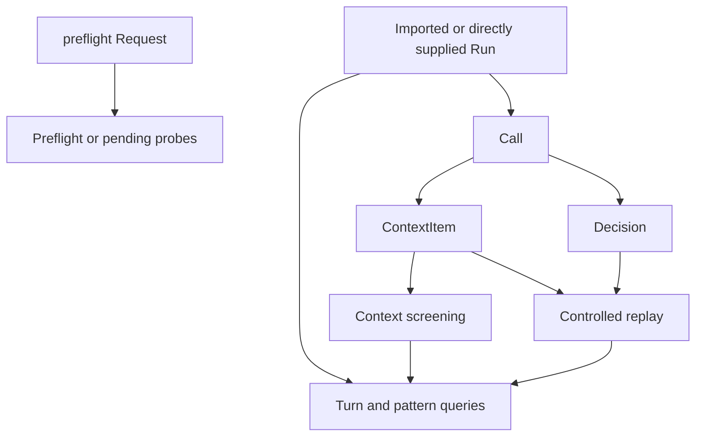

# Rust package

A2Context exposes the same inspection and replay functions used by its CLI. Use the crate to check a pending request in process, import a recorded trace, or supply your own model runner for an experiment.

[Install from a checkout](#use-the-package-from-a-checkout) · [Trace a finding in Rust](#trace-a-finding-in-rust) · [Choose an API](#find-the-api-for-your-task)

## Use the package from a checkout

To install the CLI, run this from the repository root with a stable Rust toolchain.

```sh
cargo install --locked --path .
```

To depend on the library, run this from your Rust application's directory, with the A2Context checkout in a sibling directory.

```sh
cargo add a2context --path ../A2Context
```

Generate the API reference from the A2Context checkout. The crate homepage has a tested example that links a pending finding to a recorded turn and groups it in a user scope. The `preflight::check` and `context_screening::screen_pending` pages have smaller runnable examples.

```sh
cargo doc --locked --no-deps --open
cargo test --locked --doc
```

## Trace a finding in Rust

The crate-level example uses a pending request with a 30-day company policy and a 60-day archived FAQ. The saved LangSmith span records the same request and a 60-day answer. [Read the tested example](../src/lib.rs) · [Pending request](../examples/preflight-returns.json) · [Saved LangSmith span](../examples/preflight-returns-langsmith.json)

1. Deserialize `preflight::Request` and call `preflight::check`. It returns a conflict for `return_window_days` in the `standard` scope and a receipt for the request and declarations.
2. Pass the recorded span to `langsmith::import`, then call `inspect` with the normalized runs. `Verification::Matched` confirms that the saved receipt belongs to the same captured request and declarations.
3. Call `conflict_query::query` with `phase: "preflight"` for the example user. The response counts one conflicting check in one conversation. Use the group key to fetch the contributing calls, then pass `run_id` and `call_id` to `turn_evidence::query` to return to the evidence.

To measure how the decision responds to a source edit, pass your own runner to a probe or the replay API. The checks and queries above run on supplied data. [Choose a measurement](architecture.md#test-which-source-changes-an-outcome)

## How the data fits together



A `Run` carries optional organization, user, and conversation IDs. Each `Call` carries its own ID and an optional turn ID. Source IDs and versions connect copies of a source across calls. A `replay::Location` selects one run, call, and decision. An intervention then names a context item and where to edit it in the captured request. The Rust structs and the versioned JSON schemas serve the CLI, HTTP, and MCP integration paths. [Evidence schema](../schema/evidence-1.json) · [Example replay case](../examples/context-screening/replay/case.json)

## Find the API for your task

| Task | Entry point | Input and result |
| --- | --- | --- |
| Inspect an assembled request | `pending::inspect` | Pass a pending request and optional existing reports. Read captured sources, matching request locations, and report verification. [Inspect an assembled request](guide.md#inspect-an-assembled-request) |
| Compare source edits at a supplied prefix | `replay::candidates::prefix_reviews` | Pass verified candidate and shadow probe records for the call. An optional `reference_target` adds a separate per-edit reference grade and the forecast for the uniquely selected edit. The result contains single-edit preference reversals, source excerpts, matching free-generation counts and a trial verdict (`confirmed`, `disagreed`, `unresolved`, `untested`, `mixed`, `unselected_change` or `no_selection`). `pending::inspect` exposes the same `prefix_reviews` array. [Saved example](sidecar.md#compare-source-edits-at-a-supplied-answer-prefix) |
| Prepare a two-proposal source test | `replay::candidates::prefix_trial_case` | Pass the pending request, its candidate report and your runner ID. The function validates the score and returns a shadow case for one selected edit. `test-prefix` runs the two proposals and writes a checked input. [Runnable workflow](sidecar.md#test-a-suggested-source-before-seeing-the-answer) |
| Page through pending evidence | `pending::evidence` | Pass the same input with a page size and optional excerpt request. Read the source anchors and verified findings used by MCP clients. [Pending MCP tools](guide.md#inspect-pending-requests-through-mcp) |
| Check a pending request | `preflight::check` | Pass a `preflight::Request` with captured attributes and source declarations. Read the findings and optional receipt. [Preflight guide](guide.md#check-context-before-inference) |
| Screen captured text pairs | `context_screening::screen_pending`, `context_screening::screen_call` | Pass a request or captured call, a selection, and a scorer callback. Read exact reuse and model-scored pairs with captured source references. [Context screening](guide.md#screen-captured-text-for-overlap) |
| Compare recurring screened pairs | `context_screening::patterns::query`, `context_screening::patterns::query_with_replays` | Pass a query and scoped runs. Include saved reports to read verified replay coverage and links to tested decisions. [Replay coverage](guide.md#compare-replay-coverage-on-recurring-pairs) |
| Inspect recorded calls | `otlp::import`, `langsmith::import`, `inspect` | Import trace JSON or deserialize versioned evidence into `Vec<Run>`. Pass the runs to `inspect` to derive findings, context links, source profiles, and verified probe evidence. [Evidence schema](../schema/evidence-1.json) |
| Get one turn or group findings | `turn_evidence::query`, `conflict_query::query` | Pass the runs and a query. Turn queries return evidence for the selected call or decision. Conflict queries return counts and contributing calls. Pass only the runs the caller may read. [Turn query schema](../schema/turn-evidence-request-1.json) · [Conflict breakdown](guide.md#group-recurring-conflicts) |
| Follow a source across calls | `source_profiles::query::query` | Pass scoped runs, saved replays and runtime reports, and a source query. Read capture coverage, declared conflicts, and links to exact runtime measurements, including decoder-block swaps. [Source history](guide.md#follow-a-context-source-across-sessions) |
| Compare decoder-block effects | `activation::patterns::query::query` | Pass a block, validated reports, and one or two selections. Read counts and contributing calls for matching interventions and output contrasts. [Activation comparisons](guide.md#query-activation-effects-through-mcp) |
| Rank source edits before the first token | `replay::prefill::measure` | Supply an assembled request, named interventions and a batch-scoring function. The returned preflight request carries each source’s verified request binding and adapter-reported divergence. |
| Score two pending alternatives | `replay::candidates::execute` | Pass the pending request, a case, and a scorer that returns the log probabilities of both continuations for each condition. Read original and edited margins. [Scorer contract](guide.md#connect-another-scoring-runtime) |
| Cross instructions and tools on a scored request | `replay::prefill::routing::measure` | Provide a `Design`, runner identity and proposal callback. Load the returned preflight request in the dashboard or attach its report to the original span. [Routing trial contract](sidecar.md#test-instruction-text-and-tool-definitions) |
| Compare pending proposals | `replay::shadow::execute` | Pass the pending request, a case with a declared outcome, and a callback that returns each proposal before dispatch. Read the per-trial results and match-rate shifts. [Runner contract](guide.md#connect-another-proposal-runner) |
| Validate a pending proposal experiment | `replay::shadow::validate_case` | Pass the same pending request and case to verify the outcome criterion and request edits before sampling. The local planner uses `POST /api/shadow-check` with `request` and `case`. [Prepare a shadow probe](guide.md#prepare-a-shadow-probe-from-captured-sources) |
| Find repeated probe effects | `replay::candidates::patterns::query`, `replay::shadow::patterns::query` | Pass captured runs and a probe pattern query. Compare one scope or two, then use a group key to read the contributing turns. [Candidate shifts](guide.md#find-recurring-candidate-preference-shifts) · [Shadow proposal shifts](guide.md#find-recurring-shadow-proposal-shifts) |
| Replay a recorded decision | `replay::execute` | Pass the case, captured runs, and a callback that samples each verified request variant. Read the trials and their effects relative to a reproduced baseline. [Controlled replay guide](guide.md#test-a-context-item-with-a-controlled-replay) |
| Compare recurring controlled replays | `replay_effects::query::query` | Pass scoped runs, validated reports, and a query. Compare one or two selections, then use a group key to read the contributing comparisons. [Replay effect query](guide.md#query-replay-effects-through-mcp-or-http) |

An `Inspection<'_>` references its input runs. Keep the runs in scope while using the inspection, or serialize the inspection if you need an owned result. The preflight and analysis functions operate on supplied data. For probes and replay, the caller provides the inference callback and controls how the model is called.

Workflows in other languages can use the CLI, the local HTTP endpoints, or an MCP client with the same versioned inputs. [Integrate a workflow](architecture.md#integrate-with-a-workflow) · [Connect an MCP client](guide.md#connect-an-mcp-client)
