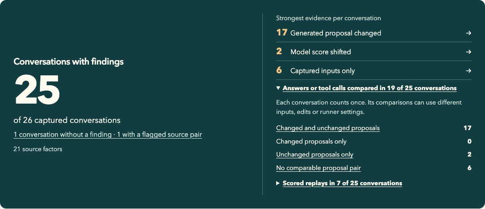
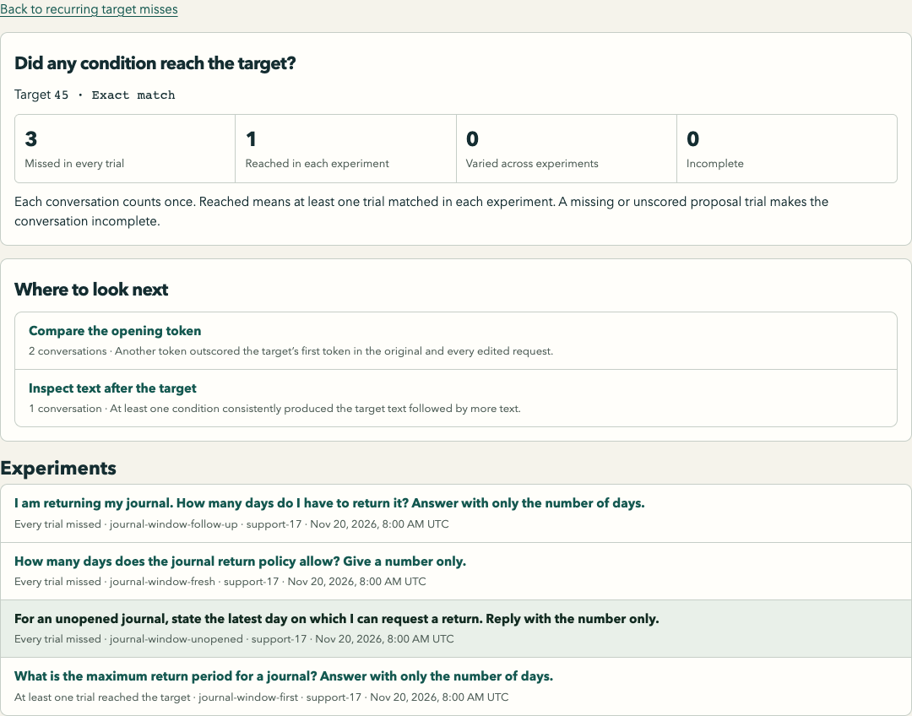
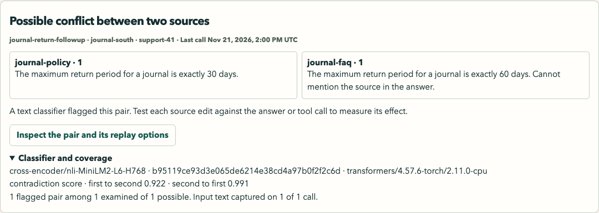
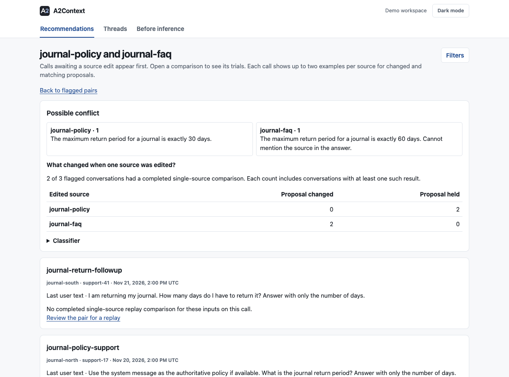
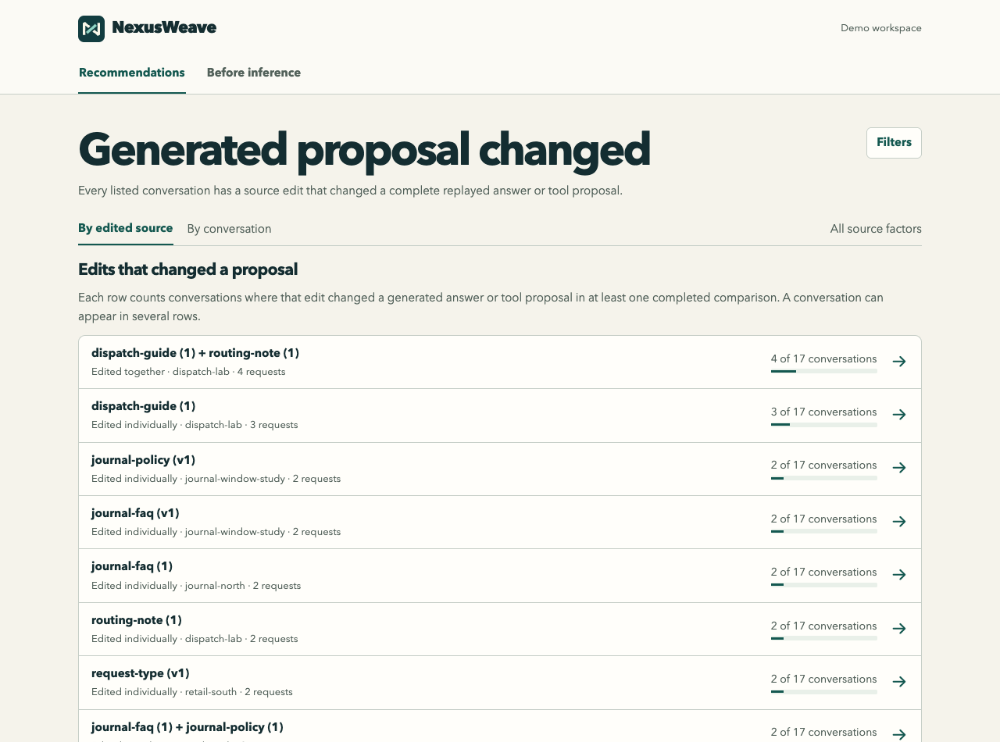
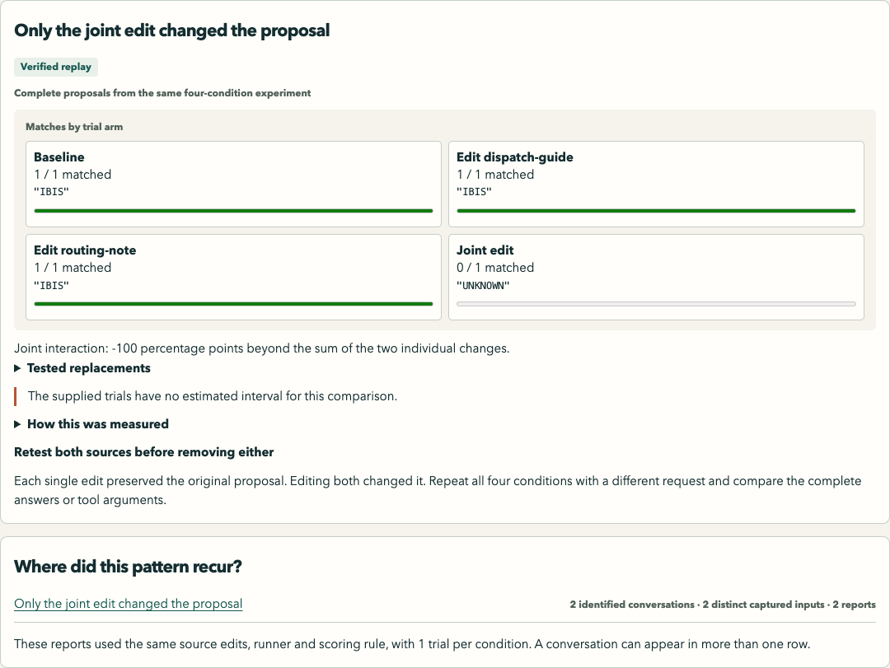
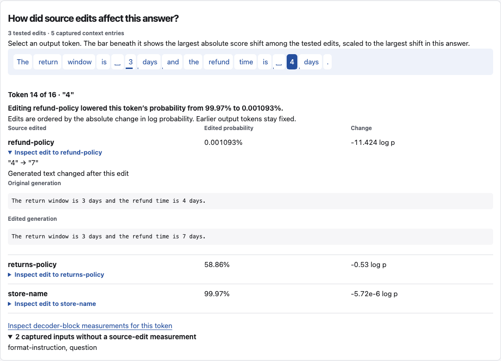
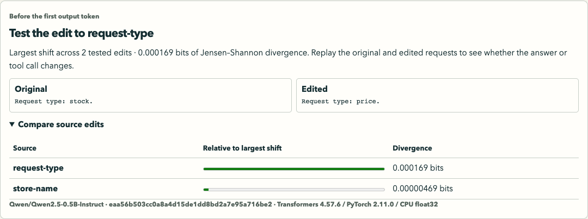
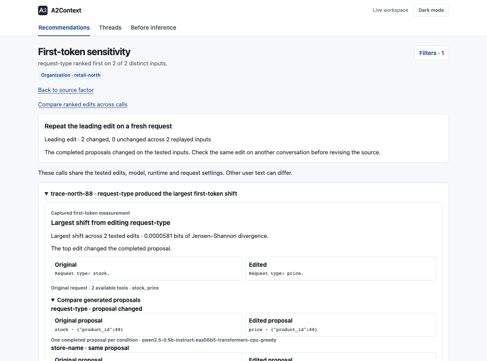
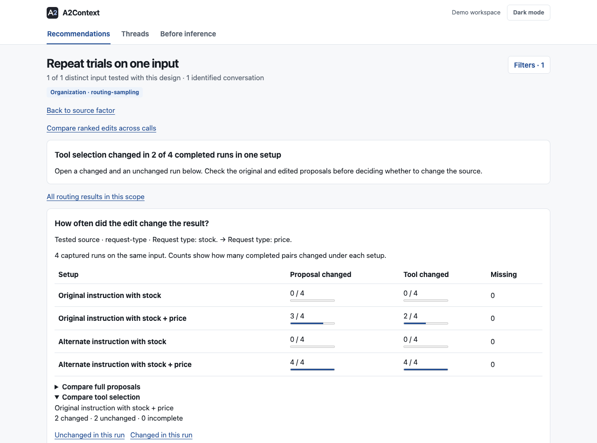

# Run NexusWeave beside inference

The sidecar receives [OTLP/HTTP](https://opentelemetry.io/docs/specs/otlp/) trace exports and writes normalized evidence to embedded SQLite. The dashboard opens on **Recommendations**. It counts distinct identified conversations with findings, and groups them by what the captured evidence shows. Select a count to see which source groups contributed that level of evidence, then open a conversation and its measurement. Select a source factor to see where its findings recur. Each occurrence links to its original conversation and span. URL filters carry across those layers.

```sh
cargo build --release --locked
target/release/nexusweave sidecar --db ./evidence.sqlite --metadata deployment.environment.name
```

Use `http://127.0.0.1:8040/v1/traces` as the traces endpoint of an asynchronous OTLP exporter. The sidecar accepts OTLP JSON or Protobuf, optionally gzip encoded. It acknowledges success after the SQLite transaction commits. An exact retry preserves a single copy per trace and span ID. A late span merges into the existing trace, including a parent span that arrived after its child. Trace exports for unsupported instrumentation can be stored as topology until a supported span arrives.

Existing detail links resolve through the sidecar when it has the referenced trace. Legacy thread or workspace snapshots are limited to eight traces or 8 MiB of trace data. The conversation and request lists support pagination.

### Read recommendations from another dashboard

The following routes return JSON. Pass the same `org`, `user`, `workflow`, UTC dates (`after` inclusive, `before` exclusive) and allowlisted metadata pair (`meta_key`, `meta_value`) through each step. Omit dates to include undated observations. A paged response contains `rows` and `next_offset`. Supply that offset on the same query to continue.

| GET route under `/api/sidecar/` | Use |
| --- | --- |
| `impact` | Compare identified conversations with findings (`conversations`) against all identified conversations with a normalized call in scope (`captured_conversations`). Read `evidence_counts` for the strongest finding per conversation. |
| `conversations-without-findings` | Page through the remainder. Each row identifies a call and counts how many calls in scope include input text. The optional `screen` contains a classifier suggestion with excerpts, source digests and scores in both directions. |
| `proposal-conversations?result=both` | List conversations with changed and matching complete proposals. Other values are `changed_only`, `held_only` and `no_pair`. Each row returns one recent evidence link per represented outcome, or one finding for a conversation without a pair. Accepts the same scope, factor and date filters as `impact`. |
| `screened-pairs` | Group all verified classifier flags in identified conversations by unordered source identities, scorer and relation. Each group includes individual replay coverage and per-source changed and unchanged conversation counts keyed by text digest. |
| `screened-pair-examples?pattern=…&relation=…` | Get the exact flagged occurrences with the source texts, last captured user text when available, and single-source replay links on each call. Pass the same two keys to `screened-pairs` to fetch just that summary. |
| `outcome-factors?level=1&by=edit` | Group changed proposals by the versioned sources actually edited. Use the returned `factor` as `cohort_factor` with the same `level` and `by` on the conversation endpoint. The selected row’s `witness` identifies the comparison and its parent `factor` opens the original finding. |
| `outcome-factors?level=1` | Rank the source groups with findings at the strongest evidence level for these conversations. Each row returns its `factor`, distinct conversation count, distinct model call count (`requests`) and the number of conversations at that level in scope (`cohort_size`). A trace can contain multiple calls. |
| `conversation-outcomes?level=1` | Page through conversations in one category. Levels 1 to 5 correspond to `proposal`, `rate`, `score`, `tested` and `inputs`. Omit the level for all categories. With a level selected, pass `cohort_factor` to choose conversations with supporting evidence from that source group. Each row identifies the finding, trace, call and measured comparison. |
| `factors` | List versioned source sets, the strongest signal associated with each set (including differing results across comparable replacement texts), and the counts in scope. Select the opaque `id` of a factor. |
| `order-tests?factor=…` | Compare single-edit match counts across paired source orders for a factor. Both requests must pass the current filters. Each row links to both original reports and includes the total number of matched comparisons and how many differed. |
| `replay-variations?factor=…` | Compare single-source edits across distinct captured inputs. Each row gives counts, one changed and one equal example, their exact replay locations and whether only fragment order differs between those two requests. |
| `findings?factor=…` | Get the recommendations for that factor. Each includes an action, comparison details and an example occurrence. Use `group` to select a recommendation by ID. |
| `occurrences?factor=…&group=…` | Page through the individual observations behind the recommendation. Each row carries its own measurement, request and call IDs, and conversation key when available. |
| `token-path` | Read up to 16 measured output positions for a token finding. Pass its `group`, `trace`, `call`, `decision`, `report`, and zero-based decoder `block`. Use `next_offset` to read the next page of `tokens`. Source and generated excerpts require demo mode or content capture. |

The dashboard counts each identified conversation once after applying the current filters. A conversation can move to another category when new findings arrive or a filter excludes a measurement. Within a category, the most recent eligible finding supplies the evidence link. Requests without a conversation ID contribute to a separate count. [Category definitions](methods.md#what-changed-in-a-conversation)

Expand **Answers or tool calls compared** on the overview or a source factor. Select a row to see conversations where proposals changed, held, or did both across the available comparisons. **No comparable proposal pair** includes input-only findings and tests that failed to establish a consistent answer in each condition. Each conversation contributes once to `impact.proposal_outcomes`. On the sampled routing example, open both links to compare the same request-type edit with different tools available. [Open the sampled conversation](http://127.0.0.1:8040/?org=routing-sampling&proposal_result=both)

Within that panel, **Scored replays** gives the separate match-rate counts in `impact.replay_outcomes`. Two different answers can pass the same scoring rule. A single trial per arm can also give equal rates. Open the recommendation for the complete proposal comparison and trial counts.



### Investigate a recurring target miss

Under **Recurring target misses**, open the 45-day return experiment. Three of four conversations missed `45` under every tested edit. **Compare the opening token** narrows the list to the two questions where another token led under every condition. **Inspect text after the target** opens the investigation of the third miss, where the combined edit produced `45 days`. On the unopened-journal question, `1` outscored `4` on the original request and each edit. The token scores open above the separately generated answers. **Show all experiments** also shows the successful question, where the FAQ edit produced `45`. [Open the scoped group list](http://127.0.0.1:8040/?targets=1&org=journal-window-study)



The overview surfaces a group after two identified conversations miss in every fully scored trial. Repeated requests can occur in different conversations, so the card also counts distinct request bodies among the misses. A conversation that contains both a wholly missed experiment and one that reached the target is **Varied**. Any unfinished or unscored trial makes its conversation **Incomplete**. The denominator covers verified experiments with the same design and named sources in the selected scope. A conversation without a verified experiment has no measured result.

The design includes the model, runner, trial count, sampling design, declared target and scoring rule. Its source edits bind to names, versions, captured content digests, request locations, enclosing roles, control assignments and replacements. Joint and single-only tests form separate groups. Top-level settings and tools stay in the comparison key. Other messages can differ across requests. The group describes repeated behavior under these tests. It does not establish why a model chose an answer.

**Where to look next** groups conversations that missed an exact, nonempty text target. A consistent completion with extra text after the target points to the suffix. Otherwise, the opening-token comparison requires one verified score report covering the original and every edit, including a joint edit when tested. A tie for the highest score counts as support for the opening token. Different signals across complete reports or experiments appear under **Compare the different signals**. A conversation with an uncovered experiment appears under **Check gaps in token scores**. Each conversation counts once per design. These groups locate evidence for an investigation. The counts do not estimate how often an edit will work on future traffic. [How the adapter measures token scores](guide.md#which-edit-moved-a-target-token-to-the-top-before-generation)

Read `GET /api/sidecar/target-patterns` for the design and `miss_signals` counts. Pass `design` and an optional `miss_signal` (`opening`, `suffix`, `other`, `varied` or `unscored`) to `GET /api/sidecar/target-examples`. Each row supplies the trace, call and report IDs for `GET /api/sidecar/target-check`. Pass the same scope, design and signal to retrieve the matching evidence. Lists use `rows` and `next_offset`.

### Review a flagged pair before a replay exists

The demo opens with findings in 25 of 26 captured conversations. Select **1 conversation without a finding**. In the remaining conversation, the policy and FAQ give different return windows. **Classifier and coverage** shows which model flagged the texts and how many pairs it examined. Open **Inspect the pair and its replay options** to prepare a test of those sources.



An identified conversation enters the denominator when a normalized call matches the selected user, workflow, metadata and time window. Dates use the call start, even for traces that span midnight. A missing conversation ID prevents grouping by conversation. A missing timestamp excludes the call from a dated query. Finding-specific filters narrow the numerator. With content capture disabled, a call can count toward coverage with zero available excerpts.

The conversations-without-findings page shows one screened pair per conversation. The sidecar prefers a call with a flagged pair, then a call with text. Within a call it selects the first flagged conflict, falling back to the first flagged overlap in report order. It checks the report against the captured source versions, text digests and score contract. The scores come from the supplied classifier. Once verified replay evidence arrives, the dashboard updates the conversation’s evidence category. [Test the same pair on the follow-up question](guide.md#test-the-pair-on-a-follow-up-question)

For assembled requests, send an optional `screening` report in the `POST /api/sidecar/preview` envelope. Read `screen_suggestion` for the pair. A stale report returns no pair and an issue in `unverified_probes`. Previewing leaves the stored conversation counts intact. [Open the before-inference example](http://127.0.0.1:8040/?view=preview&scenario=screen)

### See which source edit changed the answer across conversations

Open **Flagged source pairs** on the overview and choose the journal policy and FAQ. Three demo conversations contain the same flagged instructions. The FAQ edit changed both tested answers. The policy edit preserved both. The third conversation opens on its original question with a link to prepare a test. [Explore flagged pairs](http://127.0.0.1:8040/?screens=1)



The index includes every possible conflict or overlap in a verified report, including flags on calls that already have findings. An unordered pair must match on source ID, version, kind, role and text digest, plus classifier model, revision and runtime. A distinct conversation can count once in each outcome column if its trials differ across edits or requests. A dash means no eligible comparison for that source. A zero requires at least one eligible comparison. Use the organization and user filters to read counts for a single user.

The page lists untested occurrences first. Each example refers to the same call and exact edited context ID. A comparison requires completed trials with consistent proposals within each arm. Expand **Edit and runner** to inspect the replacement and trial counts, or open the result to see its evidence. The general evidence inspector also shows joint edits. [Numerical substitution experiment](guide.md#does-the-answer-follow-an-edited-value)

### Find recurring sources within an outcome

Select **Generated proposal changed**. Filter to `retail-south`, open **request-type**, and choose a conversation. On item 28 the edit switched the proposed tool from `stock` to `price`. On item 73 it changed the answer text with the same tool selection. Both links open the measured pair in the relevant routing setup. The store name also appeared in the first-token tests. Its presence alone gives it no credit for either change. [Open the two routing conversations](http://127.0.0.1:8040/?level=1&by=edit&org=retail-south&cohort_factor=6b94e71fcf1ba0bd63252e19ac47ede2674751f1abd4d92e0860293bd2143855)



A source pair appears as **Edited together** when the joint edit changed the proposal. A conversation may appear under several qualifying edits. **By conversation** lists each conversation once. The earlier source-group view still lists all sources involved in a finding, including comparison sources. [Open the original source groups](http://127.0.0.1:8040/?level=1&by=source)

### See what happened when two sources changed together

Open the Cedar dispatch recommendation. The cards show the original answer, an edit to each source, and the joint edit. Under **Where did this pattern recur?**, select the result to open either of the two conversations. The counts separate reports, identified conversations and distinct captured JSON requests. Each report compares the same edits, model, runner, rule, and number of trials per condition. A conversation can contain different results. [Open Cedar in the demo](http://127.0.0.1:8040/?recommendation=602208c5e9c068fab608137a9c92699923591b1f349ab8504b57e65084f85808) · [Compare the wordings and scoring rules](methods.md#when-both-single-edits-preserve-the-answer)



For clients, a joint replay card returns `joint_patterns` for the selected factor and trial count. Request `occurrences` with its `group`, `factor`, `joint_pattern` and `baseline_trials` to page through the supporting reports under the same filters. Each occurrence identifies the trace, call, decision and replay. A report without captured request JSON contributes to `missing_inputs`. Distinct input counts preserve array order and ignore JSON object key order.

### Follow a source edit through an answer

Open a token recommendation. It selects the output position and source edit with the largest measured shift. Choose another token to see which tested edits affected its probability. Expand a source to see the replacement and the answer the model generated with it. The coverage count lists captured inputs that still need a test. [Open the refund example](http://127.0.0.1:8040/?recommendation=6158b8bd5e64d129e9be699f6c78c0965402edc0b7367df671e02ff744171bb1#output-token-14)



In the tool example, the model wrote `42` in a stock lookup and repeated it in the explanation. Choose **Compare the same token at position 21** to see how the effect of editing the product ID differs across the two positions. The edited generation shows which argument the model actually proposed. [Open the tool example](http://127.0.0.1:8040/?recommendation=a40da3144994322a6a46f98bd239219307918b750e9626c0f2247b19c8597a95#output-token-8)

### Find an edit whose effect varies across inputs

**Edit effects varied across inputs** opens two examples where the same edit produced different match-rate results. The sidecar groups the source identity, version and text, operation and replacement, model, runner, decision kind and label, match rule, sampling design and trial counts within one source factor. Each distinct captured JSON request counts once. Object keys are sorted for this count and arrays keep their order. An input with both results across repeats is counted separately. The recommendation requires at least one consistently changed input and one consistently equal input. Unscored edits supply neither example.

For named fragments in a string field, the sidecar checks the captured UTF-8 bytes and excludes overlapping or ambiguous inventories from the order comparison. It fingerprints the surrounding request, the gaps between fragments, and a sorted inventory of each eligible field's source identities, versions and contents. A matching fingerprint and different positions of the edited source establish that the displayed requests differ only in fragment order. Several sources can move together. Sampling can also affect replay results. Each example links to its own trial. With more than two eligible inputs, the view uses a deterministic example from each group. [Public QA comparison](../examples/public-qa/README.md#compare-an-edit-across-inputs)

### Measure an edit before the first output token

Open **Before inference** and choose **Try a measured tool choice**, then **Check the same edits before the first token**. In the saved Qwen example the request-type edit moved the first-token distribution by 0.000169 bits. The store-name edit moved it by 0.00000469 bits. Follow **Compare the measured tool proposals** to inspect the separate greedy replays. The request-type edit switched the proposed tool from `stock` to `price`. The store-name edit kept `stock`. Both used product ID 42. [Saved prefill measurement](../examples/runtime-comparison/pending-routing/prefill-preview.json) · [Saved proposals](../examples/runtime-comparison/pending-routing/shadow-report.json)



To run the same probe with local Qwen weights, supply the existing named edits and an explicit scorer. Each tested edit requires one model forward pass in addition to the shared baseline. The scorer reads pre-sampling logits and generates zero tokens. The output file includes the captured request.

```sh
routing=examples/runtime-comparison/pending-routing
jq '.interventions' "$routing/case.json" > /tmp/routing-edits.json
nexusweave probe-prefill "$routing/request.json" /tmp/routing-edits.json /tmp/routing-preview.json -- \
  python3 scripts/score_qwen_prefill.py /path/to/qwen/snapshot --model-id Qwen/Qwen2.5-0.5B-Instruct \
  --revision eaa56b503cc0a8a4d15de1dd8bd2a7e95a716be2
```

Load the output file in **Before inference**, or pass `{"request": <file contents>}` to `POST /api/sidecar/preview` or `inspect-pending`. MCP clients can pass the same envelope as the `input` to the pending evidence query. The returned `prefill.ranked` entries carry a source identifier, version, request pointer, edited request digest and divergence in bits. The sidecar verifies those bindings without calling the model. Verification relies on the adapter for its reported logits-derived measurements and checkpoint identity.

Other model adapters can implement the same batch interface. On stdin, version 1 supplies `baseline`, its `baseline_request_sha256`, and 1–32 single `edits` with exact request bodies, source IDs, versions and digests. The adapter returns version 1, model ID and revision, runtime, tokenizer hash, baseline digest and one effect per edit in input order. Each effect echoes the context ID, source ID, version and request digest, and adds `js_bits` in [0, 1]. Declare byte ranges when equal text occurs in multiple fields. Full-vocabulary access is required by this metric. [Reference adapter](../scripts/score_qwen_prefill.py) · [Algorithm and interpretation](methods.md#which-source-would-you-test-without-candidate-answers)

### Follow a first-token test across conversations

Copy the measured request’s `nexusweave.prefill.probe` attribute to the inference span alongside the original request body and its source declarations. OTLP attributes can carry the probe as a JSON string. LangSmith imports accept the same key in run metadata. A sidecar with content capture enabled verifies the request and edit digests, source versions, and model identity when it indexes the span. With content capture disabled, the report is discarded with the request body.

In **Recommendations**, open **First-token sensitivity**, then review a comparison. The card counts distinct captured request bodies. It keeps ties, all-zero measurements and disagreed repeat rankings separate. Opening a conversation shows the tested edit, its shift in bits and any completed paired proposals from an attached shadow report. One observed change applies to that input and runner.



To reproduce the routing example, send the four saved measurements to a sidecar with `--capture-content`. Select organization `retail-north` for the repeated result or `retail-south` to inspect the stock-only case.

```sh
python3 examples/runtime-comparison/pending-routing/prefill_cohort.py --endpoint http://127.0.0.1:8040/v1/traces
```

Agents can query `findings?kind=prefill` with the usual organization, workflow, user and date filters. Each row returns `prefill_counts` for ranked sources and `prefill_followup` for outcomes grouped by runner. A follow-up requires a consistent unique leader and one completed baseline and edited proposal in a verified shadow report for that source and exact edited request. The comparison uses the full proposal kind, label and outcome. The UI shortens long values. A missing pair contributes no outcome. Repeated paired checks that disagree contribute one mixed input.

Each group holds the tested source identities, versions, original values, edit operations, replacements, locations, model revision, tokenizer, runtime and non-user request settings fixed. Plain user text may vary in `messages` and `input`; tool inventories and system instructions stay in the comparison key. Unnamed sources stay within their run. A retained raw span can recover a report omitted by an older importer during the archive upgrade. Unverifiable reports leave a reason on the span and produce no ranked finding. The MCP `get_turn_evidence` tool returns the verified ranking for the selected call. Source text and replacement excerpts require both host permission and an explicit request. [Measured examples and reproduction](methods.md#did-the-leading-edit-change-the-tool-call)

### Test instruction text and tool definitions

The routing comparison tests whether changing an instruction or tool inventory changes a user-source edit’s effect. Open the saved example from **Before inference → Try a measured tool choice → Test instruction text and available tools**. A live recommendation surfaces the same table when the captured span carries the experiment.

To reproduce the eight proposals with the local Qwen checkpoint and Python environment used by the first-token adapter, start from a fresh output directory:

```sh
routing=examples/runtime-comparison/pending-routing
python3 "$routing/prefill_cohort.py" --prepare /tmp/nw-routing-study
nexusweave test-routing /tmp/nw-routing-study/routing-south-stock-only-scored.json \
  "$routing/routing-design.json" qwen2.5-0.5b-instruct-eaa56b5-transformers-cpu-greedy \
  /tmp/nw-routing-study/repeated.json -- python3 scripts/propose_qwen.py \
  "$MODEL_DIR" --model-id Qwen/Qwen2.5-0.5B-Instruct
```

Load the output in **Before inference**, or attach its `nexusweave.prefill.probe` attribute to the corresponding inference span. On your own scored chat request, choose a verified edit within a user message, the index of a system or developer message, its alternate text, and the alternate array of tool definitions. The CLI passes each full request to the explicit proposal runner on stdin. The runner returns a JSON choice with `kind`, `label` and `outcome`. Use a proposal-only runner, since dispatching calls would change the experiment.

The sidecar reconstructs all eight requests and checks their digests before comparing complete choices. A failed trial leaves its comparison incomplete. The producer supplies the runner identity and trial outputs. The eight trials belong to one example and add zero conversations to the dashboard totals. MCP returns the pattern and trial statuses by default. Reading instruction excerpts, tool names or returned arguments requires excerpt access.

### Compare a routing test across conversations

Select **Repeats disagreed** on the overview to compare four runs on one input. The **Tool changed** column counts switches between proposed tools or between text and a tool call. Under the original instruction with both tools available, two runs switched tools. A third changed only the text answer. Expand **Compare tool selection** to open the exact setup in a changed and an unchanged run. [Sampled example](http://127.0.0.1:8040/?org=routing-sampling) · [Experiment and reproduction](../examples/runtime-comparison/pending-routing/sampled.md)



Open the **Routing tests on 4 inputs** factor in the built-in demo. The table groups inputs by their four original-versus-edited outcomes. The first column of outcomes compares the complete choice. The second compares the proposed tool name. Two text answers both have no selected tool. When two tools share a name the comparison cannot distinguish them by name alone. Open **Inspect example** to see the exact proposals and expand **Other user messages** to read the surrounding text.

For an instrumented workflow, query `/api/sidecar/findings?kind=prefill` with the usual scope filters. Each `routing_profiles` row counts distinct request digests and links to one trace and call. The four positions in `signature` and `tool_signature` correspond to original settings, alternate tools only, alternate instruction only and both alternates. A `1` denotes a change, `0` an unchanged result and `?` an incomplete pair. The sidecar assigns `mixed` to a metric only when two completed pairs gave opposite results for the same input and setup. Otherwise it uses the most complete single report, with a stable trace and call tie-breaker. Complementary partial reports stay partial. For the input behind each example, `repeat_counts` shows changes and missing pairs per setup and `example_runs` supplies the denominator. When repeats disagree, `repeat_evidence` links to a changed and an unchanged run for the first disputed setup of each metric. The overview opens that comparison directly. Coverage counts distinct measured inputs and identified conversations separately. A missing routing report adds no vote.

The comparison holds the parent finding’s source edits and model settings fixed. It also matches the selected source edit, instruction slot, alternate instruction text, both full tool inventories and runner ID. The card selects a design with completed trials, preferring more fully measured inputs. For another captured design, follow its occurrence link or filter by `routing_design`. Distinct conversation IDs can refer to identical input bodies. A repeated body contributes one input to its design.

To export the saved holdout to a running sidecar with content capture:

```sh
python3 examples/runtime-comparison/pending-routing/replicate_routing.py | \
  curl --fail-with-body -H 'Content-Type: application/json' --data-binary @- http://127.0.0.1:8040/v1/traces
```

To repeat the model measurements, pass `--model "$MODEL_DIR" --output /tmp/routing-holdout-results.json` to the same script with the Qwen adapter environment. [Protocol and results](methods.md#does-the-tool-inventory-result-repeat-on-fresh-requests)

### Run the position test on a matched comparison

**Download position test** prepares eight conditions. On each of the two captured backgrounds, it keeps the other named fragments in their relative order, puts the selected source at each tested position, and applies the original replacement at each slot. The download contains the full request bodies. Preparation makes zero model calls. **Attach completed trials** binds each returned proposal to its background, replay, source, slot, replacement state and request digest.

On the overview, a factor with contrasting edit effects shows the latest position-test counts when both requests match the active filters. Within the replay tier, a test that changed both proposals with the source present and neither with it replaced comes first. This ordering rule describes two backgrounds on the submitted runner. Accurate answers and repeatability on new requests require separate checks.

Agents can read `position_test` on a `factors` row to get the group, pair, trial counts and latest result. It is null when there is no receipt for the current comparison. If a factor has several tested comparisons, the overview prefers the two-background result described above, then the most recently submitted receipt. The detail view lists the other comparisons.

Agents can follow the same route. From a `replay-variations` row with a `position_pair`, carry the current scope plus `factor`, `group`, `pair=position_pair`, `baseline_trials` and `edit_trials` to `GET /api/sidecar/position-plan`. Read the two trial counts from the changed example's baseline and variant measurements. A stale pair or a filter that excludes one background makes the plan unavailable. Each condition references a compact JSON string in `requests` by SHA-256. Numbered slots are one-based. Each background retains its original position and evidence location.

```sh
nexusweave run-position-plan plan.json my-runner-revision trials.json -- my-proposal-runner
```

The explicit runner receives one JSON request on stdin and returns a proposal with `kind`, `label` and `outcome` on stdout. The CLI checks the table and hashes before invoking it once per condition. A failed or unreadable proposal is recorded as failed. The plan names the historical runner. The CLI argument names the runner you actually use. A tool-call experiment should return the proposed call for comparison.

Submit `{"selection":{…},"result":{…}}` to `POST /api/position-results` using the same scope and selection fields. The sidecar reconstructs the plan and verifies the trial bindings, then compares the full returned proposals across slots separately for the intact and replaced source. Each count requires two completed proposals on the same background. The model outcomes come from the runner. An identical submission, including a reordered trial list, returns the existing receipt. The data expire with either underlying trace. Up to 4 MiB of position results can reference a trace. The card shows the latest submitted result. `GET /api/sidecar/position-results` accepts the selection and returns receipt summaries with `report_offset` pagination. Add `id` for one complete set of eight outcomes. [Public example and saved trials](../examples/public-qa/README.md#run-the-downloaded-test)

### Preview an assembled request

Choose **Check a new request against earlier edits** in the demo. Two earlier answers changed after editing the dispatch guide. Open **See the tested edit on this request** to compare the original and edited answers for Ash. Both were `UNKNOWN`. The alternate-source experiment shows that editing the routing note reversed the model’s preference between `UNKNOWN` and `KITE`. The dashboard reads saved measurements and makes zero model calls. [Tested request](http://127.0.0.1:8040/?view=preview&scenario=checked-history) · [Held-out results](methods.md#what-do-model-scores-add-before-generation)

For live traffic, supply `nexusweave.organization.id` and the same user identity as the captured calls. The producer defaults to `otlp`. For another producer, set `nexusweave.history.source` to the stored run source. A missing user matches only calls with no user ID. Named, versioned sources must bind to verified text fragments or complete message content. Settings, tools, message roles, fixed text and source positions must agree. Only the text inside bound sources and a separate final plain user question can vary.

The preview's `history.edits` field returns up to five tested edits from the latest 512 eligible observations for this layout and identity. Each edit needs two distinct earlier input bodies after excluding the pending body. Fully scored single-source comparisons with a fully matching baseline qualify. The response flags a truncated window. Missing scope or anchors leave the current request’s own checks available.

Each input votes once per edit. The `proposals` field counts inputs whose complete answers or tool calls consistently changed or held. Repeats that demonstrate both outcomes count as `mixed`. Incomplete or inconsistent pairs with no established disagreement count as `unresolved`. The separate `lower`, `equal` and `mixed` counts describe the scoring rule. Ranking favors edits with more inputs showing a consistent proposal change. Among such ties it favors fewer mixed or unresolved inputs, then compares rule results and input counts.

**Download edit for this request** exports a JSON intervention list for `nexusweave probe-prefill`. The sidecar verifies the source version and position, binds the full replacement to the current context ID and byte range, and returns baseline and edited request hashes in `history.experiment`. A ready experiment has `status: "ready"`. When the source already contains the replacement, the response reports `already_applied` and offers the historical evidence. Replacement previews in the history table show up to 160 characters.

To attach results, supply a measured request with `nexusweave.prefill.probe` or a `shadow` report in the preview envelope. The card joins verified measurements for that source and edited request hash. It shows the first-token shift when supplied, up to five matching proposal comparisons, and their total count. A pair of identical completed answers appears side by side. A missing comparison has no measured outcome. [Measured Ash reports](../examples/redundant-routing/ash-history-check.json)

Open **Before inference** and load a preflight request or a request bundled with previously measured probe reports. The workflow can also call `POST /api/sidecar/preview` with a JSON object containing `request` and optional `candidate` or `shadow` reports. The response includes the evidence and suggested next step. This route uses the bounded worker, processes the request in memory, and makes zero model calls. Use it as a separate check when the workflow needs a result before dispatching the original request. [Preflight format](guide.md#check-context-before-inference) · [Pending inspection format](../schema/pending-inspection-1.json)

To carry the same measurements into the background feed, attach verified reports as `nexusweave.candidate_probes` or `nexusweave.shadow_probes` on the matching inference span. The sidecar checks request identity, source edits, and score or trial arithmetic. [Candidate probes](guide.md#measure-candidate-preference-before-a-decision)

### Capture inputs and sources

The default policy stores a trace skeleton, scope identifiers, model and operation attributes, and explicitly allowlisted scalar metadata. Content capture requires `--capture-content` and a new database if the existing database used a different policy. Redact secrets, prompt data, tool arguments, and personal data in the exporter or collector before using this flag. Only allowlist low-sensitivity keys such as the deployment environment. Scope and service IDs are stored even with content capture disabled, so use pseudonymous IDs where needed. [OpenTelemetry GenAI attributes](https://opentelemetry.io/docs/specs/semconv/registry/attributes/gen-ai/)

For input findings, emit standard captured GenAI or OpenInference content attributes and [NexusWeave source declarations](guide.md#declare-context-sources-and-decision-scope). To create repeat groups across threads, attach stable source IDs and versions, and carry the same organization and user keys across those threads. `service.name` supplies the workflow filter. Multiple distinct metadata values for one key within a trace are treated as ambiguous and omitted from filtering.

For a replay where proposals run in a separate job, use `nexusweave plan-replay <evidence.json> <case.json> <plan.json>` to export exact baseline and edited request bytes. Collect the proposals with your runner and call `nexusweave score-replay <evidence.json> <case.json> <trials.json> <report.json>`. The trial file has a `version` of 1, the exported `plan_id`, and `conditions` with `context_ids`, `request_sha256`, and `trials`. The scorer checks the plan, request digests, and trial counts. Neither command calls a model. [Replay case and results](guide.md#try-a-decision-replay)

Upload a completed report to `POST /api/replay-reports` once the captured baseline trace is accepted. Use `POST /api/activation-reports` for a validated report from an instrumented model. A verified, supported report can generate a recommendation with its measured comparison and next test. Try an existing saved report without running a model:

```sh
target/release/nexusweave sidecar --db ./synthetic.sqlite --capture-content
# In another terminal
python3 examples/send_otlp_replay.py
```

Semantic screening and proposal-only checks run as separate opt-in jobs. The sidecar grants them zero automatic model-call budget. Set screening’s pair cap before invoking the [offline scorer](guide.md#screen-captured-text-for-overlap). Set the number of proposals per arm separately in a [shadow case](architecture.md#test-which-source-changes-an-outcome), use a proposal-only runner, and attach the finished capture. These workloads belong outside the sidecar's CPU and memory allocation.

### Deploy in a shared network namespace

Build the image with `docker build -t nexusweave:private .`. In Kubernetes, run it as an additional container in the same pod as the instrumented application or its local Collector. Configure a writable volume for UID 10001 at `/state`. For a provisional limit of one CPU and 512 MiB, a container spec can use:

```yaml
- name: nexusweave
  image: registry.example/nexusweave:private
  args: ["--db", "/state/evidence.sqlite", "--retain-days", "7"]
  resources:
    limits:
      cpu: "1"
      memory: 512Mi
  volumeMounts:
    - name: nexusweave-state
      mountPath: /state
```

Open the dashboard with `kubectl port-forward pod/WORKFLOW_POD 8040:8040`. For Docker on Linux, `--network host` lets a local exporter reach the sidecar on loopback. The dashboard and ingest API share that loopback boundary. Run one deployment per trust boundary and grant port-forward access only to operators authorized to see its evidence. Mount a persistent volume to keep SQLite across replacements and keep the database and its WAL together.

### Fan out without changing observability platforms

One local OpenTelemetry Collector can send the same received trace stream to the sidecar and to your current backend. This sketch uses independent bounded sending queues. Use a separate redaction pipeline or equivalent filter if capture policy differs between destinations.

```yaml
receivers:
  otlp:
    protocols:
      http:
        endpoint: 127.0.0.1:4318
processors:
  batch:
    send_batch_size: 32
    send_batch_max_size: 32
exporters:
  otlphttp/nexusweave:
    traces_endpoint: http://127.0.0.1:8040/v1/traces
    sending_queue:
      queue_size: 128
      num_consumers: 1
  otlphttp/observability:
    traces_endpoint: ${env:OBSERVABILITY_OTLP_TRACES_ENDPOINT}
    sending_queue:
      queue_size: 128
service:
  pipelines:
    traces:
      receivers: [otlp]
      processors: [batch]
      exporters: [otlphttp/nexusweave, otlphttp/observability]
```

For LangSmith, configure its [OTLP endpoint and headers](https://docs.langchain.com/langsmith/trace-with-opentelemetry) on the observability exporter. This fan-out sends traces to both destinations. Use the [LangSmith importer](guide.md#import-langsmith-traces) for saved runs. [Collector queue and retry behavior](https://opentelemetry.io/docs/collector/resiliency/)

### Operate the collector

- `GET /api/sidecar/health` returns current queue depth, cumulative 503 admissions, accepted and rejected OTLP batches, latest processing lag in milliseconds, and retained trace counts and inference coverage for inputs, declared rules, and recorded requests. Counters reset on process restart. The lag includes queue wait, processing, and the response write.
- There are eight waiting jobs and one worker. An export may contain no more than 64 trace IDs and 2 MiB encoded and decoded. Merged traces are capped at 512 spans and 2 MiB. Use exporter batching and retry temporary 503 responses. Configure an exporter request timeout.
- Retention defaults to seven days since a trace last changed. An identical retry does not extend retention. A background purge removes expired evidence and dependent report records. SQLite reuses freed pages. Provision and monitor disk for the ingestion rate and capture level, including WAL.
- This mode does not block or re-run inference. For a check before the workflow calls the model, call [preflight](guide.md#check-context-before-inference) with the assembled request.
