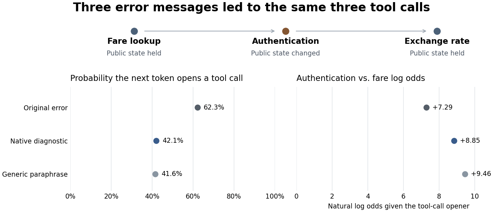

# Did a more precise route error prevent the next state change?

On travel task 150, the first fare lookup failed. The adapter told the agent only that the simulator had returned a `ValueError`. We changed that tool response before the next inference and let the agent continue. **All three wordings produced byte-identical assistant outputs, arguments and callback results.** Authentication changed the public simulator state in every arm. The agent then called the exchange-rate tool and reached its third-completion limit without completing the required fare lookup. [Receipts](results.json) · [Protocol frozen before the edits](protocol.md)



| First tool feedback | Probability the next token is the tool-call opener | Authentication minus fare log odds after supplying the opener |
| --- | ---: | ---: |
| Original exception type | 62.28% | +7.295 |
| Native route diagnostic | 42.06% | +8.846 |
| Generic paraphrase | 41.59% | +9.457 |

The opening probability comes from the model distribution on the assembled request. To compare tool names, we supplied the common opening tag, then summed autoregressive log probabilities for each seven-token continuation through its opening parenthesis. The right column subtracts the fare continuation's score from the authentication continuation's score. The two continuations cover part of the available output space. We separately decoded the entire reply from the unforced boundary.

The original and native prompts both contained 4,579 tokens at the measured call. The generic wording contained 4,581. The generic edit moved the conditional margin *more* than the route diagnostic did. The error text affected these model scores. This one case offers no evidence that adding diagnostic detail repaired the workflow. The historical reference remained unreproduced. Our attribution target here was a failure we could reproduce on the LFM runner. [Baseline calibration](../README.md)

## Open the measured request in NexusWeave

Use the pinned simulator, MLX runtime and checkpoint from the calibration. Build the Rust binary with `cargo build --locked`. The command below reconstructs the pending request before the second inference, scores both edits through `nexusweave probe-candidates`, and checks the rendered prefixes and margins against the saved intervention. The output contains public benchmark conversation text and stays on your machine. Choose an unused output path.

```sh
study=examples/bfcl-transfer/mlx/feedback
HF_HUB_OFFLINE=1 python "$study/preview.py" --upstream "$BFCL_CHECKOUT" \
  --snapshot "$LFM_SNAPSHOT" --binary target/debug/nexusweave --output /tmp/fare-preview.json
cargo run --locked -- demo
```

Open the printed address, choose **Before inference** and load `/tmp/fare-preview.json`. The two reports name the same `fare-error` source and show different replacements. Each binds to the bytes inside the tool message. Expand the candidate margins to see the original and edited comparison. The dashboard reads the verified reports without making a model call.

## Repeat the measurement

```sh
python "$study/check.py"
HF_HUB_OFFLINE=1 python "$study/measure.py" --upstream "$BFCL_CHECKOUT" \
  --snapshot "$LFM_SNAPSHOT" --output /tmp/fare-results.json
HF_HUB_OFFLINE=1 python "$study/measure.py" --upstream "$BFCL_CHECKOUT" \
  --snapshot "$LFM_SNAPSHOT" --repeat "$study/results.json" --output /tmp/fare-repeat.json
```

The second process reproduced all scores, source-prompt hashes, generated text, callback arguments and before/after state hashes. Each run made nine free generations, consuming 41,371 input and 714 generated tokens. These counts exclude the separate forward passes used for scoring. Recreate the figure with `python "$study/plot.py" /tmp/fare-feedback.png` and Matplotlib. [Independent repeat](verification.json)
