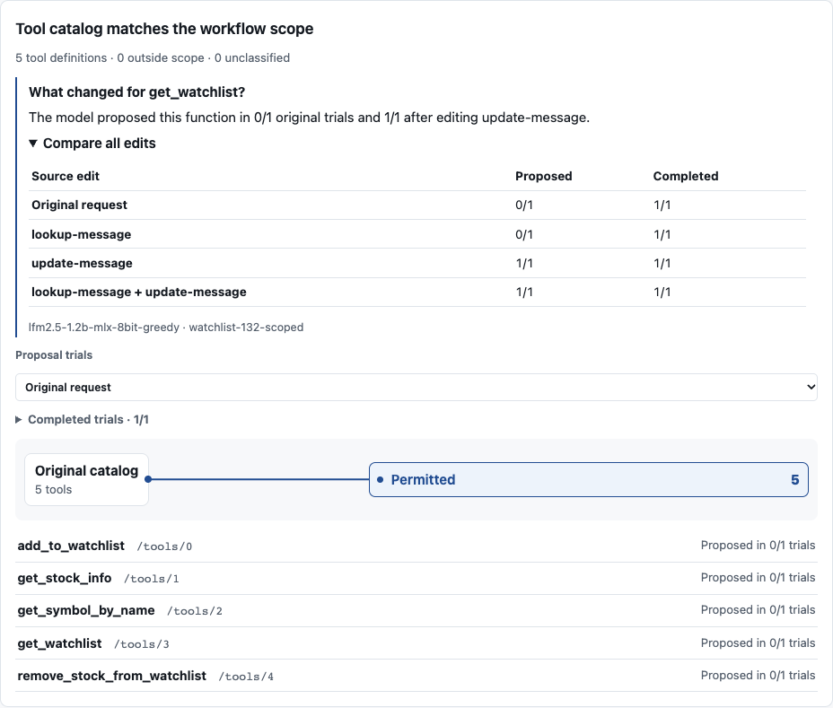

# Which part of the request led to an extra watchlist read?

After two successful tool calls on BFCL task 132, the model could report the update or ask to read the watchlist again. With five tools visible, replacing the assistant message that requested the update changed the next proposal to `get_watchlist()`. Replacing only the earlier lookup message left the model answering in text. With the full catalog, it answered in text under every tested history. [Parent workflow and reference outcome](../README.md) · [Protocol frozen before the crossed runs](protocol.md)

## The same decision under 16 inputs

Each column uses the two earlier assistant messages from different recorded runs. “Update only” replaces the message containing the add call with its five-tool counterpart. The stock lookup, resolved arguments, callback returns, and simulator state before the decision were the same. Both replacements use complete assistant messages, so text and message length change together.

Each cell gives the freely generated outcome, followed by the probability of the tool-call opening token measured immediately before generation. **Read** means the parser returned exactly one `get_watchlist()` proposal with empty arguments. No third tool ran in this experiment.

| Catalog at the decision | Original messages | Replace lookup only | Replace update only | Replace both |
| --- | --- | --- | --- | --- |
| Full, 20 tools | Text · 4.6% | Text · 7.4% | Text · 10.7% | Text · 13.4% |
| Scoped, 5 tools | Text · 28.4% | Text · 30.3% | **Read · 46.8%** | **Read · 54.2%** |
| Scoped, padded with periods | Text · 16.7% | Text · 20.9% | Text · 27.3% | **Read · 47.9%** |
| Scoped, padded with letters | Text · 22.1% | Text · 25.3% | Text · 37.5% | **Read · 59.6%** |

Both fillers restored the full catalog’s input length and user-token position for each fixed history. In those two conditions the extra read required replacing both assistant messages. The opener probability rose after replacing the update message in every row. Only some changes altered the parsed proposal. A probability below 50% can still win greedy decoding when probability is spread across many alternatives.

For an engineer debugging this call, the update message is a sensible first experiment with the five-tool catalog. The padded runs give a reason to test the two messages together as well. This task was selected *because* its outcome changed in the earlier study. These comparisons locate sensitivity on that one checkpoint and model. They leave open which words mattered and how often this behavior occurs elsewhere. [All 16 receipts](results.json) · [Independent process repeat](verification.json)

## See the recommendation

The dashboard highlights a function whose observed proposal rate changed across verified source edits. The original request here means the five-tool catalog with both assistant messages from the full-catalog history. Expand **Compare all edits** to see which individual message changed the proposal and whether combining both edits preserved it.



## Reproduce

The first command needs only standard Python. For fresh inference, use the Apple Silicon environment, pinned checkpoint and verified BFCL files from the [parent setup](../README.md#reproduce). All outputs below need unused paths.

```sh
study=examples/bfcl-transfer/mlx/watchlist/checkpoint
python3 "$study/check.py"
HF_HUB_OFFLINE=1 python "$study/cross.py" --upstream "$BFCL_CHECKOUT" \
  --snapshot "$LFM_SNAPSHOT" --output /tmp/watchlist-cross.json
HF_HUB_OFFLINE=1 python "$study/cross.py" --upstream "$BFCL_CHECKOUT" \
  --snapshot "$LFM_SNAPSHOT" --repeat /tmp/watchlist-cross.json --output /tmp/watchlist-cross-repeat.json
```

To open the actual request in the UI, build the binary and regenerate a local upload. This runs four additional proposal-only trials through the Rust shadow CLI and checks each against the archived outcome. The upload contains the public simulated request and model replies.

```sh
cargo build --locked
HF_HUB_OFFLINE=1 python "$study/preview.py" --upstream "$BFCL_CHECKOUT" \
  --snapshot "$LFM_SNAPSHOT" --binary target/debug/nexusweave --output /tmp/watchlist-preview.json
cargo run --locked -- demo
```

Open **Before inference** and choose the generated file under **Review an assembled request**. Use `--catalog full`, `dots`, or `letters` to investigate the other rows.
