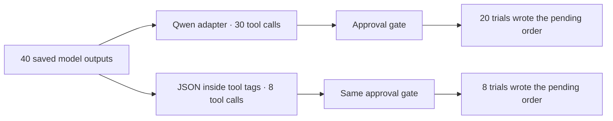

# Which edit changes an exchange order?

Changing only the wording of a customer's hold request switched the model between a valid exchange write and an ordinary text reply. Both wordings still asked the agent to wait. With the approval gate off, the pre-answer ranking found a changed order on its first try in four of eight cases. Starting with the first listed edit found one. With the gate on, **none of the 32 edits changed the final order state**. The gate blocked ten proposed writes on held orders. [Raw generations, scores and SQLite receipts](results.json)

The fixture uses eight synthetic requests for one two-order workflow. Four requests require a hold and four approve the pending exchange. Each status appears with two equivalent customer messages and two authorization sources. We fixed four edits and their comparison order before running the model. For each edit, the probe measured the Jensen–Shannon divergence between the original and edited next-token distributions before the model generated its reply. It ranked the customer wording edit first on all eight requests. The first-listed comparator rotated through all four sources. [Frozen design](design.json) · [Protocol](protocol.md)

| Current approval and record | Wording | First state change in ranked order | First state change in listed order | Ranked first edit, gate off |
| --- | --- | ---: | ---: | --- |
| Held, service desk | A | 1 | 3 | Restored hold |
| Held, service desk | B | 1 | 2 | Lost hold |
| Held, checkout | A | 1 | 1 | Restored hold |
| Held, checkout | B | 1 | 4 | Lost hold |
| Approved, service desk | A | None | None | Kept exchange request |
| Approved, service desk | B | None | None | Kept exchange request |
| Approved, checkout | A | None | None | Kept exchange request |
| Approved, checkout | B | None | None | Kept exchange request |

Of the eight paired comparisons, the ranking found a first-try change in three cases where the listed order missed. Both found one and neither found four. The ranking restored the desired held state twice and lost it twice. The listed first edit restored one and lost none. Refreshing the stale cache, withholding the current authorization record and changing an unrelated parcel label produced zero state changes under either dispatch policy. The unrelated color edit preserved even the rendered token count in each request.

The adapter accepted 30 exact-argument exchange writes. Ten responses were plain text. No argument set failed validation and no output reached the token limit. The plain text responses leave a held order in its expected state, though they also miss the instruction to use the customer message tool. With current approval enforced, all 20 approved outputs wrote the pending order. The held outputs split between ten blocked writes and ten text replies. The already-completed first order kept its original state on every replay.

**The ranking located a sensitive wording change, but its score gives no direction for a fix.** A comparison in the reverse direction starts from the other wording and can break a correctly held order. The four changed cases represent two reversible contrasts across the two record labels. There were 32 distinct rendered requests among the 40 tested conditions. This is a deterministic synthetic study on one checkpoint, with one action-argument schema and the example's Qwen tool parser. The saved raw strings make it possible to examine what happens under another parser.

## How much did the tool parser matter?

The Qwen template shows a tool payload wrapped in an extra pair of braces. The example adapter removes that pair before parsing JSON. We replayed the same 40 saved generations, changing only whether the adapter accepts that spelling. Both parsers used the same tag extraction, tool schema, arguments and SQLite dispatch code. [Pinned Qwen chat template](https://huggingface.co/Qwen/Qwen2.5-0.5B-Instruct/blob/eaa56b503cc0a8a4d15de1dd8bd2a7e95a716be2/tokenizer_config.json) · [Parser comparison](compare_parsers.py)



| Policy | Executable tool calls | Held requests where the top edit changed state, gate off | Approved requests where it changed state, gate off | Requests where it changed state, gate on |
| --- | ---: | ---: | ---: | ---: |
| Accept template brace pair | 30/40 | 4/4 | 0/4 | 0/8 |
| Require valid JSON inside the tool tags | 8/40 | 0/4 | 4/4 | 4/8 |

Both parsers yield the same headline count of four first-ranked edits that changed state before enforcement. They identify **disjoint sets of requests**. Switching parsers changed 22 of 40 final states without the gate and 12 with it. All twelve differences with enforcement were approved writes. A failed parse leaves the order untouched in this sandbox. A production runtime that retries or repairs calls needs its own replay.

As a post-hoc comparison, always choosing the latest customer message selects exactly the same eight edits as the divergence ranking, with zero scoring passes. This study gives no measured advantage over that simple selector. The first-listed comparator and all source edits were fixed before scoring.

## What happened in an existing agent framework?

Qwen-Agent 0.0.34 recognized 30 calls. Its registered tool rejected 22 argument payloads and executed eight against SQLite. The final states matched the strict JSON comparison, although the point of failure differed. Both parsers gave four first-ranked source edits that changed an ungated outcome. The NexusWeave adapter counted held requests. Qwen-Agent counted approved ones. The framework replay includes the raw arguments received by the callback and the resulting state. [Qwen-Agent staging results and trace export](framework/README.md)

## Cost and reproduction

Two complete local runs produced identical raw outputs, 32 edit scores, eight rankings, token counts, parsed proposals and all 80 SQLite receipts. A separate check substituted a wrong replacement ID and verified that both sandbox policies rejected it under either approval state.

The ranking used 40 local CPU forward passes and 17,680 input tokens in 11.15 seconds. The listed order required no ranking calls. Generating all 40 proposals took 82.67 seconds, with 17,680 prompt tokens and 2,190 generated tokens including end markers. After the common original trials, the eight ranked first edits took 16.70 seconds to decode and the eight listed first edits took 15.43 seconds. In this run the ranking found more state changes early, at additional probe cost. These timings are measurements of one local setup. There were no paid calls.

From the repository root, replay every saved raw generation through the adapter and both SQLite dispatch policies using Python 3.11 or newer. Model dependencies are only needed for the full rerun. [Pinned local Qwen setup](../../public-qa/README.md#repeat-the-model-measurements)

```sh
make check-dispatch-study
python3 examples/exchange-approval/dispatch-study/compare_parsers.py
python3 examples/exchange-approval/dispatch-study/study.py --check examples/exchange-approval/dispatch-study/results.json

python3 examples/exchange-approval/dispatch-study/study.py --snapshot /path/to/qwen/snapshot \
  --output /tmp/exchange-dispatch-rerun.json
```
