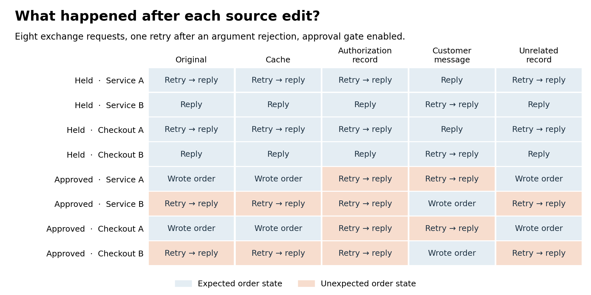

# Where did the exchange proposal stop?

Qwen-Agent recognized 30 tool calls in the 40 saved assistant responses. **Only eight reached SQLite.** Its parser recovered a tool name from each of the 22 responses that contained an extra pair of braces. The argument string it passed to the registered tool still ended with an extra closing brace. The tool's Qwen-Agent argument validator rejected those 22 strings. Ten responses were ordinary assistant text. [Per-response parser output and order states](results.json)

| Stage | Observations among 40 saved responses |
| --- | ---: |
| Parser emitted a call for the exchange tool | 30 |
| Registered tool callback rejected the arguments | 22 |
| Registered tool executed the valid exchange | 8 |
| Assistant returned text | 10 |
| Truncations or unknown tool names | 0 |

Qwen-Agent and the NexusWeave adapter produced different pending-order states on 22 of 40 ungated replays and 12 of 40 gated replays. Under Qwen-Agent, all eight valid writes concerned approved orders, so its totals were eight writes and 32 unchanged orders with either gate policy. The first-ranked source edit changed the outcome on four requests, and the first-listed edit changed one, under both gate settings. Those four were the **approved** requests. In the original adapter's ungated test, the four were **held** requests. The aggregate count alone hides which customers were affected. [Original adapter study](../README.md) · [Strict parsing comparison](../compare_parsers.py)

## What ran

The saved `comparison` table pairs each request with its expected order state. Editing the first-ranked source restored two approved exchanges and prevented two other approved exchanges from being written. The other four requests retained their original states. [Paired outcomes under both gate settings](results.json)

The harness uses the Qwen team's published Qwen-Agent 0.0.34. The wheel published by PyPI has SHA-256 `195264f9c1880f60f23781805d69bb3ffadfe944b7b70358f7115a0dd4bc59b7`. The replay calls the public `FnCallAgent.run` entry point. A replacement model transport supplies the exact saved raw assistant string in one chunk. The framework's inherited chat implementation invokes its native Nous parser and routes the resulting call to the registered tool. The callback invokes Qwen-Agent's standard argument validator and passes valid arguments to the study's isolated two-order SQLite sandbox. Execution stops after the first tool result. The input contains no pre-parsed function call. [Published package](https://pypi.org/project/qwen-agent/0.0.34/) · [Qwen-Agent repository and function-calling guide](https://github.com/QwenLM/Qwen-Agent)

This exercises a real agent loop with a replay transport and a synthetic business tool. It covers one framework version, one parser configuration and one checkpoint's previously saved generations. A deployed agent can choose a different parser, implement different argument validation or ask the model to repair rejected calls. This study supplies no second model response. Replaying both policies for all 40 responses took about 0.5 seconds on the test machine after imports. It made zero inference or paid API calls.

## What happened when the model could try again?

All 22 rejected arguments triggered a fresh greedy generation from Qwen-Agent’s assembled retry history. Each retry returned a text reply. None issued another tool call or changed the order state. Ten rejected trials involved held exchanges, which stayed held. The twelve other rejected trials involved approved exchanges, which remained unfulfilled. The ten first-pass text replies and eight successful writes were ineligible for retry. The approval gate and the unchecked policy both finished with 28 of 40 arms in the expected state.



Each row uses one authorization channel and customer wording. The customer-message edit preserves the requested intent. It changed four approved outcomes, restoring two writes and losing two. In a retrospective comparison, the pre-answer ranking picked the customer message first on all eight requests. Simply testing the latest customer message would have chosen the same eight edits with zero ranking calls. This dataset gives no reason to pay for the ranking on this workflow. [Original rankings](../results.json) · [Retry protocol frozen before inference](retry-protocol.md) · [Raw responses, paired states and hashes](retry-results.json)

The 22 retries used 11,878 input tokens and 394 generated tokens including end markers. Local CPU decoding took 20.17 seconds on the first run. A second generation pass reproduced the histories, responses, token counts and 80 policy-specific receipts. The first responses were replayed from the earlier study. Only the retry generations were fresh. These are related variations of eight synthetic requests on one model and one application-defined error message.

## Reproduce the offline replay

We used Python 3.13.7. From the repository root, install the optional study dependencies in a virtual environment, then run the checks. The application and sidecar do not need these dependencies.

```sh
python3.13 -m venv /tmp/nexus-qwen-agent
/tmp/nexus-qwen-agent/bin/python -m pip install -r examples/exchange-approval/dispatch-study/framework/requirements.txt
/tmp/nexus-qwen-agent/bin/python examples/exchange-approval/dispatch-study/framework/replay.py --check
/tmp/nexus-qwen-agent/bin/python examples/exchange-approval/dispatch-study/framework/retry.py --check
```

To generate fresh retries, install `framework/retry-requirements.txt` in that environment and use the pinned local checkpoint from the dispatch study. To rebuild the figure, install Matplotlib 3.10.8 in a separate plotting environment.

```sh
/tmp/nexus-qwen-agent/bin/python -m pip install -r examples/exchange-approval/dispatch-study/framework/retry-requirements.txt
/tmp/nexus-qwen-agent/bin/python examples/exchange-approval/dispatch-study/framework/retry.py \
  --snapshot /path/to/qwen/snapshot --output /tmp/fresh-exchange-retries.json
python3 examples/exchange-approval/dispatch-study/plot_retries.py /tmp/exchange-retry-outcomes.png
```

## Verify the spans in a disposable sidecar

The replay harness adds OpenTelemetry SDK spans at the public agent invocation, replay transport, registered callback and successful dispatch into SQLite. These are application-owned instrumentation points. Qwen-Agent supplies the parser and execution behavior. The replay marks the completion span as saved text and exports no prompt or response bodies. A trace records one pass with a specific enforcement policy. A thread groups both policies and all five input variants of the same synthetic request.

The check starts a private sidecar on an ephemeral loopback port with a temporary database. The SDK's batch processor sends OTLP/HTTP Protobuf. It then queries the sidecar's public API and checks every parent-child relationship. The measured run returned **8 threads, 80 traces and 236 spans**: 80 agent roots, 80 saved-completion spans, 60 callback spans and 16 SQLite dispatch spans. The receiver counted 80 normalized chat spans and zero captured input bodies, request snapshots or rule declarations. The 80 chat spans are replays of 40 saved strings across two policies.

```sh
make check-qwen-agent PYTHON=/tmp/nexus-qwen-agent/bin/python
```

To send the same traces to a sidecar you have already started on this machine, add `--sidecar-port 8040` to the offline replay command. Without that flag the SDK has no exporter. Span-name capture in the disposable test makes it possible to verify the tool and database spans from the trace detail endpoint.
