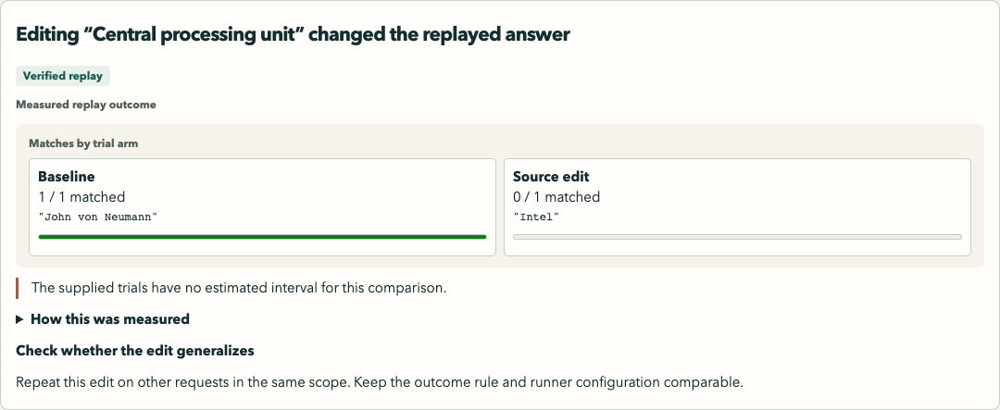
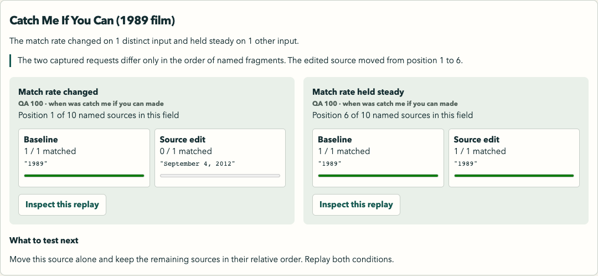
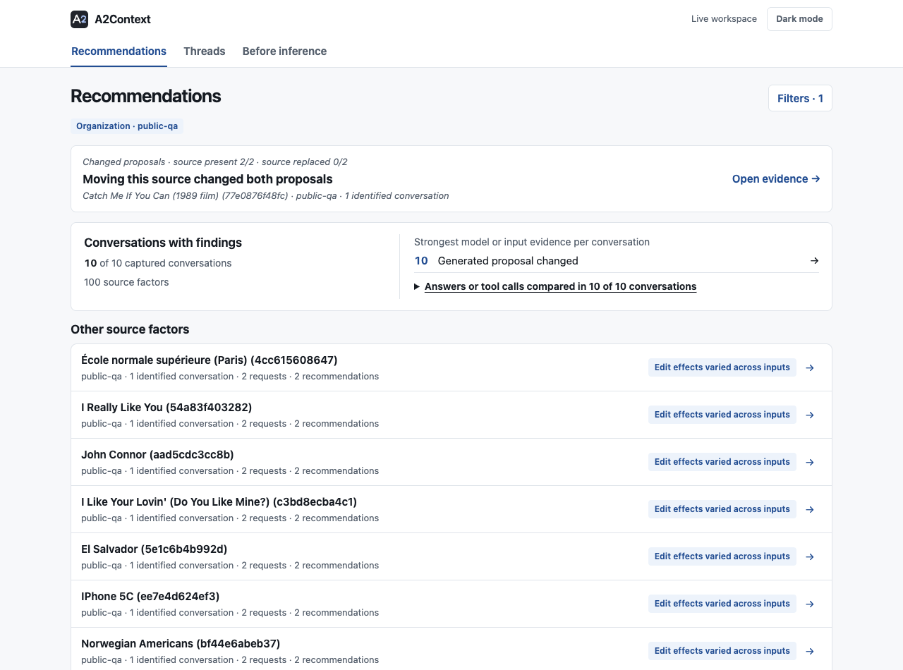
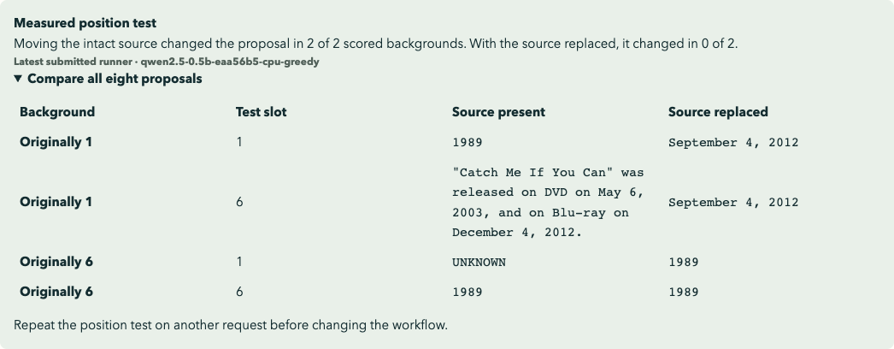

# Which passage should an engineer test first?

A retrieval workflow sent ten passages to a small language model. Before the model answered, we replaced each passage in turn and measured the shift in its next-token probabilities. We ranked those edits, then let the model answer all eleven requests. This checks whether a large early shift identifies a source worth testing when the workflow has no candidate answers.

The [fresh-question evaluation](holdout.md) tests the same ranking on 20 additional questions with its primary comparison fixed in advance.

Can a workflow flag missing evidence before the model answers? In a separate experiment, both an abstention score and a keyword baseline missed 19 of 20 annotated passage omissions. [Missing-passage experiment](annotation-gap.md)

## What changed in the answers?

In the first order, editing the passage ranked first by the model changed the generated text on **8 of 10 questions**. Testing the first passage in the prompt gave the same count for a fraction of the work. The model selected the annotated answer passage once. On one question, its largest shift was on a passage about the film *Terminator Genisys* when the question asked about the original film. Removing that passage changed the answer from “Jason Clarke” to “Michael Edwards,” which matched a dataset alias.

| Passage selected for editing | Changed text, first order | Changed text, rotated order |
| --- | ---: | ---: |
| Largest first-token distribution shift | 8/10 | 10/10 |
| First passage in the prompt | 8/10 | 6/10 |
| Last passage in the prompt | 2/10 | 5/10 |
| Highest BM25 score among all ten | 5/10 | 6/10 |
| Best available original retrieval rank among distractors | 4/10 | 6/9 |
| Every individual passage edit | 33/100 | 52/99 |

Moving each passage five slots changed which source ranked first on **all ten questions**. Only one question retained the same top-ranked slot. Nine unedited answers changed, even though the ten passages and the question stayed the same. With this order, the model selected the annotated passage four times. One distractor edit reached the 48-token limit. Its unobserved final answer is excluded from both denominators in the last two rows.

For these inputs, the ranking suggested edits that often changed behavior. It provides little support for assigning a passage a stable importance score across requests. Keep the exact input order with the recommendation, show the edited answer, and repeat under a second order before suggesting a context-wide change. These are two orders of the same ten questions, chosen for a diagnostic pilot.

The reference check looks for a dataset alias as a contiguous sequence of case-folded word tokens. Only two baseline answers in the first order passed this check. Replacing the CPU passage changed “John von Neumann” to “Intel” and lost one of those two matches. A different baseline changed from “Ernest Lawrence” to “Wilhelm Röntgen” without gaining an alias match. The latter illustrates how the spelling in a generated answer can escape automatic grading. Exact text change, alias match and selection of the annotated passage answer different questions.



## How the ranking works

1. Select rows 0, 100, …, 900 from the pinned ten-passage Natural Questions file. Rotate the list by the question index so the annotated passage occupies each slot once. In the follow-up, rotate every list another five slots. Keep each question and all ten passages.
2. Keep the numbered slots and question fixed. Replace the title and text of one passage with `[passage omitted]`. The replacement also changes input length and later token positions. The experiment measures the combined effect of that edit.
3. At the empty assistant prefix, compute the model's full next-token probability vector for the original request and each edit. With original distribution P, edited distribution Q and midpoint M, the score in bits is ½ KL(P‖M) + ½ KL(Q‖M), using base-two logarithms. Rank descending, breaking ties by input position. The scorer has access to the question, passage texts and model. The gold annotation, references and generated answers enter only during evaluation.
4. Generate each answer greedily with the same model, template and 48-token limit. Require an end-of-sequence token to score the output. Count edits that changed the exact text. Each request has one deterministic generation per condition. The 100 edits in each order share ten questions.
5. Score all ten passages with BM25 over title and text, using case-folded word tokens, k1 = 1.2 and b = 0.75. The original data separately supply retrieval ranks for nine distractors. The inserted annotated passage has no retrieval rank, so the original-rank comparator can only choose a distractor.

The diagnostic adapts the distribution-shift idea in ARC-JSD. That work measures attribution along a generated response. This experiment scores only the first prediction and tests whether it can guide a later edit. We did not reproduce the paper's benchmark. The public QA passages come from the Lost in the Middle study. [ARC-JSD paper](https://arxiv.org/abs/2505.16415v5) · [Authors’ implementation](https://github.com/ruizheliUOA/ARC_JSD/tree/6572d3be974c6eca69d9754d360756a5e6397dae) · [Lost in the Middle](https://aclanthology.org/2024.tacl-1.9/)

## Inspect the saved recommendations

From the repository root, Python 3.10 or later can check the saved measurements without a model, network call or API key.

```sh
python3 examples/public-qa/compare_orders.py
```

To view the actual trials, download the pinned dataset and start a sidecar that captures the public source text. The import checks the dataset digest and every passage hash, reconstructs the OTLP input, and checks each Rust-planned request against the input used for generation.

```sh
curl -fL https://raw.githubusercontent.com/nelson-liu/lost-in-the-middle/29b8a6d042ce29abccee3db1a73171a107d7e6af/qa_data/10_total_documents/nq-open-10_total_documents_gold_at_4.jsonl.gz -o /tmp/nexus-qa.jsonl.gz
cargo build --locked
target/debug/nexusweave sidecar --db /tmp/nexus-qa.sqlite --capture-content
```

In a second terminal, load one or both orders. Each command prints a link per question to the recommendation for the passage chosen by the pre-generation ranking. The link selects the exact trace, call, replay and source edit. From that card, **See this recommendation across requests** opens the group. Single-edit cards show an answer excerpt for each arm whose trials all returned the same text. The study completion time timestamps the reconstructed spans. A repeat import of the same saved study uses the same IDs and timestamps. For the live paired ranking comparison, use the [holdout importer](holdout.md#inspect-the-measured-calls).

```sh
python3 examples/public-qa/view_passage_edits.py /tmp/nexus-qa.jsonl.gz
python3 examples/public-qa/view_passage_edits.py /tmp/nexus-qa.jsonl.gz \
  --results examples/public-qa/rotated-results.json
```

## Compare an edit across inputs

After loading both studies, open **Edit effects varied across inputs**. For *Catch Me If You Can (1989 film)*, Qwen answered “1989” in both original requests. With the film passage in slot 1, editing it changed the answer to “September 4, 2012.” With it in slot 6, the same edit left the answer at “1989.” All ten passages moved together in this comparison. The recommended follow-up isolates the position of the selected passage.



Across the 100 passages, 37 had a complete edit in both orders with changed text in one order and equal text in the other. Verify every dashboard comparison against the saved positions and generations.

```sh
python3 examples/public-qa/compare_orders.py --url http://127.0.0.1:8040
```

### Move only the selected passage

We followed the recommendation for row 100. Two retrieved passages have the title *Catch Me If You Can (1989 film)*. The selected passage's SHA-256 starts with `77e0876f`. In each saved arrangement we kept the other nine passages in their original relative order, inserted this passage in slot 1 or 6, and generated an answer with its text present or replaced. The original conditions reproduced their saved answers.

| Order of the other nine | Slot | Passage present | Passage replaced |
| --- | ---: | --- | --- |
| First order | 1 | UNKNOWN | 1989 |
| First order | 6 | 1989 | 1989 |
| Rotated order | 1 | 1989 | September 4, 2012 |
| Rotated order | 6 | Answer about the DVD and Blu-ray release dates | September 4, 2012 |

Moving this passage alone changed the original answer in both arrangements. With its text replaced, the answer held across the two slots within each arrangement. Moving a passage also changes its neighbors' absolute positions. Each cell is one greedy generation on this checkpoint. [Exact outputs and background passage hashes](film-position-results.json)

We also tested the other same-titled passage, `af59531e`. Moving it changed the original answer in the first arrangement and left it at “1989” in the rotated arrangement. The title would have been ambiguous as an evidence link. [Second passage outputs](film-other-passage-results.json)

With the pinned local model and dataset, reproduce the selected comparison from the repository root.

```sh
python3 examples/public-qa/replay_source_position.py /tmp/nexus-qa.jsonl.gz /path/to/qwen/snapshot \
  --row 100 --source-sha256 77e0876f48fc69052adfee2956b3b1fddec5a130fdcb59984a40298501696524 \
  --output /tmp/nexus-film-position.json
```

### Run the downloaded test

Once the saved trials are attached, the overview highlights the film source. Open the card to see the positions tested, the runner and the eight returned answers. Both orders of the passages came from one question.



With both saved studies in the sidecar, open the film comparison for source version `77e0876f48fc`. Choose **Download position test**. To see the measured result immediately, open **Attach completed trials** and select the [saved CLI trials](film-position-trials.json). Expand **Compare all eight proposals** to see the answers for each passage position.



To reproduce those proposals, use the pinned Qwen snapshot and the downloaded filename in the following command. The sidecar prepares the requests. This explicit CLI command runs eight local generations.

```sh
target/debug/nexusweave run-position-plan /path/to/position-test.json qwen2.5-0.5b-eaa56b5-cpu-greedy \
  /tmp/film-trials.json -- python3 scripts/propose_qwen.py /path/to/qwen/snapshot --model-id Qwen/Qwen2.5-0.5B-Instruct
```

All eight answers from this CLI run matched the independent single-passage experiment above. Across the 37 eligible comparison cards, all 296 planned conditions reproduced the expected compact request bytes when assembled separately from the pinned passages. Repeat the byte check with both studies loaded.

```sh
python3 examples/public-qa/check_position_plans.py /tmp/nexus-qa.jsonl.gz --url http://127.0.0.1:8040
```

## Repeat the model measurements

We used Qwen2.5-0.5B-Instruct with Transformers 4.57.6, PyTorch 2.11.0, eager attention, CPU float32 and four PyTorch threads. The runner loads local files only. It saves the runtime identity and tokenizer hash. The measured weights had SHA-256 `fdf756fa7fcbe7404d5c60e26bff1a0c8b8aa1f72ced49e7dd0210fe288fb7fe`. [Pinned Qwen checkpoint](https://huggingface.co/Qwen/Qwen2.5-0.5B-Instruct/tree/eaa56b503cc0a8a4d15de1dd8bd2a7e95a716be2)

```sh
python3 -m pip install 'transformers==4.57.6' 'torch==2.11.0'
for rotation in 0 5; do
  python3 examples/public-qa/check_passage_edits.py /tmp/nexus-qa.jsonl.gz /path/to/qwen/snapshot \
    --model-id Qwen/Qwen2.5-0.5B-Instruct --revision eaa56b503cc0a8a4d15de1dd8bd2a7e95a716be2 \
    --rotation "$rotation" --output "/tmp/nexus-qa-order-$rotation.json"
done
python3 examples/public-qa/compare_orders.py /tmp/nexus-qa-order-0.json /tmp/nexus-qa-order-5.json
```

Each ranking required eleven forward passes. The median time per full ranking was 11.62 seconds in the first order and 11.60 seconds in the rotated order on this host. Timing starts after tokenization and ends before decoding. It includes inference and divergence arithmetic, with no inference latency measurement for a production workflow. The default sidecar runs zero model calls. Independent questions, more checkpoints and semantic outcome labels would be necessary to decide where this opt-in experiment adds value. [First-order measurements](results.json) · [Rotated measurements](rotated-results.json)
