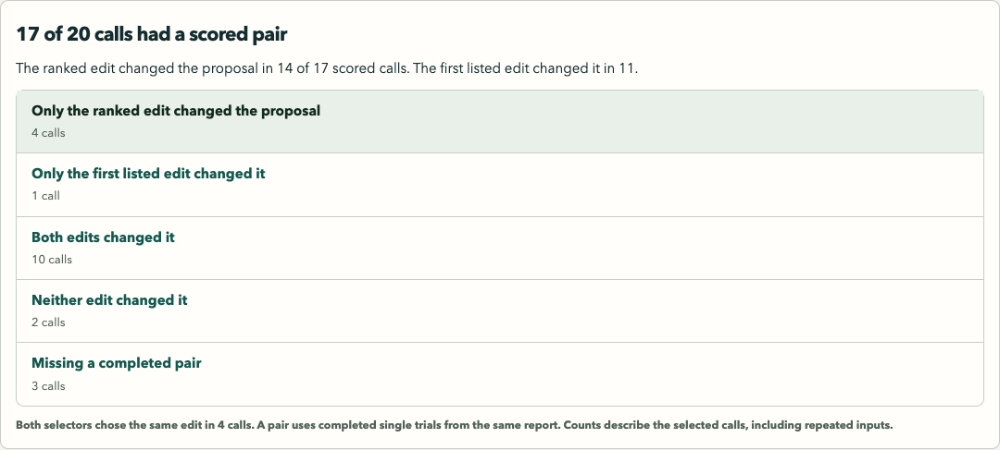
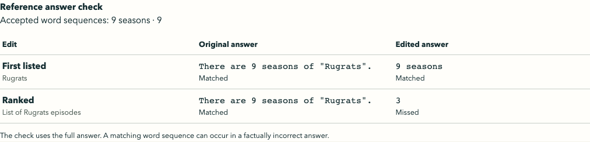

# Does a pre-inference passage ranking transfer to fresh questions?

## Results

On the 17 questions with complete baseline and paired edited answers, the model-ranked edit changed **14 answers**. Editing the first passage changed **11**. Both changed the answer on ten questions, only the ranked edit did on four, only the first edit did on one, and neither did on two. The paired difference was +17.6 percentage points. With five discordant pairs the two-sided exact test gives *p* = 0.375. That small comparison leaves the advantage over first position uncertain. The two selectors chose the same passage on four of the 20 questions. [Raw measurements](holdout-results.json) · [Protocol commit](https://github.com/thakur-ro/NexusWeave/commit/ff32861)

| Edit selector | Exact answer changed / scorable | Annotated passage selected / questions |
| --- | ---: | ---: |
| Largest first-token distribution shift | 14/17 | 5/20 |
| First passage in prompt | 11/17 | 2/20 |
| Highest BM25 score | 10/17 | 2/20 |
| Last passage in prompt | 9/17 | 2/20 |
| Best available retrieval rank among distractors | 8/17 | 0/20 |

Across all 200 passage edits, 94 of 171 scorable edits changed the answer. Two baseline generations and 21 edited generations reached the 48-token limit. This made the primary comparison unavailable on three questions. Among the three scorable baseline answers that matched a reference alias for the ranked edit, all three lost the match after that edit. The first-position edit preserved all three. Reference alias checks capture only one aspect of answer quality.

Ranking all ten passages took a median of 11.00 seconds for eleven forward passes on this CPU. That timing excludes tokenization and answer generation and includes other work running on the same host. First position needs no scoring pass. We keep model scoring explicit and show the actual edited outcome separately. This run supplies no cross-model or cross-domain estimate.

For row 1000, the baseline answer reached the generation limit. We supplied the assembled request and ten edits to `probe-prefill`, excluding the output-message attribute. The CLI rerun selected the same top passage and reproduced all ten saved scores to within 2 × 10⁻¹⁷ bits. The sidecar displayed the ranking before receiving an answer. The effect on the completed answer remains unknown on that row. [Pre-inference workflow](../../docs/sidecar.md#measure-an-edit-before-the-first-output-token)

## Inspect the measured calls

Start a content-capturing sidecar and download the pinned dataset using the [public QA setup](README.md). Load the saved holdout with the command below. Each span includes the original input, the ten edit scores and their captured source locations. The importer attaches replay trials only when a baseline answer completed. Loading the study makes zero model calls.

```sh
python3 examples/public-qa/view_rankings.py /tmp/nexus-qa.jsonl.gz \
  --results examples/public-qa/holdout-results.json
```

Open **Only the first listed edit changed it**. For the question about the University of Michigan’s school of public health, both the baseline and the model-ranked edit returned `17th`. Editing the first passage returned `17`. All three answers missed the dataset reference `#4`. Here an exact text difference was enough to count as a change. Open **Missing a completed pair** to inspect a ranking whose effect on the answer remains unknown. [Open the imported holdout](http://127.0.0.1:8040/?org=public-qa&workflow=public-qa-holdout-order-0&ranking=all)



## Which edits lost a reference answer?

Of the 17 questions with completed comparisons, three original answers contained an accepted word sequence. Removing the passage with the largest first-token shift lost the match on all three. Removing the first listed passage kept all three. Among the 14 original misses, the ranked edit gained one match and the first edit gained zero. Three further questions had an incomplete comparison.

For the *Rugrats* question, the original answer said nine seasons. Removing the ranked passage produced `3`. Removing the first passage produced `9 seasons`, which still matched. Each edit used the same original request. This is evidence about a specific omission and checkpoint. An alias can also appear in a wrong or negated answer.



Add the public aliases as evaluation metadata to see the recommendation. The importer uses a separate workflow so you can still inspect the original study. The two workflows contain the same questions. Select one when comparing counts.

```sh
python3 examples/public-qa/view_rankings.py /tmp/nexus-qa.jsonl.gz --references
python3 examples/public-qa/check_holdout.py --dataset /tmp/nexus-qa.jsonl.gz --references --sidecar http://127.0.0.1:8040
```

Open the recommended investigation, then pick a question to see the original and edited text. The checker verifies the reference counts and exact questions for gains and losses under both selectors. The sidecar lowercases Unicode text, while the independent study checker uses Unicode case folding. Both produced the same labels on the saved completed answers checked here. [Open the reference study](http://127.0.0.1:8040/?org=public-qa&workflow=public-qa-holdout-order-0-references)

## Protocol

We will test the passage selector from the ten-question pilot on 20 further questions from the same pinned public QA file. This protocol fixes the inputs, method and comparisons before generating the new answers.

- Use zero-based rows 1000 through 1950 in steps of 50. Their question texts are distinct and none appears in the pilot. The pilot used rows 0 through 900 in steps of 100. Keep every selected row.
- Run the pilot checkpoint, tokenizer, prompt, omission string, greedy decoding and 48-token limit. Use the original rotation rule at rotation zero. Across these 20 questions the annotated passage occupies each prompt slot twice.
- Before generating any answer, rank the ten passage replacements by Jensen–Shannon divergence of the first-token distributions. Break ties by earlier position. Generate the baseline answer and all ten edited answers.
- The primary comparison is the highest-ranked edit against editing the first passage. Count questions where only the ranked edit changes the exact answer, only the first edit changes it, both change it, or neither changes it. Score a question only if all three required answers finish. Report the paired difference in percentage points and a two-sided exact binomial test on the discordant pairs. A tie on the chosen passage counts as agreement.
- Report BM25, last position and available retrieval rank as descriptive baselines. Also count selection of the dataset’s annotated passage and losses of reference-alias matches. An altered answer can improve or worsen accuracy. Report missing generations separately.
- Record the eleven-forward-pass ranking time separately from decoding. No confidence probability will be assigned to an individual recommendation. One checkpoint, one passage order per question and one retrieval benchmark limit the scope of any result.

## Reproduce

Use the pinned dataset, model snapshot and Python environment from the [public QA study](README.md#repeat-the-model-measurements).

```sh
python3 examples/public-qa/check_passage_edits.py /tmp/nexus-qa.jsonl.gz /path/to/qwen/snapshot \
  --model-id Qwen/Qwen2.5-0.5B-Instruct --revision eaa56b503cc0a8a4d15de1dd8bd2a7e95a716be2 \
  --cohort holdout --rotation 0 --output /tmp/nexus-qa-holdout.json
```

Check the saved results without a model. Supplying the dataset also checks each question and passage against the pinned bytes and recomputes the alias labels. After importing the rankings, add `--sidecar http://127.0.0.1:8040` to verify the counts and all 20 question-level results served by the dashboard.

```sh
python3 examples/public-qa/check_holdout.py --dataset /tmp/nexus-qa.jsonl.gz
```
